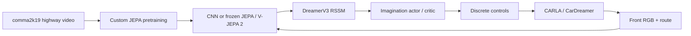
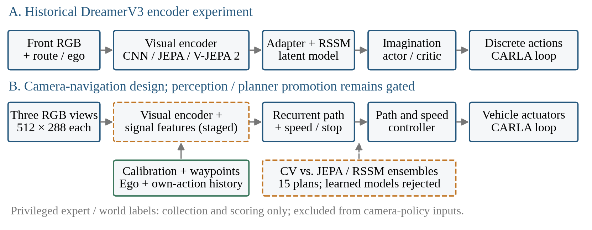

# Auto Thinker Engine

Camera-based driving research in CARLA, combining self-supervised video encoders,
DreamerV3 world-model reinforcement learning, and a later multi-camera navigation
pipeline. The research question is whether visual pretraining improves learning,
robustness and driving decisions over a CNN trained from scratch.

> **Paused by the user on 23 October 2026.** No training, collection, evaluation,
> CARLA server or storage guardian was running at the pause check. Do not launch
> or resume experiments until the user explicitly requests it. The M0–M6 goal is
> **unfinished**: camera safety/rule/planning gates remain open and final Town05
> driving has not run. See the [pause record](reports/navigation_pause_20261023.json).

## Start here

- [Detailed project report: completed work, experiments, failures and future work](reports/journey/summary.md)
- [Interview preparation: project explanation, technical questions and answers](reports/interview_preparation_20261023.md)
- [Seven-page conference paper, DOCX](reports/conference_20261023/Auto_Thinker_Engine_Conference_Paper.docx)
- [Conference paper PDF preview](reports/conference_20261023/qa/Auto_Thinker_Engine_Conference_Paper.pdf)
- [Results index](reports/navigation_results_index_20261020.md),
  [chronological journal](reports/journey/journal.md) and
  [historical interview question bank](reports/journey/interview_questions.md)
- [Approved navigation plan](reports/navigation_review_plan.md),
  [runbook](reports/navigation_runbook.md),
  [execution ledger](reports/navigation_execution_20261018.json) and
  [agent handoff](reports/agent_handoff.md)

The journal preserves historical mistakes and superseded findings. Use the pause
report and corrected assessments for current numbers rather than treating every
old “running” or “next” paragraph as current authorization.

## What works, and what remains open

| Evidence | Measured result | Meaning and limit |
|---|---|---|
| Historical right-turn encoder comparison | Two seeds: custom JEPA 100%, V-JEPA 2 100%, scratch CNN 50% mean evaluated success | A constrained front-camera maneuver; one V-JEPA 2 run is partial and the third seed was deferred. |
| Zero-shot weather | Night success: JEPA arms 100%, CNN 0%; rain: custom 95%, V-JEPA 2 100%, CNN 45% | Appearance robustness improves; traffic success remains 20–35%. |
| Privileged BEV traffic line | Selected checkpoint: 58/60 safe medium arrivals, 27/30 hard, 10/10 simple retention | One training seed; BEV is privileged and is not camera-only or JEPA evidence. Latest 150k checkpoint collapsed and must not be resumed. |
| Corrected encoder study | 67 fits; 55 TRAIN episodes/15,712 labels; 13 VAL episodes/2,822 timestamps | Full-label mean offline score: comma JEPA 0.3755, CNN 0.3874, DINOv2 0.4323, ResNet 0.4477, CARLA JEPA 0.4628; lower is better. |
| Matched camera pilots | 30 planned cases, 27 observed/3 unknown; ResNet 6/6 arrivals, zero contacts, one red and one stop violation | No encoder passes every pilot safely; offline score does not predict the safest native outcome. |
| Familiar camera long drive | ResNet completes 1,375.64 m with zero recorded contacts/interventions | TRAIN route; five minimum-speed infractions; **zero red/stop opportunities**, so no traffic-rule claim. |
| Override-disabled rule study | CNN-facts: 15/72 passes, 22 contacts, 15 red and five stop violations; 0/36 pairs pass both arms | Rule understanding is not qualified. |
| First-event world models | Calibration Brier: action-only 0.16328, calibrated CV 0.17597, JEPA 0.17706, RSSM 0.17728 | Both learned ensembles rejected; all miss 4/4 observed calibration contacts at the fixed threshold. |
| Latest full signal audit | Spatial context: 1,228/1,248 correct, 3,221 background detections | Fails original protection of ≥1,234 correct, every town/phase, and ≤3,075.8 backgrounds. |
| Staged exact preprocessing | 236,284-point parity audit; GPU feature-plus-head median 22.87 ms/image | Features exact; probability error ≤6.66e−16 and zero decisions changed. Excludes proposer and full driving control; not deployed as a qualified stack. |

The older split-contaminated encoder study and unsafe Town03 integration drive
remain historical evidence. They do not replace the corrected comparison or
establish held-out reliability. Every recorded contact and unknown failed attempt
is retained in its proper denominator.

## Two experimental branches



The later navigation branch adds synchronized front/left/right 512×288 RGB views,
calibration, route waypoints, ego motion and timestamps. A recurrent camera policy
separates path correction from speed/stop decisions. A versioned, user-approved
extension supplies only the ego's past applied controls and their frame IDs.
Constant-velocity forecasts are compared with small JEPA/RSSM ensembles; the
learned planners are not qualified. Privileged expert/world labels are for
collection, supervision and scoring, never undisclosed camera-policy inputs.



## Milestone status at pause

| Stage | Status |
|---|---|
| M0: harness, synchronized rig, expert, scoring | Implemented and calibrated; later held-out expert reference is recorder-corrected 293/300 rule-safe and 56/300 strict, with six contacts across three missions. |
| M1: data engine | Initial 20,000 timestamps collected/audited; 17,567 eligible for imitation. Further targeted datasets and causal recordings retained. No claim of a completed 100k corpus. |
| M2: camera student | Sustained familiar long drive demonstrated; broad safety and rule gates not passed. |
| M3: rule understanding | Original 72 trials completed; gate failed. |
| M4: representation comparison | Corrected 67-fit comparison and matched native pilots completed; no safe encoder winner established. |
| M5: predictive planning | Baselines, recorded action studies and ensembles evaluated; learned models rejected. |
| M6: final Town05 | Suite registered: 12 routes × 3 seeds. No qualified candidate and no final driving run. |

The immediate unstarted experiment has a verified cache of 1,596 additional exact
TRAIN bulb positives, including 4,788 original/gamma feature vectors. Its
three-fold fit is prepared but **has not started**. It is a future option, not a
running queue or an accepted model.

## Repository layout

```text
configs/             Historical experiment contract, navigation inputs, frozen suites
src/jepa/            Encoder, predictor, masking and representation learning
src/dreamer/         CarDreamer wrappers and PyTorch Dreamer encoder integration
src/navigation/      Sensors, experts, policies, data, scoring, dynamics and runtime
scripts/             Collection, fitting, audits, reports and read-only watchers
jobs/                Historical guarded training queues
tests/              Automated software tests
patches/             Reproducible vendor changes and explicitly staged candidates
reports/             Research evidence, protocols, journal, paper and pause reports
outputs/             Local checkpoints, data, recordings and native traces (ignored)
third_party/         Pinned Dreamer/CarDreamer submodules
```

`patches/*_candidate.py` contains staged experiments, not automatically imported
production implementations. A clean Git checkout includes the source, reports,
selected report figures and paper; it does **not** include local datasets,
checkpoints, simulator binaries or recordings. Links into `outputs/` require the
retained local artifacts. This repository does not claim a public release of those
artifacts or a safe pretrained driver.

## Environment and reproducibility

Measured development hardware: RTX 5070 Ti Laptop GPU, **12 GB VRAM**, approximately
32 GB host RAM, native Arch/CachyOS. Python 3.10 and the CUDA 12.8 PyTorch build are
pinned for this implementation. CARLA is version 0.9.15. The separate A4000/Docker
instructions remain in [SERVER_RUNBOOK_A4000.md](SERVER_RUNBOOK_A4000.md) and
[DOCKER_CARLA_RUNBOOK.md](DOCKER_CARLA_RUNBOOK.md); they are not the laptop's measured
hardware requirements.

Setup commands below install/check the software; they do not authorize restarting
paused training:

```bash
git clone --recursive https://github.com/JayacharanR/Auto_Thinker_Engine.git
cd Auto_Thinker_Engine
uv sync --frozen --extra dev --extra carla --extra viz
export CARLA_ROOT=/path/to/CARLA_0.9.15
bash scripts/setup_cardreamer.sh "$CARLA_ROOT"
python run.py doctor --require-cuda --require-carla
```

The setup script applies the tracked Dreamer and CarDreamer compatibility patches.
[The vendor patch audit](reports/vendor_patch_audit_20261023.json) independently
reproduces all eight modified vendor files from pinned bases. Their working trees
can intentionally appear dirty after patch application; the superproject retains
the upstream gitlinks and patches rather than referencing unpublished vendor commits.

The original right-turn comparison uses **discrete actions**, a time cost of 0.1
and `train_ratio=512`; its authoritative description is
[configs/experiment_contract.yaml](configs/experiment_contract.yaml).
Encoder geometry comes from the actual checkpoints, not a blanket 224-pixel rule:
the custom JEPA laptop configuration is 128 pixels/eight frames during pretraining.
Action conditioning was off in that original pretraining run. The later
[navigation contract](configs/navigation.yaml) is a separate experiment.

## Verification and monitoring

The pause checkpoint's full software test run: **559 passed, 3 skipped**. The
skips are environment-dependent; this is software verification, not fresh native
driving qualification. Native simulator runs were not restarted for this handoff.

```bash
.venv/bin/pytest -q
.venv/bin/python scripts/watch_navigation_execution.py --once
.venv/bin/python scripts/watch_navigation_execution.py --history --once
```

The watcher is read-only. A completed status file is historical evidence, and a
stale heartbeat is not proof of a live process. For any future active queue, stop
only through its owned `STOP` file; do not use broad process-name kills. Preserve
the current pause until the user resumes. Never restart a completed failed
experiment to seek a better outcome.

## Future work, when explicitly resumed

1. Run the prospective positive-coverage comparison, preserving the original
   full-distribution and per-town/per-phase gates.
2. Verify applicable-light association and complete approach/stop/wait/release
   sequences before retraining a camera controller.
3. Gather genuinely reactive, observed alternative-action outcomes; include
   rear hazards and red-light cases, and require learned predictors to beat
   constant-velocity/action-only baselines on held-out calibration.
4. Profile the entire three-camera pipeline and test recurrent control without
   safety overrides on the registered rule/development suites.
5. Only after qualification, run frozen Town05 final candidates and report every
   collision, failure, rule opportunity and intervention. Never lower the bar or
   relabel an engineering drive as the final test.

See the detailed report for rejected approaches, limitations, exact evidence
links and restart prerequisites.

## Licensing

This project uses the license in [LICENSE](LICENSE). Third-party code, datasets
and model checkpoints retain their respective upstream licenses and usage terms;
this project does not relicense them. Verify the exact checkpoint terms before
redistributing weights or using them outside this research setting.
