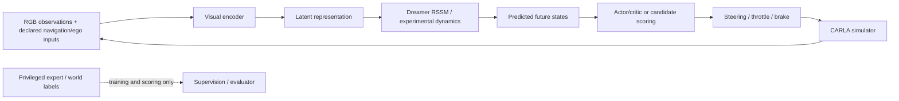

# Auto Thinker Engine — interview preparation guide

**Evidence snapshot:** 23 October 2026. **Project state:** paused by the user.

Use this guide to explain the project accurately. It includes suggested spoken
answers, technical follow-ups, the numbers worth remembering and debugging
stories. Adapt first-person wording to the work you actually performed and can
defend. Distinguish integrating an existing algorithm from inventing it, and be
honest about library, collaborator and AI assistance if asked.

The detailed evidence is in the [project report](journey/summary.md),
[chronological journal](journey/journal.md),
[results index](navigation_results_index_20261020.md) and
[historical question bank](journey/interview_questions.md). Old question-bank
answers marked pending or referring to earlier scores are historical; this guide
uses the current corrected results.

## 1. Explain the project at three lengths

### 30-second answer

> “I worked on a camera-based driving research system in CARLA. The main question
> was whether self-supervised video features—our custom JEPA and Meta's V-JEPA 2—
> help a DreamerV3 agent learn better than a CNN trained from scratch. The video
> encoders helped a right-turn task and weather robustness, but that did not solve
> traffic. I then extended the system to synchronized multi-camera navigation and
> audited its data, rule behavior and world-model predictions. A familiar 1.376 km
> camera drive succeeded without contacts, but the broader safety gates remain open.”

**What this demonstrates:** a specific problem, actual implementation, quantified
result and a credible limit. Avoid opening with “I built a fully autonomous car.”

### 90-second answer

> “The project has two experimental lines. Initially I integrated PyTorch video
> encoders into DreamerV3 while using CarDreamer for CARLA tasks. Dreamer learns a
> latent dynamics model from replay and trains an actor and critic using imagined
> rollouts. I compared a trainable CNN, a frozen dash-camera JEPA and frozen
> V-JEPA 2 features. Across two seeds the video arms achieved 100% selected-checkpoint
> right-turn success, versus a 50% CNN mean. At night, the video arms retained 100%
> success while CNN fell to zero. Traffic exposed a different problem: all arms
> still had poor interaction safety.
>
> “The later line uses three calibrated cameras, recurrent visual policies and
> separate path and speed decisions. I implemented strict input boundaries,
> source/split audits, physical rule counterfactuals and actuator verification.
> The corrected five-encoder study completed 67 fits, but the best offline score
> did not predict the best native driving behavior. JEPA/RSSM hazard ensembles
> also failed against simple controls, so they were rejected. The result is a
> working research platform, useful transfer evidence and concrete diagnoses—not
> a claim that safe urban autonomy is solved.”

### Five-minute walkthrough

Use this sequence instead of listing every experiment:

1. **Problem:** simulator interaction is expensive; pretrained video may improve
   perception and learning efficiency.
2. **Design:** explain encoder → latent world model → imagined actor/critic
   learning → simulator controls. Then distinguish the later camera-navigation arm.
3. **Constraints:** one 12 GB laptop GPU, CARLA rendering, limited disk and native
   simulator failures.
4. **Experiment:** two original video arms plus scratch CNN, then a corrected
   five-encoder/label-budget study with whole-episode/location separation.
5. **Positive result:** right-turn/weather gains and a sustained camera drive.
6. **Failure:** traffic/rules and hazard prediction did not qualify.
7. **Engineering contribution:** actual-pose split repair, all-contact recording,
   stable action/sensor boundaries and exact preprocessing acceleration.
8. **Next experiment:** the verified missing-positive data comparison; then
   applicability/stop-release and reactive branch evidence before final testing.

Let the interviewer choose where to go deeper after that overview.

## 2. Architecture you should draw on a whiteboard



Explain that this summarizes research components, not one fully qualified final
stack. The historical branch uses Dreamer and a discrete action table. The later
navigation student uses recurrent path/speed prediction with a controller.
The learned predictive-planning candidates were tested offline and rejected.

### Vocabulary without unnecessary jargon

| Term | Plain explanation | Project-specific detail |
|---|---|---|
| Reinforcement learning | Learn actions from outcomes and rewards. | Dreamer learns from CARLA transitions, not just expert action labels. |
| Imitation learning | Learn to copy a teacher's decisions. | Later camera path/speed students use privileged-expert labels during training. |
| Self-supervision | Learn from a target produced from the data itself. | JEPA predicts masked-region embeddings rather than manual driving labels. |
| Representation | A compact useful description of an observation. | Frozen video features can be stored in replay/caches. |
| World model | Predict how a hidden state changes under actions. | RSSM/JEPA dynamics need separate calibration before planning is trusted. |
| Latent imagination | Roll out predicted states without stepping CARLA. | Computationally cheaper, but model errors can produce bad decisions. |
| Partial observability | The current image does not reveal the whole state. | A light can leave view or a vehicle can be occluded; memory may be needed. |
| Privileged input | Information available in simulation that the declared camera agent should not see. | Exact actor/light state is supervision/scoring information, not camera-policy input. |
| Closed loop | An action changes future observations. | Native driving can fail despite good log-replay prediction. |
| Calibration | Match predicted probabilities to actual event frequencies. | Low uncertainty or lower likelihood alone did not qualify the hazard models. |
| Censoring | The later outcome is not observed under the original conditions. | A safety stop prevents knowing what the original action would have done. |
| Covariate shift | Deployment visits states unlike the teacher's data. | Student errors require corrections and observed off-expert consequences. |

## 3. Numbers to memorize, with the correct qualifiers

| Number | What to say |
|---|---|
| 100% /100% /50% | Historical selected right-turn success: custom JEPA / V-JEPA 2 / CNN, mean over two seeds. One V-JEPA 2 run is partial. |
| 100% vs 0% at night | Video arms versus CNN zero-shot night success, on that constrained task. |
| 58/60 medium; 27/30 hard | Privileged BEV selected checkpoint. One training seed; medium baseline already 56/60. |
| 1/90 at latest 150k | Late BEV stopping collapse; retain best 90k run-counter checkpoint, not latest. |
| 20,000 /17,567 | Initial collected timestamps /eligible clean-imitation timestamps. |
| 67 fits; 55/13 episodes | Corrected encoder study; 15,712 TRAIN and 2,822 VAL timestamps. |
| 0.3755 vs 0.3874 | Comma JEPA versus CNN full-label mean offline selection score; lower is better, not a safety probability. |
| 1,375.64 m | Familiar TRAIN camera drive, zero contacts/interventions, five minimum-speed infractions, zero red/stop opportunities. |
| 15/72; 0/36 pairs | Original CNN-facts rule passes /pairs passing both arms, with overrides disabled. |
| 0.16328 vs 0.17706/0.17728 | Action-only versus JEPA/RSSM calibration Brier. Both learned ensembles rejected; all miss 4/4 contacts at 0.5. |
| 1,228/1,248 and 3,221 | Latest spatial signal head: correct detections and background count; fails the original 1,234/3,075.8 gates. |
| 22.87 ms; 236,284 points | Staged GPU feature-plus-head median and exact feature audit size; excludes full driving pipeline. |
| 559 passed, 3 skipped | Full software test result at handoff; not proof of safe driving. |
| M6 unrun | Final Town05 suite is registered; no qualified final driver has run it. |

Do not try to recite every count. Know the observation regime, denominator,
split, selector and limitation behind each number.

## 4. Expected questions: problem and design

### Q1. What exactly did you build?

A simulator-based research platform integrating video representations with
DreamerV3, followed by a three-camera navigation/data/evaluation pipeline.
It includes training, replay/caches, encoder adapters, synchronized observations,
policies/controllers, expert collection, native recording and reproducible audits.
I used existing algorithms and simulator libraries rather than claiming to invent
Dreamer, JEPA or CARLA.

### Q2. Why choose this problem?

Learning a visual encoder only from limited driving rewards can be data-inefficient
and brittle to appearance changes. Unlabeled real video is abundant, so it is
reasonable to test whether its representations help. The experiments also show
why a better visual representation is only one part of safe control.

### Q3. Why start with a simple right turn?

It provides a cheap test that the observation/action/replay/learning loop can
actually learn. Starting with privileged BEV separates learning-loop failures
from camera perception limitations. It is a diagnostic stage, not a representative
autonomy benchmark.

### Q4. Why did the architecture change later?

The user wanted long destination drives and rules, and traffic results showed
that one front camera/right turn did not test those capabilities. The later line
adds camera coverage, frame synchronization, route-conditioned path/speed heads,
rule-specific evaluation and explicit planning baselines. It is a separate
experimental contract, not a silent modification of the original benchmark.

### Q5. Why three cameras? Are they “3D camera inputs”?

They provide front/left/right views of a three-dimensional scene and increase
field of view. They are calibrated RGB cameras, not a direct depth sensor or
complete ground-truth 3D scene representation. A pixel can define a camera ray;
it does not reveal the object's depth by itself.

### Q6. Is it end-to-end autonomous driving?

The learned policy consumes declared visual/navigation inputs and produces
plans/actions, but the navigation branch includes engineered route geometry and
a physical controller. Privileged expert labels are used in training, and some
research modules remain staged. I would describe the actual architecture and
its scope rather than call every component end-to-end or fully autonomous.

## 5. Expected questions: reinforcement learning and world models

### Q7. Explain DreamerV3 simply.

It learns a compact model of observations, rewards and continuation from replay.
It then predicts latent futures under actions and trains an actor/critic using
those imagined trajectories. The policy still interacts with CARLA to collect
experience and correct model errors; imagination does not replace all real data.

### Q8. What is the RSSM and why does it have two kinds of state?

A recurrent state-space model combines deterministic memory `h_t` with stochastic
latent state `z_t`. A useful schematic is:

```text
h_t = recurrent_update(h_(t-1), z_(t-1), a_(t-1))
posterior: q(z_t | h_t, encoded_observation_t)
prior:     p(z_t | h_t)
```

The posterior uses observations during training/inference; the prior predicts
without a future image during imagination. Memory helps with partial observability,
while stochastic state represents uncertainty in the learned latent dynamics.

### Q9. How is a world model trained?

The implementation learns observation-related predictions, rewards and continuation,
plus a regularized agreement between observation-conditioned posterior and
dynamics prior. Dreamer uses techniques such as balanced KL/free bits and robust
target scaling. I would show the actual pinned implementation/config rather than
claim every setting from the latest upstream Dreamer is identical here.

### Q10. Why can model-based RL be sample-efficient?

One collected transition can support many replay/model updates, and many policy
rollouts can be evaluated in low-dimensional latent space without rendering the
simulator. The tradeoff is model bias: optimizing imagined rewards can exploit
errors in the predictor. That is why native evaluation remains necessary.

### Q11. What is the replay ratio?

It controls training work relative to environment data collection. The historical
contract uses `train_ratio=512`; it should be interpreted through the runner's
batch/sequence scheduling rather than called “512 complete updates per tick.”
Too little training can underfit a fixed data budget, while too much can overfit
replay or destabilize the policy.

### Q12. How do actor and critic differ?

The actor chooses actions; the critic predicts expected future return and supplies
a learning signal. Dreamer trains them on imagined latent trajectories with
bootstrapped targets. A useful policy still has to survive model error and native
traffic interactions.

### Q13. Why distinguish termination from time-limit truncation?

A real terminal event ends the process according to task semantics. A time limit
can stop data collection even though future value still exists, so it usually
requires bootstrapping rather than forcing value to zero. The wrapper's exact
terminal/truncation contract matters for stable value learning.

### Q14. What reward problem did you find?

An early policy reached the junction and waited indefinitely because waiting
avoided risk without enough cost. With user approval, the time cost became 0.1;
a fresh BEV run then solved the easy turn. I keep the reward change separate from
the later encoder comparison and do not imply that all later failures had this cause.

### Q15. Does a higher reward mean safer driving?

No. Reward is a surrogate objective, and terminal flags or low-speed penalties
can produce misleading returns. The project reports arrival, contact, rule
violations, blocked time and opportunities directly. A stationary agent can have
few collisions while completely failing navigation.

### Q16. Why did the 150k run collapse?

The observed failure is a late stopping/timeout collapse after earlier useful
checkpoints. The trigger is not proven. I retained the selected 90k run-counter
checkpoint and the failed latest model, and would investigate update histories,
replay distribution and optimizer/scaler/RNG state before another long continuation.

## 6. Expected questions: JEPA and visual learning

### Q17. What does JEPA learn?

A context encoder sees visible video regions, a predictor estimates target
embeddings for masked regions, and a target encoder supplies learning targets.
The objective is representation prediction, not reconstruction of every pixel.
Whether that representation helps driving is an empirical question, not an
automatic consequence of its self-supervised objective.

### Q18. Why might it help more than pixel reconstruction?

Representation prediction can focus on persistent structure and motion instead
of modeling all unpredictable texture detail. But tiny traffic lights show the
counterpoint: information useful for control can be visually small, and a coarse
embedding or mean pool may discard it. The driving tests decide whether the
tradeoff is useful.

### Q19. What prevents collapse?

The project compares an EMA target/stop-gradient approach with a SIGReg-based
alternative. EMA makes the target evolve slowly; the alternative regularizes
feature distributions. A low loss does not prove useful noncollapsed features,
so variance and downstream/random-control diagnostics were also inspected.

### Q20. Explain the EMA update.

`theta_target ← m × theta_target + (1 − m) × theta_online`.
The target is not updated through the prediction gradient; it follows the online
network more slowly. This stabilizes targets, but EMA alone is not a certificate
of semantic quality.

### Q21. Why tube masking?

Masking the same spatial region over time makes it harder to recover a hidden
patch by copying that exact location from an adjacent frame. The model must use
the visible context and temporal structure. Temporal indexing and clip construction
still need leakage checks.

### Q22. Why not select the checkpoint with the lowest JEPA loss?

The target network changes as learning progresses, so losses across epochs are
not measured against a fixed target. In this project loss could rise while
features became more useful. Fixed-budget final weights and independently checked
probes were more informative than a misleading “best by loss.”

### Q23. Which pretraining method won, and how?

EMA was selected after diagnosing the steering probe as uninformative. Its spatial
speed probe achieved about 0.88 R², versus 0.78 random and 0.69 SIGReg. I would
explicitly disclose that the selector changed after the proxy diagnosis, rather
than rewriting history as if speed had always been the original criterion.

### Q24. Why did the steering probe fail?

The highway data has limited steering diversity, and the chosen clip-mean target
was not meaningfully linearly decodable in either trained or random features.
Weak regularization and neighboring clips also created misleading apparent gains
in an earlier probe. A proxy with near-zero signal cannot rank useful encoders reliably.

### Q25. Why disable action conditioning in original pretraining but use it later?

Giving the original predictor the same steering/speed variables later measured
by the probe would blur what the encoder had learned visually. That experiment
kept action conditioning off. The later dynamics experiment asks a different
question—predicting consequences of explicit candidate controls—so actions are
declared inputs there. Conditioning alone does not establish causal validity.

### Q26. How do custom JEPA and V-JEPA 2 differ here?

The custom model is a relatively small dash-camera-pretrained ViT-S with its own
checkpoint geometry. V-JEPA 2 is a larger externally pretrained video model. In the
historical Dreamer arm both are frozen feature providers; the original V-JEPA 2
robot action-conditioned planner is not being claimed as the deployed driving system.

### Q27. Why add DINOv2, ResNet and a random ViT?

DINOv2 tests strong non-JEPA self-supervised image features; ImageNet ResNet tests
a standard supervised representation; CNN tests learning from scratch. A random
same-architecture ViT is a diagnostic for architecture/pretraining effects but is
not enough as the only baseline. Different external datasets and compute remain
confounds even after downstream budgets match.

### Q28. Did CARLA JEPA continuation improve the result?

Not in the corrected full-label selector: CARLA JEPA's mean is 0.4628 versus
comma JEPA's 0.3755, where lower is better. It also does not establish a safer
native driver. I would report that negative result rather than presume in-domain
pretraining must help.

## 7. Expected questions: data, metrics and scientific validity

### Q29. Why split before making clips?

Adjacent frames and overlapping clips share almost the same scene. A random
frame split leaks location/time information and exaggerates generalization.
Whole episodes and shared junction components must stay together before forming
clips or label subsets.

### Q30. What split defect did you discover?

A route's nominal ID/start did not guarantee that its recorded poses stayed out
of a reserved junction. Actual-camera-pose auditing found Town02 overlap in the
first encoder study. I kept the old study as historical and ran a corrected
comparison with the original validation episodes preserved.

### Q31. Why are nominal 5% labels actually 3.49%?

The subsets are nested at whole-episode granularity, so exact percentages of
timestamps are not always attainable without splitting episodes. The paper
reports actual counts and fractions, not just the convenient nominal names.
Those counts are 549/1,516/3,857/15,712 timestamps.

### Q32. What is the offline selector, and what does it miss?

`S = 0.5 × (1 − stop_recall + false_hold_fraction) + 0.02 × go_speed_MAE`.
It trades stopping sensitivity, unwanted stops and speed error, with lower S
preferred. It does not model all closed-loop consequences or provide a safety
probability, so it cannot replace actual driving.

### Q33. What is the best evidence of the offline/online gap?

Comma JEPA has the best full-label mean offline score, but its native pilot has
four arrivals and ten contact starts across six planned cases. ResNet has six
arrivals and zero contacts but still commits two rule violations. Neither is a
qualified safe driver, and selecting a new primary from those outcomes would
contaminate evaluation.

### Q34. What did “safe arrival” mean historically?

Historical destination and collision flags can both be true in one episode.
Those original flags must be shown together; arrival alone is not collision-free
success. Later assessments explicitly use recorder contacts and their own
registered rule-safe/strict criteria without rewriting the earlier experiment.

### Q35. Why audit recorder contacts?

The pinned native criterion can exclude near-stationary ego contacts. Official
recorder queries reveal contacts that its headline omitted, so all recorder
contact starts remain counted. Fault attribution and ego speed can be useful
diagnostics but cannot filter the safety headline.

### Q36. Does the clean 1.376 km drive prove rules are learned?

No. It is a familiar TRAIN integration route with zero actual red/stop opportunities
and five minimum-speed infractions. It demonstrates sustained navigation without
observed contacts, while the separate override-disabled rule suite fails. Zero
violations with zero opportunities is not a rule success rate.

### Q37. Why keep infrastructure failures in the denominator?

Dropping them selectively can inflate performance or favor unstable candidates.
The project reports observed outcomes and unknown failures separately while
retaining planned attempt counts. Unexecuted cases are never silently declared
safe because there was no recorded collision.

### Q38. Do the two-seed results establish significance?

No. They are suggestive, descriptive evidence with high seed variation. More
predeclared seeds and scenario/location-clustered uncertainty are needed.
The three-seed min/max ranges in the label study are also not confidence intervals.

### Q39. What would zero failures in 36 final routes prove?

Under independence, the rule of three gives an approximate one-sided 95% upper
failure probability of `3/36`, or 8.3%, rather than zero risk. Correlation across
locations makes the independence assumption optimistic. The final suite has not
actually been run here.

### Q40. Why freeze Town05 and run an expert reference?

The held-out town limits repeated tuning to final outcomes. The expert reference
shows scenario difficulty and infrastructure ceilings under the same scoring,
without removing cases where the expert fails. Camera/student performance must
still be reported independently; privileged expert success is not a camera result.

## 8. Expected questions: control, rules and causal prediction

### Q41. Why separate steering geometry from speed decisions?

The route already specifies much of the geometric path. Predicting a correction
and a separate speed/stop profile reduces the need to relearn geometry from
scratch and focuses learning on go/yield/stop timing. It does not remove the need
to learn applicable signals and dynamic occupancy.

### Q42. What ego-speed shortcut did you find?

A policy can associate low speed with stopping and high speed with continuing,
instead of reading the scene. A speed-conditioned spatial model looks strong
offline yet fails to launch natively; input ablations expose false holds and
lost stop recall. The actual physical controller still needs measured speed even
when a neural shortcut is removed.

### Q43. Why use DAgger, and did it solve the issue?

DAgger gathers teacher corrections in states visited by the student's own policy,
addressing distribution shift from pure expert imitation. The project audited
correction data and then rejected a bounded fine-tune that failed parent protection.
Correctly collected extra data does not guarantee better control.

### Q44. How do you test whether a policy reads the light?

Use a pair differing only in light state at an empty junction, with no lead car
to imitate. Add a green light with a stopped lead, red leaving view, yellow at
different distances, stop-and-release and clearing cross traffic. Verify that the
physical scenarios actually implement the intended contrast and disable overrides.

### Q45. What exactly is a constant-velocity baseline?

It extrapolates perceived object motion using current estimated velocities and
combines it with the ego candidate path to estimate conflict. It is simple and
can fail under acceleration or occlusion, but it is a useful standard a learned
predictor should beat. The project keeps RGB-derived observations and ego inputs
declared consistently across CV and learned arms.

### Q46. Why compare with an action-only predictor?

It tests whether actions or collection patterns explain the outcome without
visual understanding. In the calibration study it beats JEPA/RSSM on Brier, which
weakens a claim that the visual dynamics model learned useful causal information.
A sophisticated network is not useful simply because it is more expressive.

### Q47. Explain Brier score versus likelihood.

Brier averages squared differences between predicted event probability and
observed binary outcomes. Sequence likelihood measures the probability assigned
to the observed event/censored timing sequence. A model can improve likelihood
yet have worse endpoint calibration or miss every dangerous case at the decision
threshold; that is why both metrics and missed-hazard counts are reported.

### Q48. Why are low missed hazards and low false alarms both necessary?

Missing a hazard risks a collision; flagging every scene prevents progress.
Raw CV flags all 18 calibration cases, detecting four contacts but falsely
flagging 14 noncontacts. Conversely, calibrated predictors miss all four contacts
at 0.5. Neither extreme is a satisfactory driving decision policy.

### Q49. Is recorder replay a valid interactive counterfactual?

Not automatically. Replay can impose recorded actor motion, so other traffic may
not react to the changed ego action. Valid causal comparisons require matched
prefixes followed by live/reactive branches and observed outcomes. This project's
scripted/nonreactive studies have that explicit limitation.

### Q50. Does conditioning on an action prove causality?

No. A model can exploit correlations between actions and the data collector's
choices without predicting intervention outcomes correctly. Observed alternative
branches and prefix/determinism checks are needed. Unknown outcomes must stay
unknown, and a privileged safety stop censors the original action's later result.

### Q51. Why an ensemble, and what can it not promise?

Independent small models provide a useful disagreement signal and can reduce
variance. Disagreement is not automatically a calibrated probability of danger;
members can share the same data/representation bias. The ensembles still must
beat simple controls on calibration and actual hazard outcomes.

## 9. Expected questions: perception and optimization

### Q52. Why are traffic lights difficult for a video backbone?

A distant bulb may occupy only a few pixels, while a downsampled or mean-pooled
embedding emphasizes larger scene structure. Knowing that a scene is a junction
is different from reading the specific light for the ego lane. High-resolution
perception, applicability and temporal memory need their own tests.

### Q53. What is the difference between a light housing and active bulb labels?

A projected housing can contain many pixels unrelated to the active color. A
point labeled positive somewhere inside that housing may show no relevant bulb
in the descriptor's detailed 5×5 patch. The support audit excludes unsupported
positives from fitting without turning unknown pixels into background or shrinking
the scoring denominator.

### Q54. Why didn't fewer false detections qualify the model?

Spatial context lowers full TRAIN backgrounds from 8,197 to 3,221 but lowers
correct lights from 1,234 to 1,228. The declared limit is 3,075.8 backgrounds,
with total and per-town/per-phase recall protected. All gates remain in force;
aggregate improvement cannot excuse lost decision-critical lights.

### Q55. Why evaluate all 12.36 million proposals?

The original sampled check sees only a small fraction of full-distribution
false detections. After changing candidate generation, that sample no longer
represents the complete inference workload. Full frozen-coordinate inference
exposes false positives while preserving exact comparison and subgroup scoring.

### Q56. How did you avoid leakage when expanding background data?

Use model-independent uniform sampling of known-background candidate coordinates,
exclude existing/unknown points, and preserve whole-junction folds. Mining fold-G
examples with an out-of-fold model trained on fold-F would leak F when that same
new data is later used to fit a model evaluated on F. The sampler does not consult
model scores.

### Q57. What is the next concrete training hypothesis?

The frozen generator selects 1,596 audited bulb points absent from old supervision.
Their cache has 4,788 verified original/gamma feature vectors. The prepared
experiment adds them with the same negative rows, model recipe, folds and gates.
It has not run, so I cannot say it improves the model.

### Q58. How did the preprocessing optimization remain exact?

Compute every aligned 3×3 integer average once, then gather the original windows.
Nine integer pixels cannot average to a half integer, so `(sum+4)//9` reproduces
mean-and-round. Preserve padding, interleaved layout and sequential FP32 moments;
compare patch bytes, features, probabilities and final accept/phase decisions.

### Q59. What is the strongest speed claim you can make?

On 63 fixed TRAIN images/236,284 points, the staged GPU feature-plus-classifier
path has median 22.87 ms/image and p95 30.63 ms. Features are exact, probability
error is at most 6.66e−16 and zero tested decisions change. It excludes the proposer,
three-camera scheduling and driving control, so I do not call it a qualified
10 Hz autonomous stack.

### Q60. Why can a tensor implementation be slower on CPU?

Vectorized tensor operations can allocate intermediate arrays or perform poorly
for small, irregular tree traversal compared with optimized scikit-learn code.
The first tensor CPU tree export was slower; GPU-resident traversal was faster.
The measured workload and transfer costs matter more than choosing a fashionable
framework.

## 10. Expected questions: systems and reliability

### Q61. How did the models fit the laptop?

Use reduced pretraining resolution/clip length, mixed precision, efficient
attention, frozen feature caching and bounded sequential workloads. Frozen
features are encoded during collection so repeated Dreamer updates avoid a
large ViT forward. GPU memory still needs to include CARLA rendering, not only
the network tensors.

### Q62. What was the Blackwell issue?

The original PyTorch/CUDA build did not support the laptop GPU architecture.
Pinning a CUDA 12.8-compatible PyTorch build resolved that compatibility layer.
It is separate from native simulator driver/Vulkan/memory failures, which need
their own diagnostics.

### Q63. How did you prevent half-written checkpoints?

Write to a temporary file and atomically rename after a successful save. Save
complete optimizer/sampler/RNG state where required and bind it to data/source
provenance. Atomic writing protects file integrity but does not guarantee exact
continuation if scaler/RNG/replay state is missing.

### Q64. Why are STOP files and anchored process checks important?

A plain substring process search can match the shell running the search or an
unrelated trainer. Duplicate controllers can also race with a user's stop request.
Use owned STOP files, queue locks and exact/anchored ownership checks; never broad
force-kill commands. State files alone do not prove a process is still alive.

### Q65. How did you handle simulator crashes honestly?

Retain the attempt, its committed prefix and error. Charge an actual crash only
to the running case, while unstarted cases remain unexecuted according to the
registered protocol. Any allowed infrastructure continuation preserves completed
outcomes and deadlines instead of rerunning a failed scientific case for a better score.

### Q66. What did the traffic-light actor-ID bug teach you?

CARLA can assign new IDs to the same physical light after a session reload.
Comparing raw IDs rejected valid setups; matching the hashed catalog, entry lane
and physical location fixes identity without changing the scenario. Equal IDs at
different positions must still be rejected.

### Q67. What was wrong with the TTC display?

The original helper excluded vehicles on different roads/lanes before computing
distance/relative speed, so crossing traffic could be absent and the HUD could
say safe while an actual conflict existed. That TTC was telemetry/disabled-shield
input in those runs, not the observation or reward, so repairing it alone would
not explain or fix the learned policy.

### Q68. Why did browser video playback fail?

The file's actual codec/pixel format was not reliably supported by the browsers.
The showcase was corrected using H.264/yuv420p-compatible outputs and proper
serving checks. Merely changing the extension or MIME label would not transcode
unsupported video data.

### Q69. What do the automated tests prove?

They cover data contracts, geometry, frame/action consistency, split guards,
scoring logic, checkpoint behavior and implementation parity. The pause suite
has 559 passes and three environment-dependent skips. Passing software tests
does not prove the driving policy is safe; native evidence is separately required.

### Q70. How are third-party modifications reproducible?

Keep upstream gitlinks pinned and store compatibility patches in the main
repository. A clean temporary checkout plus those patches reproduces all eight
modified vendor files exactly. I would not create local vendor commits that
fresh clones cannot fetch from their configured upstream remotes.

## 11. Tough questions about judgment and ownership

### “Was the project successful?”

> “Successful as a research/engineering investigation, unfinished as reliable
> urban autonomy. It demonstrates transfer on constrained tasks, produces a
> sustained camera drive and a reproducible evaluation platform, but its rule
> and learned-planning gates fail. I would rather give those boundaries clearly
> than claim the original safety objective was completed.”

### “Why did you spend time on failed experiments?”

Explain the hypothesis, bounded cost and what changed afterward. Examples:
the steering probe failure changed the representation diagnostic; recorder
contacts changed safety accounting; speed ablations exposed a shortcut; the
action-only baseline showed that visual dynamics had not earned a planning role.
An experiment with no change in belief or next action deserves a harder review.

### “What would you do differently from day one?”

Freeze actual-location splits and ability tests earlier; establish simple visual
and constant-velocity baselines; calibrate the expert before trusting labels;
separate stopping from path geometry; test the measurement system; and budget
targeted data before long runs. Describe these as lessons, not as proof that a
different design would definitely solve the task.

### “What is your novel contribution?”

Position novelty carefully. The project does not invent JEPA, Dreamer or CARLA.
Its defensible contributions are the integration and controlled comparisons,
camera/action/data boundary audits, corrected measurements, specific failure
analyses and exact implementation acceleration. A stronger algorithmic novelty
claim would need a distinct method and broader validated evidence.

### “How did you use AI tools?”

Answer honestly about assistance with implementation, analysis and documentation.
Then demonstrate that you understand the contracts, can trace a metric to the
source, can explain a rejected experiment and can reproduce verification. Do not
claim to have independently authored upstream algorithms or results you cannot defend.

## 12. Five debugging stories using STAR

### Story 1 — apparent learning failure was a reward strategy

- **Situation:** the car reached the intersection but would not finish the turn.
- **Task:** determine whether more training or a code change was justified.
- **Action:** inspect frames, speed and action distributions; identify waiting
  as cheap; obtain approval for a time-cost experiment.
- **Result:** a fresh easy-task run reached 100% evaluation by 22.5k and 20/20
  final episodes. Keep the later stopping collapse separate and unresolved.
- **Lesson:** understand what the objective rewards before increasing compute.

### Story 2 — an attractive safety score omitted real contacts

- **Situation:** native scoring looked better than the recorded behavior.
- **Task:** establish the correct safety headline.
- **Action:** query official recorders and audit near-stationary collision filtering.
- **Result:** expert and unsafe integration counts were corrected while original
  native counters remained retained as diagnostic evidence.
- **Lesson:** measurement defects can be more consequential than model defects.

### Story 3 — nominal split safety failed at actual positions

- **Situation:** supposedly separated routes traversed reserved physical locations.
- **Task:** recover a defensible comparison without discarding inconvenient results.
- **Action:** audit recorded poses, quarantine contaminated interpretations and
  run a corrected study with validation identities preserved.
- **Result:** 67 corrected fits supplied the current offline evidence; old studies
  remained historical and exposed integration locations were disclosed.
- **Lesson:** split the physical source, not just a convenient route identifier.

### Story 4 — a faster numerical path could change a driving decision

- **Situation:** crop preprocessing was expensive on thousands of candidates.
- **Task:** accelerate it without silently changing model inputs.
- **Action:** reuse integer averages, preserve floating-point/layout semantics and
  compare complete features/probabilities/decisions on fixed data.
- **Result:** staged GPU median 22.87 ms/image with exact features and zero tested
  decisions changed; full-system latency remained unqualified.
- **Lesson:** optimize measured cost and verify semantics at the control boundary.

### Story 5 — simpler baselines disproved a world-model improvement

- **Situation:** learned hazard likelihood improved, suggesting progress.
- **Task:** determine whether that model could support safer planning.
- **Action:** compare endpoint calibration, missed contacts and action-only/CV controls.
- **Result:** both learned ensembles lost to action-only Brier and missed all four
  calibration contacts; neither was deployed.
- **Lesson:** optimize the decision requirement, not the easiest improving metric.

## 13. Whiteboard and coding follow-ups to practice

1. **Temporal encoder input:** write a past-only rolling-buffer function; test
   reset behavior, duplicated startup frames and absence of future-frame leakage.
2. **Sensor barrier:** given asynchronous messages with frame IDs, emit exactly
   one aligned triplet or a timeout. Explain memory bounds and stale messages.
3. **Train/validation splitter:** group whole episodes and shared junctions;
   build nested label subsets without overlap or auxiliary-label leakage.
4. **Contact metrics:** given arrival/contact/truncation flags, preserve all
   flags, count attempts and calculate safe arrivals without dropping failures.
5. **Ray geometry:** derive focal length from horizontal field of view and map a
   pixel to an ego-frame ray. Explain why depth is unknown.
6. **Brier score and threshold tradeoff:** compute calibration error and missed
   hazards/false alarms separately; avoid selecting a threshold on final results.
7. **CV conflict prediction:** combine ego candidate positions and object motion
   with swept boxes; discuss crossing vehicles, acceleration and missing depth.
8. **Atomic checkpointing:** design a temporary-write/rename protocol and list
   optimizer, scaler, RNG, sampler, replay and data-provenance requirements.
9. **Idempotent job runner:** reject duplicate ownership, preserve STOP requests
   and distinguish a stale progress file from an active PID.
10. **Fair optimization benchmark:** include warm-up, transfers and tail latency;
    compare identical inputs, then verify outputs and control decisions.

Explain tests and failure modes, not only happy-path code.

## 14. Demonstration and interview checklist

Before the interview, prepare:

- A one-slide architecture distinguishing Dreamer RL, camera imitation and
  experimental predictive planning.
- The original right-turn/weather comparison with two-seed limitations.
- The corrected label-efficiency graph and the native pilot table together.
- The uninterrupted familiar long drive, explicitly labeled TRAIN/no rule opportunities.
- A failed rule or collision example, with the exact diagnosis and what remains open.
- The staged acceleration result with its timing boundary and parity checks.
- A clean walkthrough of one source file, one protocol and one automated test.

Good resume wording:

> “Implemented and evaluated a CARLA driving research pipeline integrating
> DreamerV3 and self-supervised video encoders on a 12 GB laptop GPU; built
> synchronized multi-camera data/control audits and completed a corrected
> 67-fit encoder study.”

> “Measured a 1.376 km contact-free familiar-route camera integration and
> documented remaining traffic-rule failures; verified an optimized feature/head
> path at 22.87 ms/image with exact features over 236,284 candidate points.”

Avoid: “Built a collision-free self-driving car,” “JEPA beats all baselines,”
“real-time safe urban autonomy,” or “M6 completed.” Those claims are not supported.

If you forget a number, explain the measurement and say you would consult the
report. Do not invent a confidence interval, cause or missing outcome.

## 15. A practical preparation schedule

**Session 1 — explain it:** practice the 30-second and 90-second answers; draw
both architectures; learn the ten most useful numbers and their limits.

**Session 2 — technical depth:** implement the whiteboard exercises; review RSSM,
JEPA masking/EMA, selector/Brier equations and one full data/control path.

**Session 3 — defend the evidence:** practice the five STAR stories, split/contact
corrections, failed-model decisions and why the final goal remains unfinished.

**Mock interview:** have someone interrupt with “what is your baseline?”, “where
is the evidence?”, “does that use privileged inputs?” and “what exactly did you
measure?” Answer with a source, denominator and limitation.

The strongest presentation is a clear account of decisions and verified evidence,
including what the system cannot yet do.
