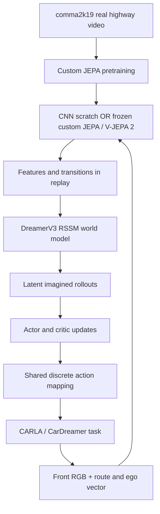

# Auto Thinker Engine — detailed project report

**Snapshot:** 23 October 2026. **Execution state:** paused by the user.

This report describes the actual completed work, including improvements,
unsuccessful experiments, implementation defects and remaining work. Pausing the
project does not mean that the original autonomous-driving goal was achieved.
No training, evaluation, collection, CARLA or storage-guardian process was live
at the pause check. The next positive-coverage experiment is prepared but unstarted.

For the original event-by-event history, see [journal.md](journal.md). For current
machine-readable state, see the [pause record](../navigation_pause_20261023.json)
and [execution ledger](../navigation_execution_20261018.json). Historical entries
can describe an earlier “running” state; the pause decision supersedes them.

## 1. Goal, motivation and honest outcome

The initial research question was whether self-supervised video pretraining
improves a DreamerV3 driving agent compared with learning its CNN encoder from
scratch. The custom encoder learns from real comma2k19 dash-camera video; Meta's
V-JEPA 2 supplies another frozen video representation. CARLA and CarDreamer make
the driving environment controllable and measurable on a single laptop GPU.

The goal later expanded beyond a right turn to destination-directed navigation
using three RGB cameras, traffic-light and stop-sign behavior, and predictive
planning. The intended final evidence was a camera policy that completes long
routes safely, understands rule counterfactuals without overrides and is evaluated
on a frozen Town05 suite.

**What the evidence supports:**

- Frozen video features helped the original constrained maneuver and weather
  robustness in two-seed experiments.
- A privileged BEV Dreamer policy reached strong traffic results in selected
  evaluation streams, with modest independent improvement over a strong baseline.
- A camera policy sustained a familiar 1.376 km route without recorded contacts.
- Corrected multi-encoder comparisons, rule tests, causal-action recordings,
  perception audits and numerical runtime optimizations were implemented and measured.
- Important evaluation and data-integrity defects were found and corrected rather
  than hidden.

**What the evidence does not support:**

- A reliable collision-free urban camera driver.
- General traffic-rule understanding, safe predictive JEPA planning or a safe
  winner among the compared encoders.
- A completed M6 final driving evaluation or real-world driving capability.

The technical progress and the remaining scientific failures are both project
outcomes. A successful demonstration, an offline score and a safety gate are
different forms of evidence.

## 2. System design and what was implemented

### 2.1 Historical DreamerV3 branch

The repository uses a PyTorch Dreamer implementation because the custom encoders
are PyTorch modules. The initial JAX integration path could not directly consume
them inside a JIT-compiled graph. CarDreamer remains useful for environment/task
definitions without requiring its original training backend.

The historical camera comparison keeps a 64×64 RGB decoder target, a shared
23-dimensional route/ego vector, the discrete action table, time cost 0.1 and
`train_ratio=512`. Frozen video features pass through a trainable adapter; the
route has its own MLP. Frozen encoder features are computed during collection and
stored in replay, avoiding a large video-transformer forward pass on every
Dreamer update. The trainable CNN still learns from images.

The custom JEPA laptop setup uses ViT-S/16, 128-pixel inputs and eight-frame clips.
These dimensions must come from the checkpoint configuration. The old README's
blanket 224-pixel/four-frame description was not the authoritative custom-pretraining
geometry. Differences in encoder size, frozen status and effective RSSM input
capacity limit a claim that the historical comparison isolates pretraining alone.

Sources: [experiment contract](../../configs/experiment_contract.yaml),
[training entry point](../../scripts/train_cardreamer.py),
[wrappers](../../src/dreamer/carla_wrappers.py),
[encoder hook](../../src/dreamer/cardreamer_encoder_hook.py).

### 2.2 Later camera-navigation branch

The navigation design is separate from the historical Dreamer comparison:

1. Three calibrated RGB views at yaw 0° and ±60°, each 512×288 with a 100° field of view.
2. A frame-ID barrier aligns sensor observations with the simulator tick.
3. Camera calibration, navigation waypoints, ego motion and timestamps enter the
   declared policy boundary. An approved v2 extension adds only past applied ego
   steering/throttle/brake and their frame IDs.
4. Spatial visual features and recurrent memory inform separate path-correction
   and speed/stop heads.
5. A physical controller converts plans into bounded, nonconflicting actuators.
6. Constant-velocity forecasts and small JEPA/RSSM ensembles are compared on a
   three-path by five-speed candidate grid over a four-second horizon.

The nominal setup uses 20 Hz physics/sensors, 10 Hz history and 5 Hz planning.
Configured cadence is not proof of sustained measured throughput.

Privileged actor state, exact traffic-light state, teacher commands and scoring
facts remain collection/supervision/evaluation information. They are not silently
added to camera-policy inputs. Three RGB images are views of a 3D simulator;
they do not themselves provide privileged depth or a complete 3D object map.

The learned predictive planners and newer signal components remain unqualified.
Staged code in `patches/*_candidate.py` does not become deployed functionality
merely because its unit tests pass.

Sources: [navigation contract](../../configs/navigation.yaml),
[approved review plan](../navigation_review_plan.md),
[ego feedback integration](../navigation_ego_feedback_integration_20261020.md).

## 3. Milestone-by-milestone state

| Stage | Completed work | Remaining qualification |
|---|---|---|
| M0: harness/expert | Rotated synchronized camera rig, expert navigation, encounter catalogs, rule/setup audits, recorder-based contact corrections and expert calibration. | Infrastructure completion does not qualify a camera student. Later held-out expert reference has failures too. |
| M1: data engine | Atomic shards, observation/target separation, exact frame/action audits, initial 20k collection and targeted later datasets. | No completed 100k corpus or broad reactive alternative-action coverage. |
| M2: camera student | Multiple imitation/recurrent variants, bounded corrections, speed-shortcut diagnosis and sustained familiar camera drive. | Reliable traffic, applicability, stop/release and broad driving safety remain open. |
| M3: rule understanding | Physical setup checks, native command audits and original 72 override-disabled camera trials completed. | Gate failed; no pairwise rule-understanding claim. |
| M4: JEPA comparison | Geography-corrected continuation, 67 fits, five main encoders, four label fractions, three seeds, controls and 30 native pilot attempts. | No generally safe encoder winner; offline scores do not transfer directly to safety. |
| M5: predictive planning | Candidate controls, CV/action-only baselines, branch records, JEPA/RSSM ensembles and frozen candidate predictions. | Learned models rejected; reactive causal coverage and calibrated hazard ranking remain insufficient. |
| M6: final evaluation | Versioned Town05 suite and runner registration. | No qualified final candidate; final driving not run. |

The corrected held-out privileged expert reference is **293/300 rule-safe,
56/300 strict**, with six unfiltered contact starts across three missions and two
missing setups retained. These later recorder-corrected numbers supersede the
fault-filtered headline for that reference; they must not be mixed with the older
M0 catalog's different calibration totals.

## 4. Timeline of the major work

| Period | Work and decision | Outcome |
|---|---|---|
| Oct 1–2 | Native laptop setup; Blackwell-compatible PyTorch; vendor patches; PyTorch Dreamer integration; route/action/resume fixes. | The complete simulator/learning loop became executable and inspectable. |
| Oct 2 | JEPA EMA/SIGReg pretraining and probe diagnosis. | EMA learned useful speed information; steering probe could not rank representations reliably. |
| Oct 3 | Diagnose indefinite waiting; approved time cost; first right-turn success. | Fresh BEV run reached 100% evaluation success by 22.5k and 20/20 final episodes. |
| Oct 3–4 | Front-camera encoder comparison, second seed, weather/traffic robustness. | Pretrained arms solved the turn and resisted weather shifts; traffic exposed failures. |
| Oct 5–8 | Dense/medium curricula, BEV diagnostics, fixed collision-cost comparison, overnight continuation. | Useful BEV checkpoint retained; reward variant did not establish benefit; late collapse preserved. |
| Oct 8 | Presentation, browser showcase and playback correction. | Videos re-encoded for browser-compatible H.264/yuv420p playback. |
| Oct 8–11 | Navigation redesign, camera/frame infrastructure, expert, encounters and scoring audits. | M0 calibrated; crashes, memory limits and light-identity defects documented. |
| Oct 15 | Approved new location split and 20k data collection. | Data gate passed; first camera student exposed stopping/visibility weaknesses. |
| Oct 16–19 | DAgger, signal labels/detectors/crops, temporal approaches, causal memory, spatial policies and speed ablations. | Some local metrics improved; no reliable rule-safe driver. |
| Oct 19–20 | Recorder-contact correction and actual-pose split audit. | Safety headlines corrected; contaminated encoder study retained and replaced by a corrected comparison. |
| Oct 20 | Corrected 67-fit study, camera rule execution, matched encoder pilots, actuator v2, familiar TRAIN long drive. | Offline comparison completed; rule safety failed; one clean familiar integration drive succeeded. |
| Oct 20–21 | Dense labels, geometry/depth diagnostics and controlled action recordings. | Data/observability limitations measured; two learned depth replacements rejected. |
| Oct 21 | First-event ensembles and multiple signal verification studies. | Learned planners and signal candidates rejected under their declared criteria. |
| Oct 22 | Supported supervision, local/global proposals, negative coverage, spatial features and exact runtime acceleration. | Recall/false-positive tradeoffs quantified; CPU/GPU acceleration verified. |
| Oct 23 | Conference paper, explicit pause, detailed/interview reports and repository checkpoint. | Stop at the measured state; no further training authorized until resumed. |

The [journal](journal.md) records individual run identifiers, errors, source
hashes and corrections. Dates in that log represent actual events, including
interruptions; the table above groups them for readability.

## 5. Datasets, supervision and fair comparison

### 5.1 Real dash-camera pretraining

The public comma2k19 dataset contains over 33 hours, but this project initially
uses one development chunk, not all public footage. Highway data has limited
urban-rule diversity. JEPA predicts representations of masked regions; it does
not reconstruct every pixel. Tube masks hide consistent spatial regions across
time to reduce copying from adjacent frames.

Both EMA and SIGReg alternatives completed fixed 30k-step pretraining budgets.
The original steering probe was almost uninformative for all encoders. Spatial
speed probes were more useful: the EMA 4×4 result was about 0.88 R², versus about
0.78 for random initialization and 0.69 for SIGReg. EMA was selected using the
disclosed speed-probe gain. That retrospective correction to an uninformative
probe must not be retold as the originally preregistered selector.

Prediction loss alone was a poor checkpoint ranking signal because the learned
teacher targets change over training. Final fixed-budget weights and downstream
probes were used. Action conditioning in the original real-video predictor was
off to avoid supplying the same steering/speed information used in the probe.

### 5.2 Simulator collections

The first accepted collection contains **20,000 three-camera timestamps**,
665 atomic shards and 73 episodes. Only **63 episodes/17,567 timestamps** are
eligible for clean imitation; collision/intervention/censored data remain retained
with their correct status. There are 252 perturbed ticks, seven privileged
safety-stop ticks, three recorded vehicle collisions and zero action-feedback
mismatches. Every stored pose was audited for spatial eligibility.

The corrected M4 study later uses **55 TRAIN episodes/15,712 labels** and the
unchanged **13 VAL episodes/2,822 timestamps**. These counts describe that study's
specific usable split; they are not an alternative total for the whole collection.
Nested whole-episode subsets contain 549, 1,516, 3,857 and 15,712 labels, or actual
fractions 3.49%, 9.65%, 24.55% and 100%.

Further data include 11 independently accepted dense-label sources from 13
attempts, giving 2,200 RGB and 429 dense-label timestamps; two sources remain
quarantined. First-event experiments use 68 verified recordings from 73 attempts:
50 TRAIN/eight locations and 18 calibration/two locations, with five unknown
failures retained.

Sources: [initial collection](../navigation_m1_assessment_20261015.md),
[dense labels](../navigation_dense_labels_20261020.md),
[first-event study](../navigation_first_event_study_20261021.md).

### 5.3 Split and exposure corrections

The original development catalog exhausted available stop-sign locations. The
user approved a versioned location split before student training; the previous
catalog and its outcomes were retained. A later actual-camera-pose audit found
Town02 overlap in the first encoder study. That study remains historical, and a
fresh corrected 67-fit study supplies the current label-efficiency comparison.

The old Town03 integration drive crossed development junctions 1135/103. That
engineering exposure is disclosed; it prevents an “all development locations
unseen” claim. The later familiar Town04 integration stays inside allowed TRAIN
geometry. Town05 remains outside student training and model selection.

Frozen encoders can cache features, but a trainable CNN cannot be compared using
only a frozen feature cache. External ImageNet labels, DINO pretraining scale,
encoder parameter counts and compute differ. Matching downstream updates is useful
control, not a claim that total compute or pretraining supervision is equal.

## 6. Main measured results

### 6.1 Historical right-turn and zero-shot tests

| Arm | Mean selected-checkpoint success | Mean route completion | Mean evaluation return |
|---|---:|---:|---:|
| Scratch CNN | 50% | 78.8% | 202.0 |
| Custom JEPA | 100% | 100% | 337.2 |
| V-JEPA 2 | 100% | 100% | 327.8 |

This is two training seeds, 42/123. CNN outcomes are 100% and 0%, not a stable
50% policy. One V-JEPA 2 run is partial near 66.7k environment steps. The third
seed was deferred. Mean threshold times are about 30.0k steps for custom JEPA and
21.7k for V-JEPA 2; the unsuccessful CNN seed has no threshold time and must not
be assigned a convenient value.

| Zero-shot condition | CNN success | Custom JEPA | V-JEPA 2 |
|---|---:|---:|---:|
| Clear baseline | 50% | 100% | 100% |
| Night | 0% | 100% | 100% |
| Rain | 45% | 95% | 100% |
| Sunset | 50% | 100% | 100% |
| Traffic | 20% | 35% | 20% |

Traffic collision rates are respectively 55%, 65% and 80%. Appearance robustness
does not supply safe interaction decisions. The historical RSSM/capacity and
training-budget differences are additional limitations on causal attribution.

Evidence: local `outputs/comparison/carla_right_turn_simple_camera_route/` and
`outputs/robustness/`; [versioned contract](../../configs/experiment_contract.yaml).

### 6.2 Traffic adaptation, BEV and late collapse

The medium-first 30k-step curriculum produces selected success of 11/30 for CNN
and 4/30 for both video arms. All fail the traffic promotion gate. Initial traffic
arrivals can overlap collisions in historical independent flags; report both,
rather than changing the old selector after seeing results.

The later BEV line is stronger but privileged. Its selected checkpoint obtains
58/60 safe medium arrivals versus baseline 56/60, 27/30 hard versus 26/30 and 10/10
simple retention for both. This is a two-episode medium gain, one training seed,
and already strong baseline performance. The selected **90k run-counter** model
belongs to a continued lineage; it is not a new-from-scratch 90k budget.

The retained latest 150k model collapses to 1/90 safe medium arrivals and 0/10
simple turns, largely through waiting/timeouts. Do not resume or deploy it. A
fixed collision-cost pilot did not establish a driving advantage; the unchanged
reward control remained preferred. Longer training and lower collision counts
alone are not evidence of progress.

Sources: [traffic curriculum](../traffic_curriculum_assessment_20261005.md),
[BEV assessment](../overnight_bev_assessment_20261008.md),
[collision-cost assessment](../collision_cost_assessment_20261006.md).

### 6.3 Corrected M4 offline comparison

| Encoder | Full-label score ↓ | Stop recall | False holds | Go-speed MAE (m/s) |
|---|---:|---:|---:|---:|
| Scratch CNN | 0.3874 | 55.9% | 18.2% | 3.789 |
| ImageNet ResNet-18 | 0.4477 | 36.8% | 15.4% | 2.728 |
| DINOv2-S | 0.4323 | 44.9% | 18.0% | 3.327 |
| Comma JEPA | 0.3755 | 52.0% | 10.0% | 4.277 |
| CARLA JEPA | 0.4628 | 37.7% | 13.6% | 4.168 |

The score is `0.5 × (1 − stop_recall + false_hold_fraction) + 0.02 × go_speed_MAE`.
It is a development selector, not a probability of safety. Means cover three
seeds; ranges are descriptive, not confidence intervals. Sixty main fits plus
registered controls total 67 completed fits. The low-label comma variant can
achieve high stop recall while falsely holding about half of go cases, illustrating
why always stopping is not a solution.

Source: [corrected study and full curves](../navigation_m4_repaired_20261020.md).

### 6.4 Native camera behavior and rule tests

| Full-label seed-42 encoder | Arrived /6 | Strict /6 | Contact starts | Red / stop | Unknown cases |
|---|---:|---:|---:|---:|---:|
| CNN | 0 | 0 | 1 | 1 / 0 | 2 |
| ResNet-18 | 6 | 3 | 0 | 1 / 1 | 0 |
| DINOv2-S | 1 | 1 | 0 | 0 / 0 | 1 |
| CARLA JEPA | 3 | 0 | 1 | 2 / 0 | 0 |
| Comma JEPA | 4 | 2 | 10 | 2 / 1 | 0 |

All 30 planned attempts remain: 27 observed/three unknown. The original comma
primary is reused, not reselected from the native pilot. ResNet's 6/6 arrival and
zero contacts are useful but do not erase two rule failures. These six familiar
cases per encoder are not a population safety test.

Separately, the frozen ResNet camera policy completes a predetermined **1,375.64 m**
Town04 TRAIN drive in **199.5 simulated seconds**, with zero recorded contact
starts/intervention ticks. Five minimum-speed infractions remain. The opportunity
audit records **zero red-light and zero stop-sign encounters**. Its paired expert
crashed before the first trace; no valid expert-relative comparison exists.

The dedicated CNN-facts M3 evaluation gives **15/72 passes**, **22 contacts**,
**15 red and five stop violations**, and **0/36 paired scenarios passing both
arms** with overrides disabled. This is the appropriate evidence for rule behavior,
not the long drive's zero violations on zero opportunities.

Sources: [matched pilots](../navigation_m4_matched_native_20261020.md),
[long drive](../navigation_train_long_drive_20261020.md),
[camera rule grid](../navigation_m3_camera_rules_20261020.md).

### 6.5 First-event world models and baselines

| Predictor | Calibration Brier ↓ | Missed contacts at 0.5 | False alarms |
|---|---:|---:|---:|
| Action only | 0.16328 | 4/4 | 0/14 |
| Constant | 0.17285 | 4/4 | 0/14 |
| Calibrated CV | 0.17597 | 4/4 | 0/14 |
| JEPA ensemble | 0.17706 | 4/4 | 0/14 |
| RSSM ensemble | 0.17728 | 4/4 | 0/14 |

Six fits use 400 updates each. JEPA/RSSM members have about 454k/623k parameters;
the budgets match in updates, not model size. Both learned arms are rejected
despite some sequence-likelihood improvement. The raw CV proximity score flags
all 18 cases: zero missed contacts but 14 false alarms. It is not a calibrated
probability.

Recorded actors are scripted/nonreactive, all lights are green and positive rear
hazards are absent. Alternative candidates without an executed branch remain
unknown. Ensemble variance alone is not calibrated safety uncertainty. A model
that cannot beat the action-only control is not promoted as a useful visual
world model.

Source: [first-event report](../navigation_first_event_study_20261021.md).

## 7. Perception experiments: what improved and what failed

### 7.1 Detector and verifier investigation

The project tried complementary hypotheses rather than only extending training:

| Approach | Main observation | Decision / lesson |
|---|---|---|
| Off-the-shelf COCO detector | Weak on distant lamps, particularly labels below eight pixels. | Generic pretraining does not resolve small-object coverage. |
| Small-anchor detector adaptation | Selected development detector improves localization; later checkpoint can improve aggregate coverage yet regress a town. | Preserve the frozen selector and subgroup gates. |
| Negative mining / head-only correction | Background suppression can remove true lights. | Verify negative semantics, reject suspect windows and preserve parent recall. |
| ROI residual / state expansion | Some component gains, including 36→44 detections and state-head improvement. | Component gains do not establish visibility, applicability or driving safety. |
| Temporal tracking and smoothing | Same-match state accuracy improves, but long unmatched approaches remain and identities are unstable. | Memory cannot recover information the detector never observed. |
| Causal camera-memory / varied-wait data | Better-targeted stop/release data exposes ego-speed shortcuts and missing physical setup conditions. | Audit actual light visibility/state and behavior, not intended scenario labels alone. |
| Native active-bulb supervision | Better small-point localization than housing-center training, but many background peaks. | Localization and foreground rejection are different bottlenecks. |
| Wider context, pretrained crop, tight-crop verifiers | Lower background counts with substantial recall/generalization losses. | A lower foreground loss or fewer peaks does not pass protection. |
| Whole-TRAIN-junction regularization | Converged models; TRAIN-selected regularization still yields only 30/72 component joint lights. | Tuning must use training locations, but honest selection can still fail. |
| Gamma, state-aware, opponent-color and CNN feature fusion | Several representations improve some counts; none passes all fixed component protections. | Exact raw-control parity is necessary; reject losing representations without cherry-picked validation. |

These results are detailed in the [results index](../navigation_results_index_20261020.md)
and associated `navigation_signal_*` and `navigation_m2_signal_*` reports. Their
scoring modes differ; sampled proposal accuracy is not interchangeable with full
housing detection or native driving success.

### 7.2 Label support and candidate placement

An audit finds 2,006 sampled positive housing points without matching active bulb
support in the raw descriptor's detailed 5×5 neighborhood. They are excluded from
fitting rather than relabeled background, while original scoring denominators
remain unchanged. Supported supervision strongly suppresses backgrounds, but
the final component head still fails yellow/town/total recall protection.

RGB-only local proposal refinement improves the component result from **43 to
55 correct of 72**, with 127 known-background detections. Yellow remains **12/18
versus protected 15/18**, so the candidate is rejected despite the aggregate gain.

Independent channel maxima improve coverage, but the first dense inventory hits
its fixed 15-million-point cap. A separately registered plateau-consolidated
algorithm retains every region and all old coordinates; it yields **12,362,313**
points across 2,844 TRAIN images and candidate housing coverage **1,246/1,248**.
That coverage is an inventory result, not classification accuracy.

### 7.3 Full-distribution comparisons

| Head on the same frozen coordinates | Correct /1,248 | Background | Unknown | Qualified? |
|---|---:|---:|---:|---|
| Original plateau head | 1,234 | 8,197 | 7,480 | No: too many backgrounds. |
| Expanded negative supervision | 1,232 | 4,848 | 7,497 | No: recall and background gates fail. |
| Added spatial context | 1,228 | 3,221 | 6,898 | No: total/town/phase/background protections fail. |

The fixed gate stays at **≥1,234 correct**, each original town/phase protected,
and **≤3,075.8 backgrounds**. It is not weakened to the latest head's lower recall.
Independent recounts agree with every aggregate/town/phase result; 48,865 original
sampled rows and 182,016 added backgrounds pass exact feature/probability checks.

The old sampled check covers only a small fraction of full-distribution false
positives. Uniform negative sampling avoids mining with a model whose training
fold could leak the location later used to evaluate it. Added spatial context uses
4×4 RGB mean/std grids at native 16/32/96-pixel scales, increasing 87 features to
375 with the same tree recipe. Three spatial fits take 508.46 s versus 77.45 s
for expanded raw RGB; equal tree count does not equal CPU cost.

The final no-inference coverage audit finds **1,596 exact active candidate pixels**
absent from existing supervision: **577 red, 339 green, 680 yellow**. Their new
cache passes **4,788** original/gamma feature checks, preserves whole-junction
folds and releases those rows for a prospective study. **No new fit has run.**
This prepared experiment is the immediate restart option, not a promised fix.

Sources: [refinement](../navigation_signal_refinement_20261022.md),
[plateau audit](../navigation_signal_plateau_20261022.md),
[negative expansion](../navigation_signal_background_full_20261022.md),
[spatial result](../navigation_signal_spatial_full_20261022.md),
[positive protocol](../navigation_signal_positive_protocol_20261022.md).

## 8. Runtime and systems improvements

### 8.1 Exact image-feature acceleration

| Staged implementation | Median feature + classifier | p95 | Agreement |
|---|---:|---:|---|
| Shared integer averages + NumPy | 343.35 ms/image | 489.84 ms | Exact features/probabilities. |
| Sequential compiled CPU reduction | 49.09 ms/image | 65.80 ms | Exact features/probabilities. |
| Sequential CUDA + GPU tree export | 22.87 ms/image | 30.63 ms | Features exact; probability error ≤6.66e−16; zero acceptance/phase changes. |

All profiles use the same 63 fixed TRAIN images and **236,284 points**. The CPU
compiled profile's original control is 972.83 ms median; the CUDA profile's
separate control is 1,638.27 ms. Different host conditions make an exact cross-run
speedup claim inappropriate. CUDA timing includes preparation, transfer and
returned probabilities, with peak tensors about 11.09 MB and warm-up 0.37 s.

The optimization precomputes all aligned 3×3 integer averages once per image,
preserves edge padding/layout and sequential FP32 reduction order, and exports
every existing tree without refitting. A second-process test found a Numba cache
identity defect; disk caching was disabled for dynamic staging imports. The
GPU profile's inherited “concurrent CPU audit” metadata was corrected in the
report: the main audit was already finished before that profile.

These numbers exclude proposal generation, image decode, three-camera scheduling,
tracking, policy and CARLA. They are not a qualified 10 Hz driving stack. The
later 375-feature head has different timing and cannot inherit the 87-feature
profile's latency claim.

Source: [preprocessing report](../navigation_signal_preprocessing_20261022.md).

### 8.2 Other engineering improvements

- Atomic checkpoints/shards prevent partially written outputs from being treated
  as completed state; interrupted prefixes remain auditable.
- STOP-based lifecycle and anchored ownership checks avoid duplicate queues and
  broad process kills. Normal owned cleanup is bounded and recorded.
- A measured map-cache workaround resolves a Traffic Manager initialization fault;
  not every subsequent CARLA crash is attributed to that cause.
- Native process containment keeps an engine abort from corrupting unrelated
  queued work, but does not fix the simulator engine itself.
- Requested/actual control audits and ego-action v2 verify the actuator boundary:
  160 observations, 159 acknowledgments, zero mismatches in its activation probe.
- Browser-compatible H.264/yuv420p recordings and a presentation/showcase make
  outcomes reviewable; an attractive video never replaces metrics.
- Compact recording and a fixed-baseline capacity guardian preserve failed
  evidence under the approved local 14 GB net-growth /10 GB minimum reserve plan.
  The baseline is never reset to make new experiments appear cheaper.
- Current software verification passes **559 tests, three skipped**. Fresh
  compatibility-patch application reproduces all eight modified vendor files.

## 9. The hardest problems and what they taught

| Problem | Evidence and cause | Response | Reusable lesson |
|---|---|---|---|
| Agent optimizes waiting | Early Dreamer reaches the junction then stalls because waiting is effectively free. | Approved time penalty; fresh run solves the easy task. Later 150k collapse is kept as a separate unresolved regression. | Diagnose the learned strategy, not just the return curve. |
| Encoder probe ranks noise | Highway steering R² is near zero for trained/random models; weak ridge and neighboring clips create misleading apparent gains. | Correct ridge/protocol, use spatial/multitarget speed diagnosis and disclose selector change. | A cheap proxy must itself be validated. |
| Real route crosses held-out geography | Nominal route IDs do not prevent actual camera poses entering reserved junctions. | Audit all actual poses, correct the study, retain contaminated historical results. | Split the physical source before overlapping clips. |
| “Safe” score misses contacts | Native evaluator filters near-stationary ego contacts and some flags overlap. | Official recorder-based all-contact recount; preserve old counters as diagnostic. | Audit the measurement system before improving its score. |
| Actor identity changes between sessions | CARLA renumbers the same physical lights; raw actor-ID comparison rejects valid setups. | Bind lane/position/catalog hashes and reject equal IDs at wrong positions. | Session IDs are not persistent physical identity. |
| Strong stopping metric, blocked driver | Ego-speed shortcuts and false holds inflate stop recall without correct release. | Speed ablations, physical controller checks, path/speed separation and real rule pairs. | Recall needs a complementary progress/false-positive cost. |
| Larger perception context still loses lights | Spatial features lower false detections but suppress correct red/green cases. | Protect per-town/per-phase recall and reject aggregate-only “improvements.” | Multi-objective safety criteria cannot be reduced after results. |
| World model ignores hazardous consequences | Action-only control beats visual dynamics; calibration misses all contacts. | Reject ensembles; request more observed reactive causal branches, not blind extra epochs. | A learned model must beat a simple baseline on the actual decision. |

## 10. Current limitations and interpretation risks

1. **Too little independent driving evidence.** Two historical seeds and familiar
   six-case pilots are not robust population estimates. More frames do not mean
   more independent junction encounters.
2. **Perception/applicability gap.** A colored bulb does not identify the ego lane's
   light or a valid stop line. Boxes, rays, depth and temporal identity cannot be
   fabricated from one another.
3. **Imitation/teacher limits.** The expert has contacts and blocked/strict failures.
   Its demonstrations need quality/censoring labels; a safety-stopped trajectory
   is not proof the student's original action was safe.
4. **Pretraining confounds.** Encoders differ in architecture, training corpus,
   supervision and downstream capacity. The results do not establish universal
   JEPA superiority or a clean single-variable causal effect.
5. **Repeated development exposure.** Component validation has been inspected many
   times. It is development evidence, not an untouched final test.
6. **Causal-model limits.** Nonreactive traffic, all-green scenes, few positive
   hazards and only two calibration locations constrain the planning claim.
7. **Simulator reliability.** Crashes, timeouts, memory pressure and callback
   faults leave real unknown cases. They must not be quietly rerun or relabeled.
8. **Partial runtime scope.** Kernel improvements are measured; full dynamic
   camera/control performance still needs validation.
9. **Storage constraints.** Native evidence, caches and checkpoints consume the
   fixed reserve. Expansion needs an explicit capacity check, not silent deletion.
10. **No final or real-world validation.** Town05 final driving is unrun, and
    no safety or deployment claim is justified outside the simulator.

## 11. Future work, in a sensible order

These are recommendations only. The explicit pause remains in force.

### Priority 0 — make any restart reproducible

- Read the pause record and source archives; check live owners before starting.
- Preserve the selected checkpoints, all rejected models, original suites,
  cache hashes and the immutable storage baseline.
- Re-register current source identities after handoff formatting changes; do not
  bypass a changed-source resume guard or restart a settled scientific case.
- Start the existing capacity guardian against its original baseline only when
  project execution is explicitly resumed and host checks pass.

### Priority 1 — close the measured positive-coverage gap

Run the already prepared three-fold positive-coverage comparison using the 1,596
verified new TRAIN points. Keep all original positives/backgrounds, gamma
variants, whole-junction exclusion, per-phase weights, fixed tree recipe and the
original full-proposal gate. Record actual fit cost. Sampled metrics cannot
qualify a model. If the full gate fails, preserve the failure and diagnose rather
than lowering the required recall or sweeping a threshold after seeing results.

### Priority 2 — connect perception to the correct driving decision

Verify ego-lane signal applicability, stop-line semantics and continuous
approach/stop/wait/release observability. Train recurrent memory only on correctly
aligned past observations. Keep explicit tests for red versus green without a
lead car, green with a blocked lead, red leaving view, yellow dilemma distances,
stop-and-release and green with clearing cross traffic. Measure rule success
with overrides disabled and preserve every failed attempt.

### Priority 3 — improve causal-action data before another world-model run

Collect genuinely reactive branches from matched prefixes, including unsafe gaps,
rear hazards, red lights and student-induced states. Record control acknowledgments
and exact intervention/contact times. Keep unobserved alternatives unknown.
Compare endpoint calibration, missed hazards and candidate-ranking accuracy with
CV and action-only controls under the same declared inputs. Retain the simpler
baseline if learned dynamics supplies no benefit.

### Priority 4 — qualify the complete system

Profile all three cameras, proposer, context, recurrent model, IPC, controller and
simulator together, with latency tails and resource usage. Reassess development
encounters with scenario/location uncertainty and sufficient rule opportunities.
Use the long drive as integration evidence and short encounters as ability tests.

### Priority 5 — final Town05 and broader research

Only a qualified, frozen candidate should enter the registered 12-route/three-seed
Town05 suite. Preserve its routes, all five stop locations, planned rule coverage
and runtime opportunity checks. Report all contacts and infrastructure failures;
do not replace failed cases. The 33/36 safe-route stretch target is not a safety
guarantee: even zero failures in 36 independent trials permits roughly an 8%
one-sided failure upper bound.

Later research options are targeted CARLA JEPA pretraining on diverse failure
video, fair label-efficiency extensions, action-conditioned JEPA planning after
calibration, and an optional privileged BEV RL teacher. Teacher replacement needs
measured development improvement; BEV results remain privileged. Open-loop real
video checks could test representation transfer without claiming real driving.

## 12. How to reproduce the evidence and prepare a demonstration

- Start with the [README](../../README.md), versioned contracts and linked
  corrected assessments. Never infer the current task from an old running banner.
- The [conference paper](../conference_20261023/Auto_Thinker_Engine_Conference_Paper.docx)
  contains seven figures, six tables and references; its source manifest hashes
  the measurement artifacts used in the paper.
- The old presentation and browser showcase live locally under
  `outputs/showcase_20261008/`. That showcase predates the camera-navigation work;
  its slides must be presented with the newer corrected reports.
- For a demonstration, show one solved maneuver, the weather comparison, the
  familiar long route and a failed rule/collision example. Label each observation
  regime and split. Do not splice multiple episodes into an implied continuous run.
- Raw videos, datasets, checkpoints and native traces in `outputs/` are retained
  locally and ignored by Git. Source code and report publication is not a public
  release of every training artifact.
- For software verification use `.venv/bin/pytest -q`. Watchers are read-only.
  Unit tests do not replace native driving qualification.

## 13. Final pause inventory

**Completed:** implemented source and tests, historical encoder/traffic evidence,
M0/M1 foundations, corrected M4 comparison, native/rule/hazard audits, failed
perception experiments, staged exact runtime work, verified new positive cache,
conference document and this handoff.

**Prepared but not started:** positive-coverage three-fold fit and any later
conditional component/policy/driving stages.

**Unachieved:** robust camera rule behavior, qualified predictive planning,
development safety gate, M6 final driving and real-world driving validation.

The user requested a stop at this state. Future suggestions in this document
are not automatic authorization to restart it.
