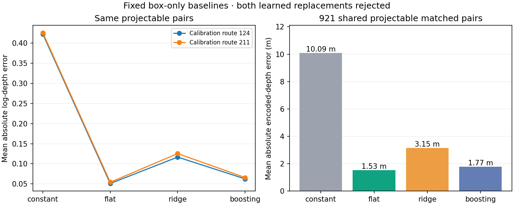

# Shared RGB observations and box-depth baselines — 20 October 2026

Both learned depth replacements are rejected. Keep the existing flat-ground
estimate where valid; preserve unlocated boxes explicitly instead of treating
them as an empty scene. No driver or world model has adopted the new pack yet.

The new `navigation-camera-road-users-v1` representation retains every raw FPN
road-user detection with three-camera identity, box, class, confidence, bearing,
presence and approximate-ground validity. Independent reconstruction checks
every429cached packet bit for bit; the first TRAINpacket also matches the
original production detector forward exactly. TRAIN:351timestamps/4,194boxes,
1,022without a ground location. Calibration:78timestamps/1,930boxes,247unlocated.
All1,930original calibration detections are preserved without repeating inference.
Cache runtime134.8s,3MBdisk. No depth/semantic target is loaded during caching.
An unlocated object's zero-filled XYis explicitly masked and is NOT free space.
The shared pack is equally available to CV/RSSM/JEPA, with adoption still pending.

The fixed CPUbaseline study uses2,520TRAINmatched boxes across all9sources,
including2,501vehicle/19two-wheeler pairs. Calibration has1,110matched vehicle
boxes at2locations. All351/78supervised timestamps and1,287image annotations
are charged. Raw predictions supply every feature; targets come from independently
verified instance/depth pixels. Models fit only TRAINwith equal source weights.
Every calibration box prediction is committed before calibration target reads.
There are no unsupported/nonpositive target depths and no sweep/continuation.

| Model | Same921projectable pairs: mean absolute encoded-depth error | Calibration macro absolute-log error |
|---|---:|---:|
| Constant TRAINmedian | 10.09m | 0.42359 |
| Original flat ground | 1.53m | 0.05264 |
| Ridge,alpha1 | 3.15m | 0.12106 |
| Boosting,200iterations | 1.77m | 0.06426 |

The learned candidate with best all-pair macro score is boosting; it still fails
the predeclared≥5%improvement requirement on the common-supported subset. Both
fits, all predictions and the `selected_offline=null` result remain retained.
The fixed stage takes117.2s; this outcome does not justify a larger blind fit.
On all1,110matched boxes, boosting MAEis2.86m versus constant13.65m; flat ground
has no estimate for189of those pairs, so its1.53m supported-subset number must
not be compared as if it covered all1,110. The earlier independent rematching
of projectable detections yields926matches; conditioning the original raw
matching gives921. These are different assignments, not five missing records.

These targets are the depth at an observed visible bottom pixel, not actor
centres or calibrated3Dcollision envelopes. Documentation supports axial depth,
but the native six-placement convention check crashed before its first capture:
0/6observed, six unknown, empty recorder and native signal11log retained. It is
FAILED, not passed, not retried and excluded from all fits. Cleanup incurred
repeated20sRPCtimeouts after the engine exited. A separate tested helper for
future collectors skips RPCs to an already exited owned server and bounds live
cleanup calls; it has not been substituted into any frozen past attempt.

Both calibration locations had historical encoder/driver exposure. Their repeated
snapshots do not provide independent encounter confidence intervals. These are
posthoc engineering diagnostics, not new M4results, safety qualification or
permission to run the final suite. No change to benchmark, reward, route suite,
model selection protection or the original M4primary occurred.

Next: retain explicit unknown/bearing observations; integrate a genuinely shared
perception input into all three planning arms; collect diverse TRAINalternative
actions with independent calibration roles, native acknowledgments and first-event
censoring. The old three collision-containing TRAINepisodes and the new zero-
contact expert labels do not support the requested predictive-planning claim.

Artifacts: `outputs/navigation_shared_road_users_20261020`,
`outputs/navigation_box_depth_baselines_20261020`, and the failed
`outputs/navigation_depth_geometry_probe_20261020`. Source archives, request hashes,
all failed evidence and original weights remain retained. Live progress:
`.venv/bin/python scripts/watch_navigation_execution.py`.
