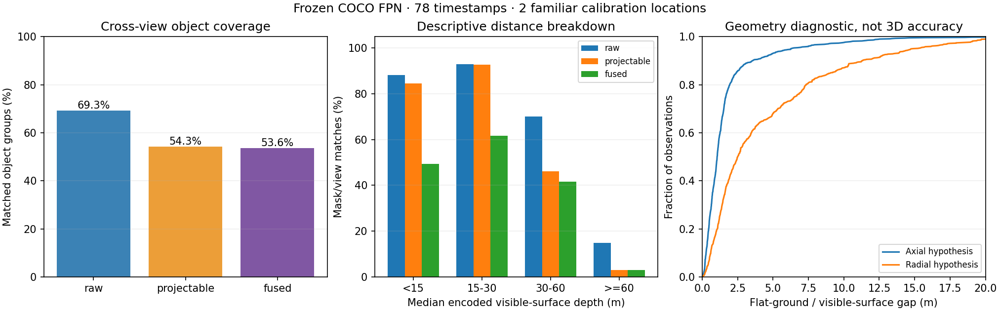
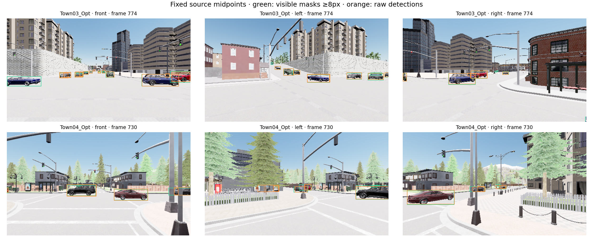

# Frozen camera perception diagnosis — 20 October 2026

The fixed detector loses substantial coverage before tracking: both small-object
detection and flat-ground projection need attention. Cross-view merging removes
many duplicate view predictions but only eight additional matched object groups.
This is a diagnosis, not a trained improvement or driving qualification.

| Stage | Mask/view matches / 1,584 | Cross-view object groups / 1,134 |
|---|---:|---:|
| Raw detector | 1,110 (70.1%) | 786 (69.3%) |
| Projectable | 926 (58.5%) | 616 (54.3%) |
| Fused | 666 (42.0%) | 608 (53.6%) |

All 78 timestamps / 234 views from the two original calibration sources were
processed once with unchanged FP32 frozen FPN weights, score 0.35, IoU match 0.3,
60 m projection and 2 m merge. Predictions were written before reading targets.
Three warmups; measured mean 109.7 ms / p95 115.0 ms, peak allocated GPU 0.939 GB.
The diagnostic hook adds overhead. No model fitting or threshold sweep occurred.

The depth breakdown is descriptive and was calculated after the main diagnostic:

| Median encoded visible-surface depth | Mask/view pairs | Raw matches | Projectable matches |
|---|---:|---:|---:|
| <15 m | 253 | 223 (88.1%) | 214 (84.6%) |
| 15–30 m | 465 | 432 (92.9%) | 431 (92.7%) |
| 30–60 m | 591 | 414 (70.1%) | 273 (46.2%) |
| ≥60 m | 275 | 41 (14.9%) | 8 (2.9%) |

Thus the all-distance denominator includes objects outside the declared 60 m
projection range; it must not be used to claim a near-field recall of only 58.5%.
Nevertheless, 141 raw matched mask/view pairs in the 30–60 m encoded-depth bin
are lost at projection. Ground-plane assumptions, thin silhouettes and box
bottom errors are plausible contributors, not separately established causes.
Raw detection matches 21.2% of the 430 masks with 8–31 pixels, versus 99.1% of the
327 masks with ≥512 pixels. All 1,584 included masks are **vehicles**: there are
no pedestrian or two-wheeler examples here. A further 140 masks below eight
pixels remain in the raw records and outside the primary matching denominator.

The flat-ground estimate differs from the axial visible-bottom surface hypothesis
by median 1.05 m / p95 6.26 m across 1,004 diagnostic observations; the radial
alternative is 2.51 m / 14.88 m. These are different hypotheses about visible
surfaces, not certified actor-centre localization error. Neither is selected or
substituted into the current controller. Do not tune tracking uncertainty from
these distances or from the single observed action-branch outcome.

The next useful countermeasure is to validate metric depth and preserve explicit
unknown/bearing-only detections instead of silently treating projection failure
as an empty scene. Any learned geometry must fit only the nine verified TRAIN
sources and select on the two predeclared calibration locations. Declare and
charge all new dense supervision. Keep the same shared perceived input for CV,
RSSM and JEPA; do not attribute a perception improvement to the dynamics model.
Collect independent alternative-action encounters before fitting first-event
risk: these short expert sources contain no contacts and cannot supply that
missing action coverage. Add pedestrian/two-wheeler coverage before claims about
those classes. These recommendations change no frozen test, reward or scoring.

Evidence: `outputs/navigation_dense_perception_diagnosis_20261020` retains the
request, exact initial source, predictions, matching records and assessment.
The verified manifest SHA is
`9165e84ebe15a78d9aafb8ec6139f7e081b68b348609a98b93fb60eff0742163`.
Both locations are familiar TRAIN geography with earlier encoder/driver exposure;
snapshots are correlated and low16 Unreal instance IDs may alias. Unmatched
predictions are relative to included masks, not exhaustive false positives.
The original 13-source collection denominator, both rejected sources and failed
whole-corpus audit remain unchanged. No M2/M3/M5/M6 safety gate has passed.
