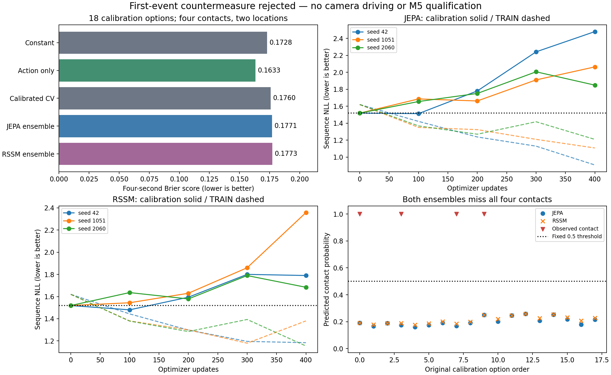

# First-event models: completed countermeasure, both ensembles rejected

The new JEPA and RSSM ensembles do not beat the simple baselines on endpoint
prediction, and both miss all four calibration contacts at the frozen0.5threshold.
No native planner was deployed. M2/M3/M5 remain unqualified; M6 has not run.

| Model | Endpoint Brier ↓ | Sequence NLL ↓ | Misses | False alarms |
|---|---:|---:|---:|---:|
| Constant | 0.17285 | 1.5191 | 4/4 | 0/14 |
| Action only | 0.16328 | not a survival model | 4/4 | 0/14 |
| Calibrated CV | 0.17597 | 4.1394 | 4/4 | 0/14 |
| JEPA ensemble | 0.17706 | 1.4923 | 4/4 | 0/14 |
| RSSM ensemble | 0.17728 | 1.4925 | 4/4 | 0/14 |

The raw CV proximity score flags all18cases:0misses/14false alarms. It is not a
probability. Its monotone sigmoid calibration was fitted on TRAIN only and frozen
before calibration targets were opened. The action-only model also uses TRAIN
only, with no visual/world/route identity. Lower sequenceNLL does not override
worse endpointBrier or justify a safety claim.

Data:73original attempts,68 independently verified recordings,5unknown failures.
TRAIN50episodes/eightlocations/12contacts; calibration18/twolocations/4contacts.
All10,880native controls and5,440RGBtimestamps in eligible sources were audited.
39expansion prefixes match exactly after a separate static-light identity
correction; original failed audit and its actor-order error remain retained.
Scripted actors are nonreactive; all lights are green. No red-cost model is trained.

Both learned arms receive the same complete eight-timestamp RGB-derived object
history, current48x384JEPAgrid, declared navigation/ego state, two actual prior ego
commands, and prospective80-command plans. CV receives the same object history
and own-action geometry. No simulator traffic or teacher state enters inference.
The futureRGBtargets remain separate, censored at contact/intervention; missing
4.0sRGBis unknown. Every accepted detector box, including unlocated boxes, is
retained. Shared features completed in197.34s without model updates.

Six independent fits,400updates each, same50examples/uniformbatch12draws, fixed
optimizer and selection. The first-contact likelihood sums each observed prefix;
it fixes the variable-duration weighting in the earlier untrained prototype.
JEPA has453,613parameters andRSSM622,701; equal updates are not equal parameter
count or measured hardware compute. Training took58.90s total including loading.
Each arm selected steps100/0/0 for seeds42/1051/2060. Later training likelihood
improves while calibration worsens. No losing fit is extended or reselected.

All15prospective candidates were subsequently predicted by all six frozen members.
Only the originally executed options have observed outcomes; alternative outcomes
remain unknown. BF16different-batch inference differs by up to0.0625logit; maximum
cumulative-probability difference is0.000515.
Original selected predictions remain the primary metrics. Member disagreement
is not calibrated uncertainty, and two calibration locations do not support a
general reliability claim. The frozen backbone's historical exposure was already
disclosed; this is not a new clean encoder comparison or a change to M4's primary.

Next: diagnose ground geometry/object observability and address the independent
traffic-light localization/stop-release failures before another driving pilot.
Keep the rejected models, every checkpoint, RNG/optimizer state, original failed
attempts and frozen evaluation suite. No Town05 tuning or final driving.

Evidence: outputs/navigation_interventions_verified_20261021,
outputs/navigation_intervention_features_20261021,
outputs/navigation_first_event_baselines_20261021,
outputs/navigation_first_event_study_20261021 and
outputs/navigation_first_event_assessment_20261021. Protocol:
[registered study](navigation_first_event_study_protocol_20261021.md).
