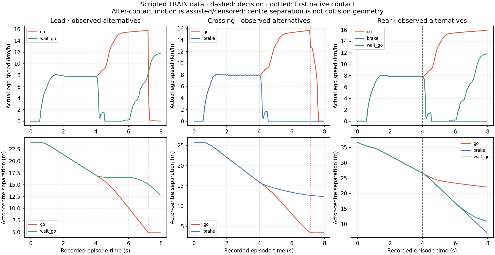

# Causal-action data pilot — 20 October 2026

Eight original rollouts are independently verified; two reload failures remain
unknown in the ten-attempt denominator. This is factual TRAINdata, not a camera
policy result or an improved world model. The whole pilot audit stays FAILED.

| Context | Go | Brake | Wait then go |
|---|---|---|---|
| Lead · Town01/j306 | Contact at 3.25s; repeat matches | Unknown | No contact in 4s |
| Crossing · Town03/j238 | Contact at 3.15s | No contact in 4s | Unknown |
| Rear · Town01/j306 | No contact in 4s | No contact in 4s | No contact in 4s |

There are3observed unfiltered contact starts: two correlated repeats of lead/go,
and crossing/go. Two scenarios have positive outcomes, not three independent
positive encounters. The two missing recorders remain unknown, never zero hits.
No observed contact within4sdoes not mean that the same action is safe later.

The closed-file audit verifies640RGBtimestamps and1,280next-tick actual ego
controls, every RGBpixel hash, both actual prior commands, all15prospective plans
at each decision and both actors'actual geography. All six registered observable
comparisons have EXACTzero differences in position/rotation/velocity/light phase,
including one complete go repeat. This establishes observable replay agreement
for these conditions; no hidden-state or general CARLAdeterminism guarantee.
The original1mreserved-location clearance remains unchanged. Town01ego minimum
is only1.000012m, so do not present that numerical margin as physical certainty.

All candidate controls were saved before first execution, using only current
navigation, own speed and two actual prior commands. Proposed and acknowledged
actions match through native contact:65ticks for lead/go,63for crossing/go.
Privileged post-contact stopping censors future latent/progress targets. Every
first event remains counted. Native event index is tick−1for the80next-tick
first-event hazards; observations at/after an earlier event cannot become new
first-event labels. The verified manifest retains the explicit eligible prefix.

All data here is TRAIN:3contexts at2locations,8rollouts including a repeat.
There are NOindependent calibration episodes in this pilot. Count all640RGB
timestamps and1,280labeled physics ticks in future supervision accounting. Other
actors are scripted, not reactive traffic. All lights are green/frozen: NOred
positives or traffic-rule learning evidence. Rear actors can be outside the rig.
No rear contact occurred, so this pilot has not produced the desired examples
where braking is worse than going. The final rear/brake centre separation is
7.10m; the observed horizon ended before any contact. Do not extend or relabel it.

The pilot originally allowed900s/600MB. Every native capture receipt precedes the
original deadline. Explicit STOP-based cleanup and the separate read-only audit
finished afterwards; that lifecycle overrun is not a successful whole-stage
completion. All four original owner generations remain FAILED. The first short
timeout leak was corrected, but subsequent20stimeouts and fresh-engine failures
showed that was not the full cause. Every orphan was recovered only through its
owned STOPand verified normal SIGTERMretry; no force kill or unrelated job.

The retained core of the final client identifies native LightManagerlight-state
query failure in a streaming callback followed by std::terminate. The stack
is in `outputs/navigation_native_lifecycle_diagnosis_20261020`.
The [pinned LightManager implementation](https://github.com/carla-simulator/carla/blob/0.9.15/LibCarla/source/carla/client/LightManager.cpp)
registers that callback; the
[Episode listener](https://github.com/carla-simulator/carla/blob/0.9.15/LibCarla/source/carla/client/detail/Episode.cpp)
dispatches it from the native stream. This explains the observed client abort
path, not every engine segmentation fault. A later two-cycle client-release
instrument also FAILED: one captured cycle ended with engine−11; the second
engine crashed. Python survived that instrument, but infrastructure is unqualified.
Use per-episode child-process isolation and an external owner before scaling up.

The separate verified manifest is
`outputs/navigation_interventions_verified_20261020/manifest.json`, SHA
`ef35b75311dd6d683c8f98713eb3cf919e0606d00865dafd79625fe93b1680fc`.
It includes the8audited sources and both explicit rejections; original audit
`outputs/navigation_intervention_audit_20261020` remains FAILED.
No data is silently promoted to expert imitation, no model has been fit on this
corpus, no gate has passed, and M6has not run. The next useful work is reliable
process ownership, diverse predeclared action conditions including closer rear
approaches and reactive traffic, shared perception, then matched first-event fits.
