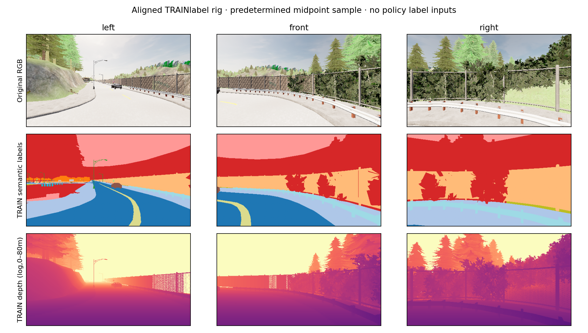

# Aligned training-label profile

Both registered modes complete120physics ticks/60stored timestamps, with zero native contacts. Every raw RGB/label pixel roundtrips through atomic shards and all image frames/timestamps/poses align. Total retained artifacts142.61MB.

| Mode | Physics fps | Tick p95 | Compressed arrays | Raw arrays |
|---|---:|---:|---:|---:|
| rgb_only | 21.97 | 63.4ms | 44.91MB | 79.63MB |
| rgb_instance_depth | 10.19 | 138.7ms | 94.21MB | 291.96MB |

The profile includes storage, transforms and statistics. Nine cameras roughly halve throughput in this one slow single-scene check. Fixed baseline-first order and slow2m/s motion limit extrapolation. Neither mode is a learned driver or diverse traffic benchmark.

The installed0.9.15enum and actual raw pixel classes use Car14/TrafficLight7, matching the pinned C++source; the older table still visible on the versioned sensor-doc page differs. Instance green/blue bytes are preserved as render-component identifiers, not asserted actor IDs. Depth is decoded from raw R+256G+65536B.

New dense labels remain training/scoring only and require strict source/geography audit before fitting. Future low-label claims must charge every supervised timestamp. The current five-encoder matrix stays unchanged.

Raw source: `outputs/navigation_label_rig_profile_20261020`.
