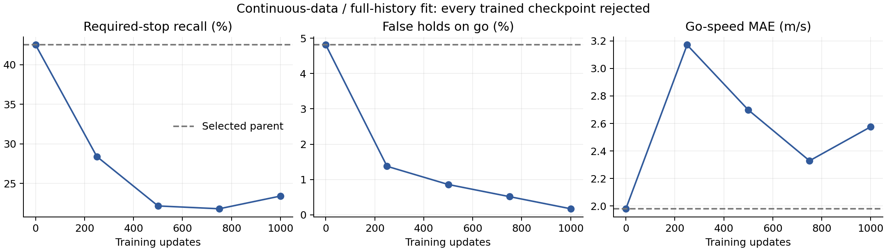

# Continuous expert data and causal-history fit: rejected

The1000-update countermeasure did not improve the protected parent. Selected0
remains byte-identical `80bee4e338eec8f55f57d96ad4cf0bf27c736e47bc641e2b1dd4e8bb0cfdc3e4`; no redundant camera driving
run was made. Rejected latest and full recovery state are preserved.

|Update|Required-stop recall|False holds|Go-speed MAE m/s|Accepted|
|---:|---:|---:|---:|---|
|0|42.50%|4.81%|1.980|False|
|250|28.39%|1.37%|3.171|False|
|500|22.14%|0.86%|2.698|False|
|750|21.79%|0.52%|2.329|False|
|1000|23.39%|0.17%|2.576|False|

Original13 validation episodes and1312 label positions are unchanged. Parent
causal/clipped results are nearly identical. Continuous TRAIN supplement has
2550 timestamps from12 episodes/four locations with7/11/15s waits; no unverified
perception labels receive a loss. All10296 control positions are TRAIN-audited.
Exact replay of1000 sampler draws finds47.35% stop labels. Latest stop hits fall
33→0/278 in signal-memory scenes,146→88/201 signal-stop and41→25/63 stop-sign.
This combined experiment does not identify a single failure mechanism.

Protocol deviation: code also evaluated750 beyond declared0/250/500/1000;750 was
rejected and had no selection effect. All five evaluations remain visible.
The watcher optional-field KeyError was fixed without modifying active training.
Next hypothesis: frozen-parent learned stop residual, localized RGB facts versus
matched null-token arm. No parent promotion, safe-driving claim or M2 completion.
M3–M6 remain open. Town05 was not used in fitting or model selection.

Reproduce with `.venv/bin/python scripts/summarize_navigation_causal_history.py`.
Machine-readable companion contains exact metrics, hashes and sampler diagnosis.
