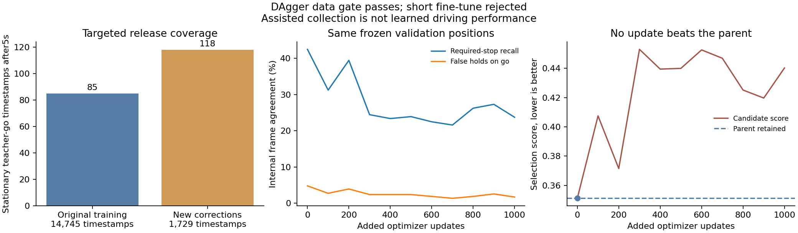

# Targeted DAgger corrections — 16 October 2026

**The correction-data gate passed; the fine-tune was rejected and its parent
retained. M2 driving remains open.** Privileged assistance during collection is
not evidence of a stronger camera policy.

Implemented a collector that runs the unchanged camera student in its isolated
inference process while a privileged expert labels each observed state. It
records student-requested, expert, selected and next-tick observed controls
separately. Teacher braking/hazards take priority. Four seconds stationary while
the teacher would go triggers up to three seconds of marked expert recovery;
new hazards cancel recovery. These mechanisms are collection-only. Evaluation
and policy/controller code do not acquire a forced crawl or oracle rules.

The [protocol](navigation_m2_dagger_protocol_20261016.md) and
[guard](navigation_m2_dagger_guard_20261016.json) were frozen before collection.
Reserve the existing eight internal-validation junctions as well as heldout_dev;
Town05 stays unused. Of300 approved TRAIN routes,235 satisfy the combined1m
geometry clearance. Actual collection is checked before every20Hz policy call.
The small pilot uses fresh seed202610160+route ID and the first eligible Town03
route per family:86,101,111,123,133,143. Prior diagnostic recordings are excluded.

## Collected data and verification

Output: `outputs/navigation_m2_dagger_pilot_20261016`.
Assessment: [audited correction JSON](navigation_m2_dagger_assessment_20261016.json).

| Measurement | Value |
|---|---:|
| New10Hz timestamps / atomic shards | 1,729 /59 |
| Storage, including lossless RGB and labels | 701.20MB |
| Expert zero-speed / go targets | 500 /1,139 |
| Stationary expert-go timestamps | 143 |
| Stationary expert-go after first5s | 118 |
| Marked recovery events | 2 |
| Privileged control selections,20Hz | 1,168 /3,454 ticks |
| Student / teacher-selected sampled actions,10Hz | 1,106 /623 |
| Recorded collision / red / stop events | 0 /0 /0 |
| Reserved-geography violations | 0 |

All six assisted episodes arrived compliantly. This is **not6/6 camera success**:
the expert selected approximately34% of the physics controls. Both recoveries
occurred at states where the student would remain stopped. Four episodes contain
teacher interventions and are censored. Two completed without an actual teacher
selection; all six remain unavailable as clean expert imitation demonstrations.
A separate reader permits their instantaneous expert corrections, with no
inferred expert future or counterfactual safe-action label.

Every committed RGB pixel/frame/member and actuator acknowledgment passed the
data audit. An independent check covered all3,454 physics-frame ego centres.
Source/checkpoint, scenario start and physical light identity checks passed.
Applicable-light IDs agree with same-frame world states; visibility remains
unknown. All six videos fully decoded. A progress-display ordering issue was
corrected after this run: future runs stay running until pixel auditing ends.

The new data are concentrated in six familiar Town03 situations. Frame counts
are correlated; this adds correction examples, not geographic diversity or a
statistical reliability claim. Future repetition on these routes is explicitly
training-task monitoring.

## Protected correction fine-tune

Use a separate1.34GB raw-image correction cache; preserve the original13.605GB
cache and its50/13 episode split. No heldout_dev/Town05 or internal-validation
sample enters the new training pool. Instantaneous speed, brake, path and
perception targets come from the expert, never student/executed actions. Every
future-speed mask from the assisted data is zero; original demonstrations retain
their valid future supervision.

Warm-start the previous stop/go best1500, with a fresh AdamW and1,000 added
updates, LR5e-5, batch2,32-frame history, CUDA BF16 and1,200s invocation cap.
Half the clips come from the original data; half from corrections, balancing
stationary expert-go errors and required-stop endpoints. Architecture, controller,
inference inputs and internal selection score stay fixed. The parent is measured
and saved as candidate step0, so worse fine-tuning cannot displace it. Full
optimizer/RNG/sampler and source/data provenance are saved.

Run: `outputs/navigation_m2_dagger_finetune_20261016`.
It completed all1,000 added updates in89.46s, including correction-cache
preparation. None of the ten evaluated training checkpoints beat the step0
parent under the unchanged selection score. **Selected step0 has bit-identical
model parameters to the parent**, while latest1000 changed56 parameter tensors.
This confirms actual learning occurred and the protection correctly rejected it.

| Same1,312 internal positions | Parent / retained selection | Latest1000, rejected |
|---|---:|---:|
| Required-stop frames held | 238/560 (42.50%) | 133/560 (23.75%) |
| Go/nonbraking frames falsely held | 28/582 (4.81%) | 10/582 (1.72%) |
| Speed MAE | 2.583m/s | 3.248m/s |
| Selection score, lower is better | 0.35115 | 0.44028 |

Detailed [matched assessment](navigation_m2_dagger_finetune_20261016.json) includes
parent/selected equality and latest metrics. The latest lower false-hold rate
comes with substantially worse required-stop recognition; it is not an improved
driver. No CARLA evaluation was repeated on the identical selected parameters.
Both latest and parent remain preserved, with an explicit policy review in the
run directory. No longer continuation is scheduled.

An exact replay of the1,000 mixed batches yields14,030 stopped targets among
32,000 supervised positions (**43.84%**):6,267/16,000 original and7,763/16,000
correction positions. The negative result is not explained by an absence of stop
labels. Its cause remains open: limited six-location diversity, ambiguous visual
rule labels, and short memory are hypotheses, not proven causes. There are only
two actual recovery events despite many correlated frames.

The existing coarse CNN/state heads and3.2s reset clips still do not establish
localized applicable-signal perception, stop-line distance or memory through
long waits. The new applicable-lamp IDs support that next label audit, but their
image visibility and housing/stop-line geometry have not been validated. Focus
there and on full stop/release sequences before another data-only continuation.
Keep heldout_dev expert calibration and the late Town05 suite freeze as separate
open tasks; no held-out image, trajectory or model-selection result was used.

All collection, training and simulator jobs are idle. The original selected v2
is still only an engineering baseline (3/6 compliant familiar TRAIN cases), not a
promoted navigation model. Existing failed videos/benchmarks remain unchanged.

Implementation verification before launch:247 CPU tests passed,2 skipped. Tests
cover cancellation of recovery, no privileged camera imports, internal-location
exclusion, correction-only eligibility, cross-episode sampling and zero future
supervision from assisted data. Historical Dreamer experiments and benchmark
criteria remain unchanged.
