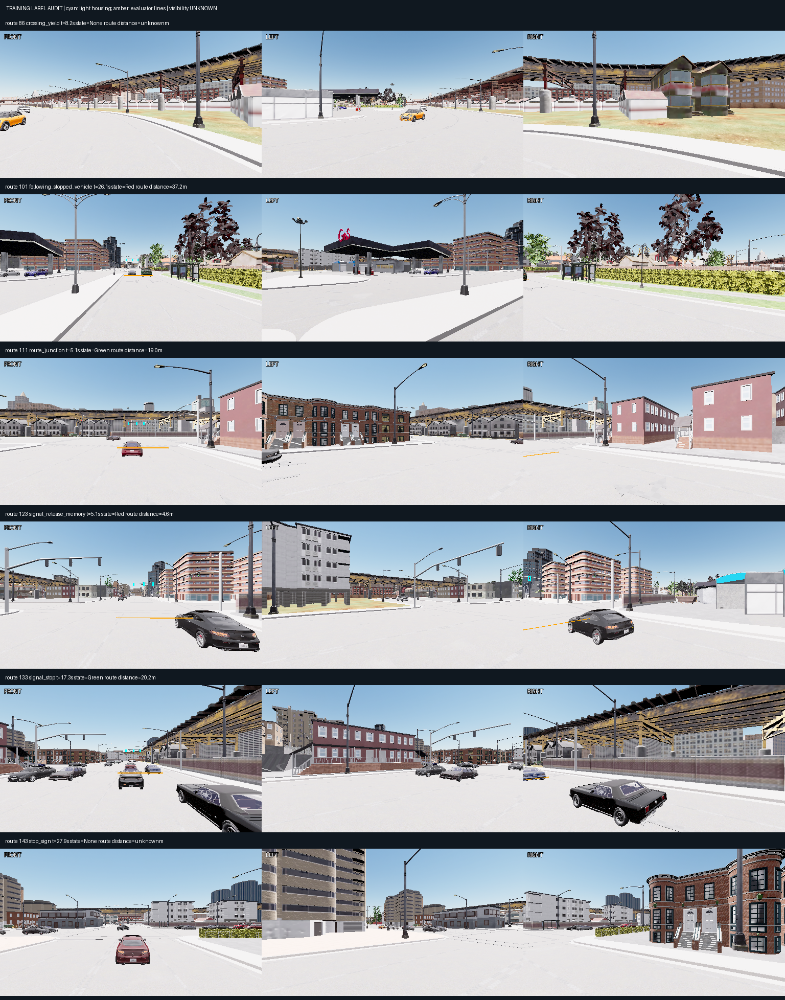
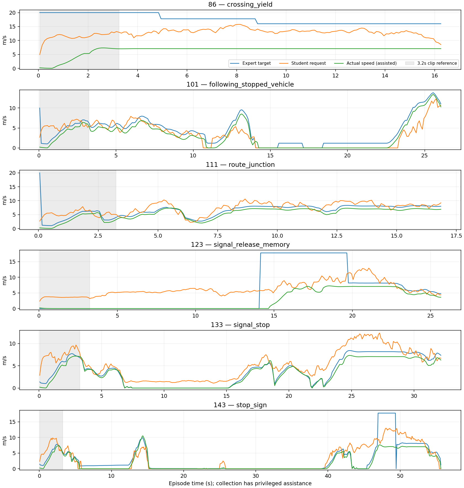

# Camera-rule observability audit — 16 October 2026

**The spatial/temporal audit completed. The camera model is unchanged and M2
remains open.** The subsequent [pixel/perception continuation](navigation_m2_signal_perception_20261016.md)
resolved cleanup and completed the stationary probe, fresh static supervision
and bounded component tests. The incomplete-probe section below records the
earlier failed attempts; it is no longer the live blocker.

The [correction fine-tune](navigation_m2_dagger_20261016.md) missed more required
stops and retained its parent. Before another training run, inspect the quality
of rule supervision and the duration of zero-speed intent. Use only the six
audited internal-TRAIN correction episodes; preserve the original cache/split,
heldout_dev, Town05 and all evaluation criteria.

## Completed spatial audit

New training-only geometry module and scripts capture actual traffic-light
housings and the pinned evaluator's crossing lines. The static Town03 inventory
completed in4.92s:38 actors,107 housings. Full-pose matching joins physical lamps
across simulator instances without assuming actor IDs persist. Projections use
recorded same-frame ego pitch/roll, camera translation/rotation and intrinsics.
Random matrices were checked against installed CARLA; side-camera and near-plane
cases have independent tests. The module is forbidden in camera inference.

CARLA0.9.15 returns component geometry already transformed into world coordinates;
do not apply the actor pose twice. See the versioned
[bounding-box implementation](https://github.com/carla-simulator/carla/blob/0.9.15/Unreal/CarlaUE4/Plugins/Carla/Source/Carla/Util/BoundingBoxCalculator.cpp).

The audit validates frozen collection/geometry source hashes, original correction
assessment and internal manifest, map hash, contiguous10Hz frames and matching
camera/world/label timestamps. Image examples load lossless RGB and verify pixel
hashes. No model is trained or selected by this audit.

| Existing TRAIN correction labels | Count |
|---|---:|
| All timestamps | 1,729 |
| Known applicable-light states | 766:424 red,311 green,31 yellow |
| Within the old80m distance mask | 677 |
| No housing projects into any of the three images | 0/766 |
| No housing projects into the front image | 227/766 (29.6%) |
| Largest native housing under6px tall | 556/766 (72.6%) |
| Largest housing at model-input resolution under6px | 717/766 (93.6%) |

At native512×288 resolution the median largest housing is3.60px tall. At deployed
input resolution (front512×288, side context256×144), the25th/50th/75th percentiles
are1.35/3.60/5.32px. Six pixels is a descriptive diagnostic, **not** a validated
legibility cutoff or a new gate. A housing includes multiple bulbs; it is not
the size of the illuminated color patch.

This rules out the narrow claim that these labels all refer to lights outside
every camera. It identifies a front-versus-side resolution issue and very small
image evidence. It does **not** prove the lamp is visible, faces the ego or has
a readable state. Every projected sample retains `visibility_valid:null` and
`state_supervision_approved:false`. No new state labels are released for training.

Cyan marks projected housings; amber shows all evaluator-line lane candidates
for that actor. The applicable lane is unassigned. These are geometric candidates,
not pixel segmentation or painted stop-line truth. Examples use the closest
labelled distance to20m after5s, with a middle sample for no-light episodes.

The API stop positions and evaluator crossing lines differ on the inspected
signals:3.5m for actor48,6m for71 and5m for72. This is a **semantic distinction**,
not permission to change scoring. Existing planner distance labels must not be
presented as verified distance to a painted line or to the evaluator's line.
The privileged planner also pads routes by50m; an upcoming-light label need not
be a rule encounter inside the scored short mission. Future label preparation
must preserve which reference each distance uses.

## Completed temporal audit

There are13 contiguous teacher zero-speed-intent runs, totaling500 timestamps.
Four last longer than a32-frame/3.2s training clip:

| TRAIN route | Zero-speed intent duration |
|---|---:|
| 123, signal release/memory | 14.1s |
| 133, signal stop | 7.8s |
| 143, stop-sign family | 7.3s and13.6s |

These four contain428/500 zero-speed labels (85.6%). They are target-speed events,
not independent encounters, and not a claim that ego speed was zero throughout.
Family names do not establish the cause of every halt; recorded hazard flags
are not an exhaustive account of the expert's IDM and route constraints.

The displayed graph uses automatic upper bounds. Final visual review removed
an11m/s ceiling from the first draft, which hid high requests. Original output
and corrected plotting provenance are both retained; all metrics are unchanged.

Short clips cannot contain the beginning and release of the longest events.
However, the earlier whole-episode teacher-trajectory diagnostic still had weak
stop recall. Longer memory is therefore a testable hypothesis, not an established
fix or a substitute for localized perception/student-state coverage.

## Historical incomplete stationary pixel probe (resolved subsequently)

Implemented a four-minute-capped diagnostic: four deterministic applicable-light
TRAIN poses; fixed ego/camera; red→green→red repeat; compare the housing pixels
and repeat-control variation. Freeze all lights, verify the exact camera matrices,
retain original pose/provenance and save all images. Original dynamic traffic
is omitted, so even a completed probe would not certify original-scene visibility
or constitute learned driving or the M3 behavioral counterfactual suite.

Two infrastructure attempts are preserved:

1. `outputs/navigation_m2_signal_pixels_20261016`: resource guard counted its own
   `probe_` process; failed before simulator startup. Fixed by excluding only the
   current PID. A regression test still rejects another probe.
2. `outputs/navigation_m2_signal_pixels_retry_20261016`: spawn rejected a recorded
   physics-settled pose because it overlaps asphalt. No paired images were made.
   Its synchronous server remained alive after the owner's normal SIGTERM cleanup
   timed out; `STOP` is present. A bounded attempt to restore asynchronous ticking
   through RPC timed out too. Last observed owned PID:240326,port2100;~1.5GiB
   incremental GPU memory,zero utilization. No force kill or duplicate server.

The script now spawns above the road, disables physics, places the vehicle at
the exact recorded pose, verifies camera/ego drift, and restores world settings
in `finally` even when setup fails. CPU tests cover cleanup restoration. These
changes were **not yet verified in a successful live probe at12:45**. Additional
graceful cleanup permission was then pending under the project's STOP-only rule.
The later approved cleanup and successful exact-frame probe are documented in
the [continuation](navigation_m2_signal_perception_20261016.md). No cleanup
permission remains pending. Check live state before any fresh diagnostic.

## Original next experiment (subsequent results linked above)

1. Resolve the stopped diagnostic server and finish the stationary pixel check.
   Confirm housing alignment and state-dependent pixels before approving localized
   state targets. Add occlusion/facing validity where it can be verified.
2. Build a learned localization/state head covering all three cameras at adequate
   resolution. Geometry supplies training targets only; runtime receives the same
   RGB/navigation/ego packet. Include same-pose state pairs to test whether the
   head reads color rather than memorizing locations. Broaden TRAIN locations
   before treating six familiar cases as evidence of generalization.
3. Test continuous stop/release sequences with causal recurrent burn-in while
   holding the original validation positions, selection score and parent protection
   fixed. Change one main hypothesis per experiment; do not resume rejected latest.
4. Only after internal evidence improves, run a fresh camera-only TRAIN pilot with
   overrides off. Keep failed videos. Heldout-dev expert calibration and late
   Town05 suite registration remain separate open protocol tasks.

No longer training run is scheduled. Selected weights, controller, loss, benchmark,
reward and jobs scripts are unchanged.261 CPU tests passed,2 skipped;64 historical
Dreamer AMP deprecation warnings. This includes14 new projection/provenance/
privilege/contrast/resource/cleanup tests.

Reproducible evidence:

- [Spatial/temporal statistics](navigation_m2_rule_observability_20261016.json).
- `outputs/navigation_m2_rule_geometry_20261016`: static geometry and source archive.
- `outputs/navigation_m2_rule_audit_20261016`:1,729 per-frame projections, raw
  assessment, images, timeline and supplemental analysis source.
- `scripts/capture_navigation_rule_geometry.py`,
  `scripts/audit_navigation_rule_observability.py`,
  `scripts/probe_navigation_signal_pixels.py`.
