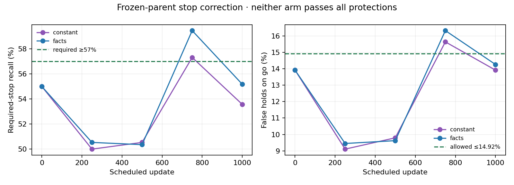

# Structured stop correction: both arms rejected

Both1000-update arms retain the exact original parent at step0. No candidate qualifies for a native pilot. Original RGB/source hashes verify and selected parent metrics reproduce; paired arms see identical1000TRAINepisode draws. No M3/heldout-dev/Town05examples are fitted.

| Arm | Update | Stop recall | False holds | Go-speed MAE | Old composite ↓ | Admitted |
|---|---:|---:|---:|---:|---:|---|
| constant | 0 | 55.00% | 13.92% | 4.594m/s | 0.38646 | False |
| constant | 250 | 50.00% | 9.11% | 4.492m/s | 0.38537 | False |
| constant | 500 | 50.54% | 9.79% | 4.489m/s | 0.38608 | False |
| constant | 750 | 57.32% | 15.64% | 4.610m/s | 0.38377 | False |
| constant | 1000 | 53.57% | 13.92% | 4.622m/s | 0.39418 | False |
| facts | 0 | 55.00% | 13.92% | 4.594m/s | 0.38646 | False |
| facts | 250 | 50.54% | 9.45% | 4.465m/s | 0.38388 | False |
| facts | 500 | 50.36% | 9.62% | 4.473m/s | 0.38579 | False |
| facts | 750 | 59.46% | 16.32% | 4.596m/s | 0.37622 | False |
| facts | 1000 | 55.18% | 14.26% | 4.626m/s | 0.38793 | False |

At750updates, predicted facts increase stop hits308→333of560(+4.46points) but false holds81→95of582(+2.41points). The preregistered allowance is at most+1point. The better composite.37622 versus.38646 cannot override that protection. The constant-facts control also fails its protections. No longer continuation or post-hoc reselection.

The scored validation positions include no stopped examples for following-stopped-vehicle or crossing-yield. Thus this offline stop selector alone cannot establish obstacle safety, even if a future fit passes. Keep the native counterfactual and encounter requirements.

Raw study: `outputs/navigation_semantic_residual_study_v2_20261020`. All failed scheduled validations, checkpoints, optimizer/RNG/sampler and source archives remain retained.
