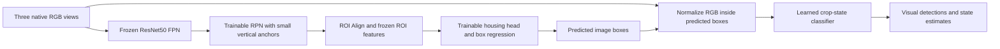
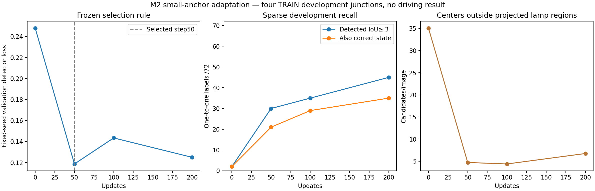
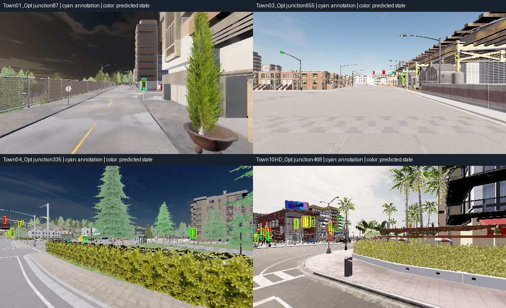
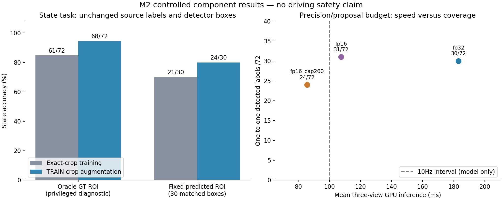

# M2 small-light detector and crop alignment — 16 October 2026

**Later continuation (18:06):** [Hard-negative refinement and calibration](navigation_m2_signal_hard_negatives_20261016.md)
are complete. Registered semantics corrects the initial visual suspicion of real
lights: no inventory defect is established.110/118 candidates pass all semantic
and RGB checks; a separate approved subset preserves the initial mining veto.
Protected head refinement reduces approximate backgrounds681→171 but loses
coverage30/72→27/72, so all trained candidates are rejected. A TRAIN-derived bias
rule chooses zero and leaves that result unchanged. Keep the original detector.
Counts below retain their approximate background definition, not verified full
false positives. No new driving gain; broader TRAIN positive views are next.

**There is a measurable perception gain, but M2 is still open.** The selected
RGB detector finds30/72 supported light labels; the fixed crop classifier
countermeasure gets24/72 both detected and state-correct. No component is
connected to the driver, and no new driving result is claimed.

Read this after the [earlier perception diagnosis](navigation_m2_signal_perception_20261016.md).
The [machine summary](navigation_m2_signal_detector_20261016.json) verifies all
612 image hashes, archived sources, selected component, fixed assignments and
unchanged original camera policy/cache. Rebuild the summary/second graph without
training or mutating experiment inputs:

```bash
.venv/bin/python scripts/summarize_navigation_signal_detector.py
```

## Method and fixed supervision

Use the same static TRAIN corpus:13/4 whole-junction groups,468/144 native RGB
images and179/72 supported housing/phase labels. The four development groups
are Town01_87,Town03_655,Town04_335,Town10HD_468. Earlier annotation development
inspected some of them. These72 correlated labels are not72 independent
encounters or untouched test data. Existing driving-validation locations,
heldout_dev and Town05 remain excluded.



Geometry supplies positive/ignore regions during training and scoring only.
Inference receives RGB, with no lamp state, actor, map location or ground-truth
ROI. This component does not determine ego-lane applicability or control speed.

Start with declared external COCO supervised FasterRCNN-ResNet50-FPN-v2 weights.
Copy background/light classes0/10 into a binary head. Use anchor square-root
areas8/16/32/64/128 with height/width ratios1/2/4. Train RPN and final ROI predictor;
freeze backbone/FPN and ROI feature weights plus normalization buffers. Confirm
the frozen state remains byte-identical. Smaller anchors and binary logits change
the initial system, so the adapted step0 is the matched training control; the old
91-class COCO14/72 remains a separate reference, not an isolated anchor ablation.

All projected housing regions have the original4px ignore margin. Exclude
uncertain lamps from negative sampling in BOTH RPN and ROI classification,
after resizing those regions with the RGB. Preserve positive assignments.
Unresponsive/back-facing/occluded geometry does not become certified background.
The [frozen protocol](navigation_m2_signal_detector_protocol_20261016.md) defines
200 updates, FP32 AdamW5e-4,batch2, seed20261016 and900s cap. Actual wall time
is111.54s,1,194,265 trainable/43,256,153 total parameters, peak allocated1.69GB.

## Detector result and selection

| Updates | Fixed-seed detector loss ↓ | Detected IoU≥.3 /72 | IoU≥.5 /72 | Detected + correct old state /72 | Approximate-background candidates /144 images |
|---|---:|---:|---:|---:|---:|
| Adapted0 | .24792 | 2 | 2 | 2 | 5,049 |
| **Selected50** | **.11866** | **30** | **22** | **21** | **681** |
| 100 | .14343 | 35 | 24 | 29 | 632 |
| 200 | .12498 | 45 | 31 | 35 | 972 |

Selection was frozen as mean sum of standard detector validation losses, using
fixed validation RNG restored afterwards. Keep step50 despite higher latest200
recall. Loss and recall disagree; a future operational selection criterion needs
to be declared before another experiment, not substituted into this result.

The selected model detects13/40 labels with housing height<8 native pixels,
13/28 at8–15px and4/4 at≥16px. The old generic detector found0/40 under8px.
An independent maximum-cardinality one-to-one matching audit reproduces all
counts; no predicted box counts as two lights. Background candidates have centers
outside every projected ignore region; this is approximate geometry supervision,
not full detection AP or exhaustive false-positive annotation. Selected50 still
has1,452 predictions across144 images, including681 approximate-background cases.





Cyan outlines supported annotations; red/yellow/green outlines predicted states.
Each example is selected by largest supported red housing per junction, using
geometry rather than detector outcomes. Background predictions and wrong states
remain visible. These are static scenes, not driving videos or selected successes.

## Crop-alignment countermeasure

Keep the selected detector, every predicted box and its30 matched ROIs fixed.
The [next frozen protocol](navigation_m2_signal_crop_alignment_protocol_20261016.md)
adds15 outward TRAIN crop variants to each original179 crop. Every variant
contains all original housing pixels, with random margins clipped to the image.
Use the same16×32 bilinear RGB feature and C1 balanced L2 logistic regression.
Each of16 variants has weight1/16, preserving total source-example weight179.

| State-only task | Original classifier | Augmented classifier |
|---|---:|---:|
| Exact GT crops, privileged diagnostic | 61/72 (84.7%) | 68/72 (94.4%) |
| Same fixed predicted ROIs | 21/30 (70.0%) | 24/30 (80.0%) |
| Full sparse denominator, detected and state-correct | 21/72 | 24/72 |

Fit time0.184s/44 optimizer iterations,3.11s including preparation. Exported
coefficients reproduce predictions exactly. The gain is consistent with alignment
sensitivity, but augmented appearance also changes; do not claim an isolated
physical cause. There is no oracle crop at predicted-ROI inference. The68/72
number remains explicitly privileged and is not the pipeline's headline accuracy.

## Precision and proposal-budget audit

Freeze selected50 detector and augmented crop classifier. Same144 RGB images,
confidence.5, IoU.3/.5, three warmups/mode and rotating paired order. Model
parameters/buffers remain unchanged. Default internal800/1333 resizing only
interpolates original pixels. In the final controlled three-mode comparison:

| Inference mode | RPN proposals/image | Detected /72 | Detected + correct state /72 | Mean three-view GPU ms | p95 ms |
|---|---:|---:|---:|---:|---:|
| FP32 | 1,000 | 30 | 24 | 183.1 | 187.9 |
| FP16 | 1,000 | 31 | 25 | 107.5 | 112.2 |
| FP16 reduced budget | 200 | 24 | 19 | 85.6 | 89.3 |

The earlier two-mode audit agrees on counts, with184.1/106.5ms means. FP16 changes
rounding/NMS/threshold outcomes:1,469 predictions versus1,452 in FP32, so it is
not numerically identical. One extra label is not a generalization/safety claim.
Peak allocated memory1.67GB FP32/1.35GB FP16.

**Reject the200-proposal configuration as the default optimization:** it loses
7 of31 detected labels and6 of25 correct joint states. The full FP16 model still
exceeds the100ms10Hz interval before preprocessing, classifier and controller.
The faster configuration's85.6ms is model-only, not demonstrated end-to-end10Hz.



## Artifacts, recovery and next step

- Detector: `outputs/navigation_m2_signal_detector_20261016`, selected
  `best_component.pt` SHA256
  `8df27ee218056e392cc5ddb0f50fef9263a1e8b81517b1d5ecbeba8038a6e49b`.
- Augmented state: `outputs/navigation_m2_signal_crop_alignment_20261016`,
  `robust_rgb_linear.npz` SHA256
  `ca08ac5a7c301c76489a9fc8cde692a9da213c0fa679fd7307e7dc0d2a6b5de2`.
- Precision: `outputs/navigation_m2_signal_precision_20261016` and
  `outputs/navigation_m2_signal_proposal_budget_20261016`; all source/requests
  and predicted boxes retained. The latter is not a new driving candidate.

A post-run review caught a resume corner: STOP during final validation could
save optimizer step200 with older scoring. Future worker checkpoints now track
`validation_step` separately and rerun pending scheduled validation. The completed
run never resumed and is unaffected; its original archived worker stays immutable.
Current-worker resume refuses that old source version. No end-to-end interrupted
recovery claim is made; tests verify validation interruption restores RNG.

Next, mine/audit hard negatives only in component-TRAIN groups, broaden their
approach/lighting views and measure detector recall/box quality independently
of state. Preserve all current validation locations/results; do not mine their
illustrated errors into training. Then add visual identity/state tracking,
ego-route applicability and complete7–14s stop/release memory before another
matched overrides-off TRAIN driving pilot. Static phase pairs cannot substitute
for those behavioral tests.

The remaining misses/backgrounds are too severe for integration. COCO pretraining
is declared and is not a matched JEPA result; all geometry/state supervision and
unique source labels must count in future fair label budgets. No new reward,
benchmark, sensor, jobs script or driving-policy change, multi-hour run or push.
heldout_dev expert reference and late Town05 registration remain open; both
held-out partitions are unused.293 tests pass,2 skipped, with64 historical AMP
deprecation warnings. Lint and diff checks pass. Final live check: no trainer or
CARLA, GPU idle41°C,35.81GiB disk free. Check live state again before future work.
