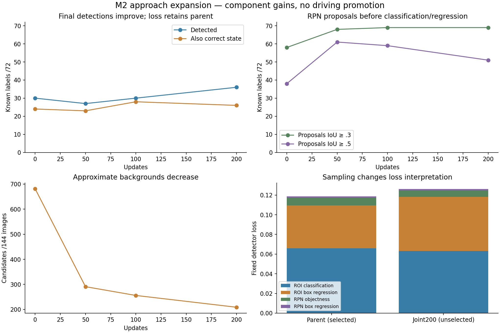

# M2 approach expansion — 16 October 2026

Later continuation: [ROI context adapter and state alignment](navigation_m2_signal_roi_adapter_20261016.md)
selects a new component at44/72 detections/31 joint under a separately frozen
prospective rule. This run's original loss-based parent selection below stands.

**The new development candidate detects more lights, but the frozen loss rule
retains the original detector.** The driving policy is unchanged and M2 remains
open. No longer training repeat or automatic component promotion is scheduled.

Read after the [negative-refinement result](navigation_m2_signal_hard_negatives_20261016.md).
The [machine summary](navigation_m2_signal_expansion_20261016.json) verifies
sources, all1,800 original/supplement images, unchanged validation payload and
selected/frozen model tensors. The [protocol](navigation_m2_signal_expansion_protocol_20261016.md)
was frozen before capture and fitting.

## Broader TRAIN data with a fixed validation set

The original corpus has one incoming approach per junction at40/20/6m. Select
up to three light/incoming-lane approaches per original TRAIN junction in catalog
route-ID order, then capture32/12/2m views. Outgoing turns and scenario-family
duplicates do not count as new approaches. Exclude duplicate old/new poses and
keep≥1m clearance from every junction outside the original13 TRAIN groups.

All99 planned poses completed in100.03s:1,188 native512×288 RGB images,36 incoming
approaches across Town01–04. Same three cameras, exact-frame phase intervention,
physical-light identity and response-v2 label rules. All13 junctions respond;
116 light/view pairs pass (115 yellow), and12 junctions have responsive examples
on multiple incoming lanes. The fixed data gate passes without relaxation.

Append as an explicit TRAIN-only supplement: TRAIN images468→1,656 and positive
phase labels179→642. Retain440 verified negative phase copies from the earlier
110 canonical negatives. **Original validation remains144 images/72 labels at
the same four junctions**, byte-identical in RGB, sample identity, targets and
annotations. Its SHA256 is
`9ab66584c129e8a84a676512bad8b693dd9f82d2df5de2f1a8c74a3edcb0bd2f`.
Never run the seeded splitter on this smaller supplement; that would move roles.
Standalone supplement loading refuses it. These are correlated static labels,
not independent driving encounters or original-traffic visibility guarantees.

## Joint proposal/head adaptation

Start the original selected50 detector, not the rejected hard-negative latest.
Freeze backbone/FPN, ROI features and normalization buffers. Train RPN plus
binary box/class predictor:1,194,265 parameters, FP32 AdamW5e-4,batch2,200 updates
in109.48s;1.69GB peak GPU allocation. Independently sample original/supplement
with50/50 probability for each batch's positive/uniform image slot. Fixed robust
crop-state classifier, confidence.5 and1,000 RPN proposals; old ROI replay retained.

| Updates | Fixed loss ↓ | RPN IoU≥.3 /72 | Final IoU≥.3 /72 | Final IoU≥.5 /72 | Detected + correct state /72 | Approximate backgrounds /144 images | Protection |
|---|---:|---:|---:|---:|---:|---:|---|
| **0: selected parent** | **.118660** | **58** | **30** | **22** | **24** | **681** | Pass |
| 50 | .195660 | 68 | 27 | 21 | 23 | 291 | Fail |
| 100 | .178262 | 69 | 30 | 23 | 28 | 256 | Pass |
| 200: unselected candidate | .126094 | 69 | 36 | 25 | 26 | 209 | Pass |

Protection remains recall≥30,joint≥24,approximate backgrounds≤681; minimize the
pre-existing loss among eligible checkpoints. Latest200 passes protection but
loses on loss; **keep selected0**. Its tensors equal the original parent exactly.
This differs from the earlier classifier-only experiment, whose latest failed
recall protection. Keep the completed joint candidate as unselected evidence;
do not resume it or overwrite the selected artifact.

The joint candidate retains26 parent-detected labels, loses4 and gains10; higher
aggregate recall does not mean every old detection is preserved. Under8px
coverage13/40→15/40. Town01/03/04/10HD results are4/8,6/20,12/12,14/32 versus
parent4/8,6/20,12/12,8/32. RPN IoU≥.5 coverage38→51/72. RPN geometry is measured
before class/box refinement and is not a strict upper bound on final refined boxes.

These are development-component gains from combined data and parameter changes,
not an isolated data ablation, matched encoder comparison or driving improvement.
The72 labels are phase-correlated observations of four already inspected
development junctions.209 approximate-background candidates are still not
exhaustively verified false positives or a full detection AP measurement.



## Why loss and detection disagree

The [fixed loss audit](navigation_m2_signal_loss_audit_protocol_20261016.md)
reproduces both saved totals exactly in21.49s, with no fitting or new selection.

| Loss term | Parent | Joint200 |
|---|---:|---:|
| ROI classification | .066034 | .063204 |
| ROI box regression | .043388 | .054930 |
| RPN objectness | .008110 | .006782 |
| RPN box regression | .001128 | .001179 |

The ROI box term drives the total increase. A separately frozen
[sampler-count audit](navigation_m2_signal_sampling_audit_protocol_20261016.md)
finishes in19.76s and reproduces both totals again. Both models sample9,216 ROIs,
but positive samples rise171→222. Mean SmoothL1 per positive falls2.33836→2.28034.
The reported ROI box loss sums positive residuals and divides by **all** sampled
ROIs, so the larger positive count raises it. The sampled populations differ;
this is not a controlled physical localization-error comparison. Preserve the
original selection despite this diagnostic finding.

Shared frozen GT-ROI features give binary foreground acceptance23/72→29/72 at.5.
Town03 remains3/20. These use privileged exact boxes, not runtime detection or
precision. Tight GT and predicted ROIs contain different context, so acceptance
is not a detector ceiling. Results point toward head/feature/context
generalization as a remaining issue without isolating its cause.

Three-view FP32 model timing is181ms mean/200ms p95 for latest200, excluding full
pipeline work. Current camera policy updates its recurrent model at10Hz; a
configured5Hz planner is not evidence that this detector has been integrated at
that cadence. No asynchronous or real-time deployment claim is made.

## Artifacts and next work

- Supplement: `outputs/navigation_m2_signal_expansion_20261016`, including immutable
  data/attachment audits and per-pose metadata. Completed; do not duplicate.
- Joint fit: `outputs/navigation_m2_signal_joint_expansion_20261016`.
  `best_component.pt` selects0 and matches original parent; `latest.pt` is the
  completed, unselected200 development candidate. No driver consumes either here.
- Descriptive audits: `outputs/navigation_m2_signal_joint_loss_audit_20261016`
  and `outputs/navigation_m2_signal_joint_sampling_audit_20261016`.
- Retained detector: original `outputs/navigation_m2_signal_detector_20261016/best_component.pt`.
  Original camera policy/cache/crop-classifier hashes remain unchanged.

Rebuild aggregate/graph without GPU, fitting or changing original audits:

```bash
.venv/bin/python scripts/summarize_navigation_signal_expansion.py
```

Next target: TRAIN-only ROI context/scale robustness and limited ROI feature
adaptation, with a new prospective protocol and operational selection criterion
that accounts for this sampler-dependent loss. Do not retroactively select100
or200 from this inspected result. Preserve every current validation location,
fair tuning budgets and supervision counts. No blind longer repeat is justified.
Tracking, ego-route applicability and full stop/release memory still precede a
new overrides-off camera driving pilot. heldout_dev expert calibration and the
missed pre-student Town05 registration remain open; neither held-out suite was
used. Multi-hour work or driving reward/benchmark changes require approval.

305 CPU tests passed,2 skipped,64 historical AMP warnings in16.59s. Focused lint,
source/data/weight and validation-preservation checks pass. No job scripts changed,
no policy promotion and no push.

Final host check (2026-10-16 19:26 IST): no trainer/CARLA process, GPU0%/39°C,34.75GiB
free disk. Candidate SHA256
`a44f65acd4e3d2941c7f36e6dcc7e0f5d6a3853e3be6a7d1fbd691ed0370f1f9`.
All bounded jobs and audits completed; check live state again before future work.
