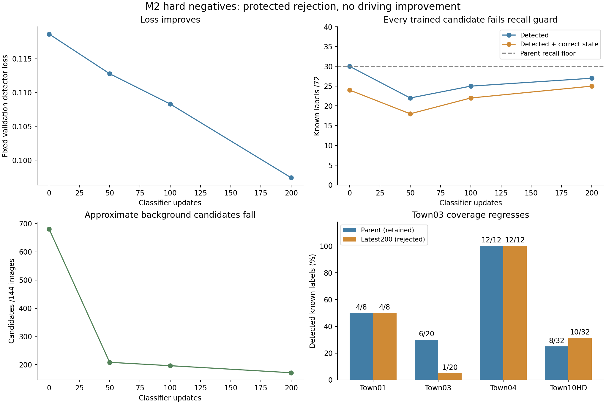

# M2 hard-negative refinement — 16 October 2026

Later continuation: [approach expansion and joint adaptation](navigation_m2_signal_expansion_20261016.md)
adds broader positive data and improves36/72 development detection, while the
frozen loss retains the parent. The rejected classifier-only results below stand.

**The refinement is rejected; the original detector and driving policy are retained.**
Background discrimination improved on these development images, but known-light
coverage regressed. This is a completed negative experiment, not a better driver
or an M2 gate pass. No further automatic calibration or longer repeat is scheduled.

Read after the [detector/crop result](navigation_m2_signal_detector_20261016.md).
The [verified machine summary](navigation_m2_signal_hard_negatives_20261016.json)
and [frozen mining protocol](navigation_m2_signal_hard_negative_protocol_20261016.md)
preserve every checkpoint outcome. All work here used component-TRAIN locations
and the existing four component-development junctions; heldout_dev and Town05
were unused. No driving benchmark, reward or inference threshold changed.

## What changed

Mine frozen parent predictions on117 red-phase TRAIN images. Exclude every padded
projected lamp region and require red/green/yellow/repeat appearance stability.
Keep at most two boxes per view. This produces118 canonical candidates in71 views
across13 junctions/four towns in12.63s. They are candidate negatives, not certified
labels merely because a geometric/photometric gate passed.

Initial enlarged RGB inspection mistook windows/building features and traffic
signs for real traffic lights. Registered semantic checks corrected this claim;
**no traffic-light inventory defect was established**. Preserve the original
`training_release.json` veto instead of rewriting its history.

The [semantic supplement](navigation_m2_signal_negative_semantics_protocol_20261016.md)
was frozen before the complete check. Capture33 TRAIN poses with three RGB and
three semantic cameras:99 RGB and99 semantic frames. Actual lens attributes,
frame IDs and image poses must match; the first attempt with invalid optics is
explicitly excluded. Each candidate's2px padded mask must contain neither
TrafficLight7 nor Unknown0, and its source/fresh RGB crop MAE must be≤10.
All118 pass the tag check;8 fail RGB correspondence and remain excluded.

Release110 canonical negatives across13 junctions: Town01/02/03/04 have8/28/37/37.
These yield440 correlated phase copies on264 TRAIN images and **zero validation
training targets**. The separate approved release is
`outputs/navigation_m2_signal_negative_release_20261016/release.json`, SHA256
`9a842d1179fadcea11cfdf2b4c6c3ae51d0ed2b662a3c49a0b97127f66df7077`.
Semantic masks are additional privileged training supervision, never policy inputs.
Traffic signs are negatives for this binary LIGHT detector only, not a stop-sign task.

## Protected fit and findings

Freeze backbone/FPN, ROI features, RPN, regression and normalization buffers.
Train only the2050 binary classifier parameters, with explicit positive/negative
ROI replay. Same FP32 AdamW5e-4, batch2,200 updates;97.51s actual wall time and
1.68GB peak allocated GPU memory. Keep confidence.5 and the existing loss.

The predeclared protection requires at least30 detections and24 joint correct
states, with at most681 approximate-background candidates. Minimize loss only
among eligible candidates, including the parent at step0.

| Classifier updates | Fixed validation loss ↓ | Detected IoU≥.3 /72 | IoU≥.5 /72 | Detected + correct state /72 | Approximate backgrounds /144 images | Protection |
|---|---:|---:|---:|---:|---:|---|
| **0: retained parent** | **.118660** | **30** | **22** | **24** | **681** | Pass |
| 50 | .112794 | 22 | 13 | 18 | 208 | Fail recall/state |
| 100 | .108309 | 25 | 16 | 22 | 196 | Fail recall/state |
| 200: rejected latest | .097397 | 27 | 18 | 25 | 171 | Fail recall |

The latest loses five parent-detected labels and gains two others. Town03 drops
6/20 to1/20; Town10HD rises8/32 to10/32. Under8px coverage drops13/40 to9/40.
The681→171 count is about75% fewer approximate background candidates, **not a
verified75% false-positive reduction**: sparse projected regions are not exhaustive
validation object labels or full detection AP. The72 labels are correlated phases
from four previously inspected development junctions, not72 independent encounters.



One [TRAIN-derived calibration rule](navigation_m2_signal_train_calibration_protocol_20261016.md)
then tested the smallest nonnegative foreground bias restoring the parent's
positive GT-ROI acceptance count. Shared frozen features,179 TRAIN positive
boxes and440 released negative copies; no validation examples fit the scalar.

| TRAIN ROI task at.5 | Parent | Latest200 |
|---|---:|---:|
| Positive boxes accepted /179 | 117 | 120 |
| Verified negative copies accepted /440 | 360 | 91 |

The rule chooses **zero bias** in16.45s. Reuse the exact latest200 evaluation;
there is no extra validation inference or identical checkpoint export. It still
fails the recall guard. This rules out this particular TRAIN-derived offset as
a remedy; it does not isolate appearance, proposals, localization or sampling as
the cause, nor establish that every calibration method would fail.

## Recovery and reproducibility

The first head-fit attempt was launched before inspecting a failing replay test.
It was stopped with its STOP file during initial validation at **zero updates**.
The bug was tuple mutation in torchvision's regression targets. Convert to a list;
all14 then-existing focused tests passed before the separate completed retry.
With the subsequent calibration regression,15 focused tests now pass. Earlier optical
wrapper-string copying, wrong helper import, and the overconfident visual label
diagnosis are corrected append-only in the journal. Failed/invalid outputs remain.

Completed evidence:

- Mining: `outputs/navigation_m2_signal_hard_negatives_20261016`.
- Semantic captures: `outputs/navigation_m2_negative_semantics_town01_20261016`
  through `town04`; explicit allowed-index release above.
- Fit: `outputs/navigation_m2_signal_hard_negative_fit_retry_20261016`.
  Its selected step0 tensors are byte-identical to the original step50 parent.
  Its `latest.pt` is rejected and must not be resumed as the selected component.
- Calibration: `outputs/navigation_m2_signal_train_calibration_20261016`.
- Retained detector: `outputs/navigation_m2_signal_detector_20261016/best_component.pt`,
  SHA256 `8df27ee218056e392cc5ddb0f50fef9263a1e8b81517b1d5ecbeba8038a6e49b`.

Rebuild the summary/graph without fitting, GPU or changing original audits:

```bash
.venv/bin/python scripts/summarize_navigation_signal_negatives.py
```

This verifies all612 original images, archived sources, semantic evidence hashes,
release membership, one-to-one predictions, frozen tensors, exact selected-parent
identity and unchanged camera-policy/cache/crop-classifier hashes.

## Next experiment

Broaden positive TRAIN coverage before another fit: several approach distances
and views per existing TRAIN junction, with registered visible-lamp labels and
the verified hard negatives. Preserve all four component-validation locations
and the driving-validation/held-out spatial guards. Freeze a fresh data protocol,
coverage audit, small wall-time cap and parent-protection criteria before fitting.
Then test limited joint proposal/head adaptation rather than repeating this
classifier-only run; report proposal recall separately from final detections.

Once perception is adequate, add temporal identity/state tracking, ego-route
signal applicability and complete7–14s stop/release sequences before another
overrides-off camera driving pilot. Current static components are too weak for
integration. COCO pretraining and semantic/geometry labels must be counted in fair
encoder/label budgets. The heldout_dev expert reference and late Town05 registration
remain open. Multi-hour work still requires user approval.

Final verification (2026-10-16 18:09 IST):300 tests passed,2 skipped,64 historical Dreamer
AMP warnings in15.78s. Targeted lint and diff checks pass. All recorded source
archives,612 original image hashes, selected/frozen tensors and unchanged policy/
cache/classifier hashes verify. Final anchored host check finds no trainer or
CARLA; GPU0%,42°C,35.33GiB disk free, above the25GB reserve. No multi-hour run,
jobs-script change or push.
