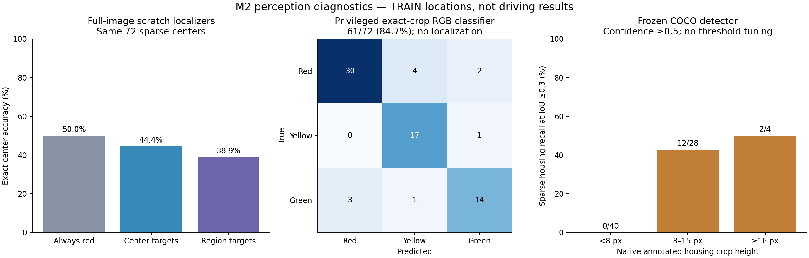

# M2 signal perception — 16 October 2026

Follow-up: [small-anchor adaptation and crop alignment](navigation_m2_signal_detector_20261016.md)
now improve the measured perception task. The results below preserve the earlier
negative baselines; no candidate is yet integrated into driving.

**Static supervision now passes its data gate. None of the perception prototypes
is ready for driving integration; M2 remains open.** The selected camera driving
checkpoint and original 20k cache are unchanged. No heldout_dev or Town05 data
was used, and there is no new closed-loop driving result.

The [machine assessment](navigation_m2_signal_perception_20261016.json) records
artifact hashes and source evidence. Reproduce it and the graph with:

```bash
.venv/bin/python scripts/assess_navigation_signal_perception.py
```



The panels measure different tasks. In particular, the exact-crop classifier
receives privileged annotations and cannot be compared as a deployable alternative
to a full-image localizer. All results use small, correlated development samples.

## From projected geometry to verified pixel changes

The [earlier audit](navigation_m2_rule_observability_20261016.md) found very small
light images and long stop events. The previously stuck owned server was resolved
after the user's approval: verify PID/executable/port/create-time, then one
additional SIGTERM. It exited; no force kill or duplicate server was used.
The cleanup record is in
`outputs/navigation_m2_signal_pixels_retry_20261016/graceful_cleanup_retry.json`.

The new static probe succeeds at four fixed TRAIN poses: 36 images, exact shared
frame IDs across three cameras, frozen lights, red/green/red controls. Spawn above
the road, disable physics, then set the recorded pose. GPU cameras need subsequent
render ticks before draining the requested frame; two extra ticks solve the
observed timeout without substituting a later frame. Exception-safe settings
restoration prevents a failed probe from leaving the server waiting for ticks.

Seven housing/view crops show clear bulb changes at three of the four poses.
The remaining pose has no clear phase response. This certifies a static change,
not visibility amid the original traffic or the applicability of a light to ego.
Images and controls are in
`outputs/navigation_m2_signal_pixels_retry3_20261016/signal_crop_pairs.png`.

The selected camera policy was loaded through production inference, with every
parameter checked against its checkpoint before and after. Branch an identical
recurrent history into repeated red, green and red-repeat frames. At the three
responsive poses its final green-probability changes are only +0.0165, −0.0480
and +0.0256 percentage points; the predicted class stays Red in every branch.
The red branches still request 5.01, 6.49 and 6.31m/s. This supports testing
localized perception, but static repeated frames do not establish a causal
explanation for every driving failure or pass the M3 rule counterfactual suite.
See `outputs/navigation_m2_signal_response_20261016/assessment.json`.

## Audited TRAIN-only phase corpus

Freeze 51 poses across 17 junctions and five training towns, at roughly 40/20/6m
before evaluator crossing lines. Use the original three-camera rig, 512×288 RGB,
red/green/yellow/red-repeat phases and seeded, frozen background lamp states.
This yields 204 sensor timestamps and 612 images. There are no action targets,
dynamic traffic, future-speed labels or driving outcomes in this collection.

The first completed corpus **fails** its predeclared gate: 56 responsive head/view
pairs across 15 junctions, but none in Town10HD. Its hue test rejects near-white
Town10HD green bulbs despite repeatable phase changes. Preserve that failure and
exclude it from fitting. A versioned response validator instead requires opposite
local on/off intensity changes, with repeated-red drift controls. Freeze it
before a fresh collection; retain the same five-town coverage/integrity gate.
See the [original protocol](navigation_m2_signal_pairs_protocol_20261016.md) and
[versioned replacement](navigation_m2_signal_pairs_protocol_v2_20261016.md).

The fresh corpus **passes**: 63 responsive head/view pairs, 62 also supporting
yellow, across 16 junctions in all five towns. Hash/decode/frame/map/physical
identity/background-state checks pass. A native Town10HD crash interrupted the
last three poses; exact-source recovery verified and skipped the four completed
towns, archived the failed directory and collected only Town10HD. Original
failed attempts and the recovery ledger remain in the output directories.

The original corpus is `outputs/navigation_m2_signal_corpus_retry2_20261016`;
the usable fresh corpus is `outputs/navigation_m2_signal_corpus_v2_20261016`.
The latter's frozen plan SHA256 is
`92335457bb8521593450eff76007a119e663a49b01c9820689b049b7c32c911e`.
Every phase/geometry label counts toward later supervision budgets; this is not
free unlabeled JEPA data. Annotation development inspected some TRAIN locations,
including locations later used in component validation.

## Bounded component results

The outcome-independent whole-junction split has 13 train and four validation
junctions: 468/144 images and 179/72 supported center labels. Validation junctions
are Town01_87, Town03_655, Town04_335 and Town10HD_468. These are development
locations inside TRAIN, separate from the existing driving-validation junctions.
Do not call this an untouched test or Town10HD zero-shot generalization.

| Experiment | Measured result | Decision |
|---|---|---|
| Always-Red reference | 36/72 centers, 50.0% | Reference reflects duplicated red-repeat phases |
| Native spatial CNN, center supervision | Selected step200: 32/72, 44.4%; background activation ≥.5: 9.38% | Reject integration |
| Same CNN, regional TRAIN supervision | Selected step1000: 28/72, 38.9%; background activation ≥.5: 2.99% | Reject integration |
| Exact annotated crop + linear RGB state classifier | 61/72, 84.7%; training179/179 | Privileged diagnostic, no detection or lane relevance |
| Frozen COCO detector + learned crop-state classifier | Housing recall IoU≥.3: 14/72; IoU≥.5: 8/72; detected-and-correct state: 14/72 | Reject integration |

Both spatial fits use 37,772 parameters, 1,000 updates, batch16, LR1e-3 and the
fixed foreground-CE +0.2 background-CE selection. They take 13.17s and 11.14s.
The regional experiment changes only TRAIN labels: all 612 RGB inputs, evaluation
masks, metadata and split indices were checked byte-for-byte against the archived
original builder. Later center-fit updates overfit; neither longer repetition
nor nearby activations establish usable traffic-light perception.

The oracle crop diagnostic uses native annotated housings resized to 16×32 RGB,
a fixed class-balanced L2 logistic regression and no tuning. It demonstrates
useful appearance evidence after localization; it is not a mathematical ceiling,
an isolated architecture ablation or a camera-only driver. Saved coefficients
reproduce the reported predictions exactly.

The reference detector uses official [torchvision Faster R-CNN ResNet50 FPN v2
COCO weights](https://docs.pytorch.org/vision/stable/models/generated/torchvision.models.detection.fasterrcnn_resnet50_fpn_v2.html),
with installed torchvision0.26.0, confidence≥.5 and IoU thresholds frozen before
inference. External supervised pretraining is declared; this is not a matched
JEPA comparison. Default resizing interpolates existing camera pixels. No change
was made to sensor resolution or evaluation inputs.

Of 40 supported validation housing/phase labels shorter than 8 native pixels, it detects
zero; at 8–15px it detects12/28, and at ≥16px2/4. These size buckets are descriptive
post-run diagnostics, not new gates. Three-view GPU inference averages182.7ms,
p95 195.3ms, excluding the first cold batch and data preparation. That exceeds
the 100ms interval of a 10Hz controller even before integration. Peak PyTorch
allocated memory is1.67GB. Sparse annotations do not support full detection AP
or labeling all134 predictions as false positives.

Artifacts: `outputs/navigation_m2_signal_grid_20261016`,
`outputs/navigation_m2_signal_grid_region_20261016`,
`outputs/navigation_m2_signal_oracle_crops_20261016`, and
`outputs/navigation_m2_reference_detector_20261016`. Each preserves source/data
provenance and results. None replaces `best_policy.pt`.

## Next M2 work

1. Build a small-object RGB proposal/state baseline trained on audited native
   housing crops, with explicit context negatives and unknown/occluded regions.
   Broaden TRAIN pose/lighting coverage before committing to long training;
   179 correlated training crops are insufficient evidence for a robust detector.
   Keep the existing whole-junction development split and report localization
   and state errors separately. Measure latency at native three-view resolution.
2. Track visual light identity/state over approach and stop/release transitions.
   Separately learn whether a detected signal applies to the ego route. Geometry
   and privileged state remain training labels, never undeclared runtime inputs.
3. Test continuous memory through complete 7–14s stops and release, with repeated
   red controls, missing-view periods and competing non-ego lights. Keep static
   component tests distinct from M3 overrides-off driving counterfactuals.
4. Only integrate a demonstrably better RGB component into a new stop/go student,
   then run matched TRAIN driving pilots with overrides off. Preserve every
   collision, violation, blocked failure and the protected parent. Obtain the
   new heldout_dev expert reference before its student comparison.

No multi-hour job, reward/benchmark change or higher-resolution/map-projected
runtime crop is authorized by these diagnostics. Town05 remains unused; freeze
its geometry/coverage before testing and disclose missed pre-student registration.
CARLA native crashes, sparse visibility labels, lane applicability and long-memory
behavior remain open. All bounded runs have exited; no queue needs restarting.
