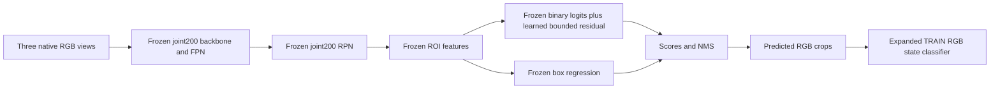
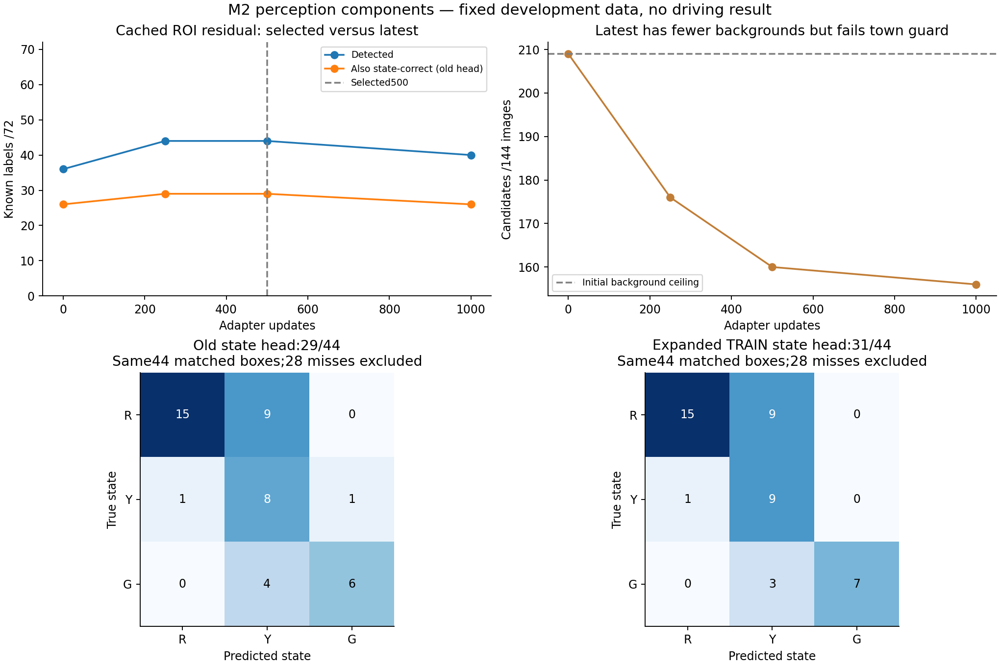
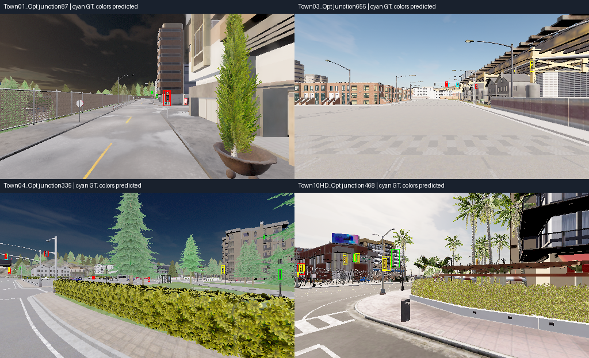

# M2 ROI adapter and state alignment — 16 October 2026

**A new perception component passes its prospective gate:44/72 lights detected,
31/72 detected with correct state, and160 approximate background candidates.**
This is development-component progress. The camera driving policy is unchanged;
M2, rule understanding and long-drive competence remain unproven.

Read after the [approach-expansion result](navigation_m2_signal_expansion_20261016.md).
The [verified JSON](navigation_m2_signal_roi_adapter_20261016.json) contains all
checkpoints, selection decisions, state confusions, source hashes and bundle.

## What changed and why

The joint detector covered69/72 labels with RPN proposals but produced36/72 final
detections. Its exact-GT ROI acceptance remained weak. Keep its proposal network,
visual/ROI features, old classifier and box-regression weights frozen. Add a
65,665-parameter nonlinear foreground correction: LayerNorm1024, Linear64, GELU,
Linear1, with fixed correction2*tanh(raw/2). Zero last-layer weights reproduce
the source logits and per-proposal box outputs exactly.



Final retained detections can change with scores/NMS even though box-regression
weights are fixed. Only the later state experiment keeps every final box fixed.

Cache30,824 **TRAIN-only**1024-d features:2,568 positive variants,1,760 verified
negative variants and26,496 unlabelled RPN proposals (first16/image). Positive
variants retain the whole source housing; negatives only shrink inside certified
boxes. Unlabelled proposals receive frozen soft-logit consistency, not asserted
negative labels. Four variants do not make four independent annotations.

Fit1,000 cached updates, supervised cross-entropy plus KL consistency, in147.61s
including cache/scoring; peak GPU1.94GB. Same144 validation images/72 labels and
13/4 whole-junction roles; all1,800 native images and30,824 cache rows verify.
The [protocol](navigation_m2_signal_roi_adapter_protocol_20261016.md) freezes one
recipe and a **new prospective component** selection rule, leaving prior runs'
loss-based selections unchanged. Initialization is explicitly the unselected
joint200 development checkpoint, not a retroactive promotion of it.

## Protected selection and results

Require recall≥36,joint state≥26,background≤209, every starting town recall and
under8px coverage preserved. A trained candidate must strictly improve recall
or joint count. Rank eligible improved candidates by joint,recall,-background.

| Adapter updates | Detected IoU≥.3 /72 | IoU≥.5 /72 | Detected + correct old state /72 | Approximate backgrounds /144 images | Fixed detector loss | Decision |
|---|---:|---:|---:|---:|---:|---|
| 0: joint initialization | 36 | 25 | 26 | 209 | .126094 | Reference |
| 250 | 44 | 35 | 29 | 176 | .106158 | Pass |
| **500** | **44** | **36** | **29** | **160** | **.105714** | **Selected** |
| 1,000 | 40 | 34 | 26 | 156 | .108428 | Reject: Town03 regression |

Selected500 retains all36 initialization detections and gains8. All detection
gains are at the previously inspected Town10HD development junction:14/32→22/32.
Town01/03/04 remain4/8,6/20,12/12. Under8px coverage15/40→20/40. This does not
establish broad town or encounter generalization. Latest1,000 drops Town03 to5/20;
fewer background candidates do not compensate, so **do not resume latest**.

CPU cached-TRAIN diagnosis: source positive GT acceptance545/642→592/642 and
certified negative acceptance124/440→27/440. Balanced CE falls.725→.301. Latest
improves TRAIN objective further (.311→.307) while development metrics regress.
These are TRAIN diagnostics, not deployment accuracy. RPN/visual/localization
tensors and normalization buffers are byte-identical to the initialization.

## Separate state fit on exactly the same predictions

Keep selected500 and all578 predictions/boxes/scores fixed. One
[state-fit protocol](navigation_m2_signal_state_expansion_protocol_20261016.md)
reuses the original16×32 RGB/C1 balanced L2 logistic recipe with642 existing TRAIN
phase labels and16 outward variants/source. Total source weight642, split321/321
between original/supplement. Fit0.880s;10.15s including preparation/audits.

| State task | Prior robust classifier | Expanded classifier |
|---|---:|---:|
| Same44 matched predicted boxes | 29/44 | **31/44** |
| Full known-label denominator | 29/72 | **31/72** |
| Original detector's fixed30 boxes, compatibility | 24/30 | **27/30** |
| Exact GT crops, privileged diagnostic only | 68/72 | **66/72** |

Accept by the predeclared predicted-ROI and compatibility criteria; disclose the
oracle regression. Exported coefficients reproduce sklearn exactly. All578 new
state estimates use RGB plus predicted boxes, with no labels at inference.
Independent one-to-one matching verifies the result; geometric assignments and
box/score identities remain unchanged.



State improvement is one yellow and one green correction. Red classification
does **not** improve:24 of36 red labels are detected;15 correctly red,9 yellow,
and12 missed. Zero of the24 matched reds is called green, but that restricted
count is not a safety result. Overall28 known labels are missed and13 of44
matched states are wrong. Approximate backgrounds remain160; sparse geometry is
not exhaustive precision or full detection AP.



These four examples are chosen by largest supported red housing per junction,
independently of model success. Cyan is annotation; colored outlines are inferred
states. They are static development views, not driving videos.

## Selected artifact and next work

Local bundle:
`outputs/navigation_m2_signal_state_expansion_20261016/perception_bundle.json`.

- Detector: `outputs/navigation_m2_signal_roi_adapter_20261016/best_candidate.pt`,
  selected500, SHA256
  `2dbd3e56c7de29c5f1b79c284f7fe0f704ec659e43b0a4885583ca2f108ee507`.
  Architecture `signal-detector-roi-residual-v1`; construct with
  `make_signal_detector(roi_adapter=True)` then strict-load its model state.
- State classifier: `outputs/navigation_m2_signal_state_expansion_20261016/expanded_rgb_linear.npz`,
  SHA256 `f4171de1e652e1f53b64089145e38dacd4a353199a4a097c3712d6c2259c17c4`.
- Rejected latest, cache, all source archives, optimizer/RNG, validation_step,
  requests, predictions and state-fit artifacts remain separate. No completed
  run should restart. No automatic source-changing resume is implemented here.

Rebuild evidence/graphs with CPU only, no refit or original-audit mutation:

```bash
.venv/bin/python scripts/summarize_navigation_signal_roi_adapter.py
```

Next: ground temporal identity/state tracking and ego-route signal applicability
on the existing TRAIN rollouts; measure full stop/release observability before
another policy fit. Red/yellow ambiguity and Town03 misses remain concrete weak
points. Never mine the illustrated component-validation errors into training.
Only after those checks, run a bounded overrides-off camera pilot. A better
component cannot establish learned rules or long-route collision avoidance.

Selected FP32 model-only three-view timing186.4ms mean/191.7ms p95 still needs
full-pipeline/cadence engineering. No real-time, asynchronous or driving claim.
All comparison stages have different supervised budgets/architectures and external
COCO features; this is not a matched JEPA experiment. Geometry/semantic labels
and tuning effort must count in later label-efficiency studies. heldout_dev expert
reference and late Town05 registration remain open; neither held-out suite used.

310 CPU tests passed,2 skipped,64 historical AMP warnings in17.19s. Source/data/
cache-row/selected-weight checks pass, original validation payload is byte-identical,
and original camera policy/cache/detector/state artifacts are unchanged. No job
scripts, driving benchmark/reward, multi-hour run, policy promotion or push.

Final host check (2026-10-16 19:58 IST): no trainer/CARLA, GPU0%/42°C,34.37GiB free disk.
Progress snapshots now distinguish rejected latest1000 (40/26) from selected500
(44/29 with the old state head), and show the accepted fixed-box bundle31/72.
All runs completed; check live state again before new work.
