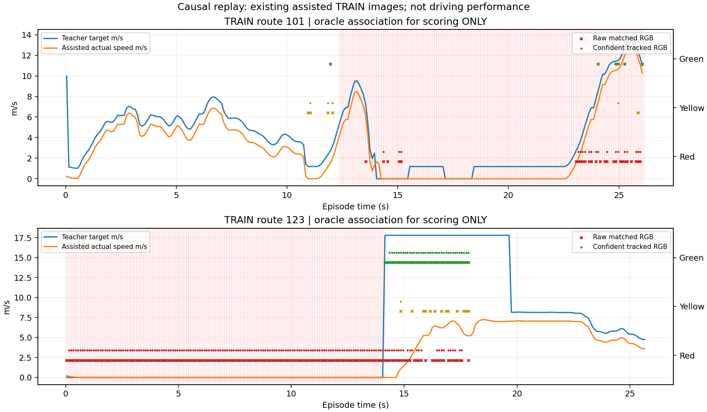

# Causal signal replay — 16 October 2026

The fixed TRAIN replay completed in118.99s. This is
perception/tracking evidence on existing assisted rollouts. **M2 remains open;
the camera driver is unchanged and no tracker is promoted.** No fitting,
simulator, new collection, held-out evaluation or threshold search was performed.

## Scope and split protection

Preserve all six original correction episodes. Exclude routes111/133 and their491
timestamps because Town03/655 is now component-validation. Four safe routes
remain (1,238 timestamps). Replay the two complete signal-bearing routes101/123:
518 timestamps/1,554 native RGB images. They contain440 known
applicable-state timestamps. These are correlated, familiar TRAIN examples,
not independent encounters or a new driving-validation result.

The frozen [protocol](navigation_m2_signal_temporal_protocol_20261016.md) predates
inference. The RGB wrapper verifies selected detector500 and expanded-state
artifact hashes. A causal, color-blind per-view geometric tracker compensates
ego heading and smooths probabilities. It reports Unknown before confirmation
or after stale evidence. It never confirms lane applicability or commands control.
Training/scoring imports are forbidden in the camera worker; inference modules
pass a fresh-process privilege-guard test.

## Identical-match state comparison

IoU>=.3 scoring matches current RGB predictions to clipped, projected housings
of the privileged applicable actor. There are1534 projected
housing/view/time targets and769 one-to-one matches. **Projection and
recorded actor phase do not certify visibility, facing or legibility.** No new
state labels are approved for fitting. GT association is scoring-only, so these
numbers do not measure selecting the correct light from the scene.

| State estimate | Correct / same matched targets | Additional coverage |
|---|---:|---|
| Current RGB argmax | 715/769 | Every match |
| Causal smoothed argmax | 721/769 | Every match |
| Confident smoothed state | 660/769 | 690 confident; 79 Unknown |

Matched red targets:610. Raw red-called-green:
6; confident tracked red-called-green:
0. Every Unknown stays in the denominator.
Smoothed argmax still calls one matched red target green; zero confident
red-called-green includes abstention and is not a safety result.
Consecutive matched housing pairs:734,
track-ID changes:133. These diagnostics do
not certify physical identity, lane applicability or safe driving.

| Complete TRAIN rollout | Known timestamps with a match | Raw correct / matches | Smoothed correct / matches | Longest known detection gap |
|---|---:|---:|---:|---:|
| 101 | 34/261 | 42/51 | 49/51 | 10.9s |
| 123 | 179/179 | 673/718 | 672/718 | 0.0s |



Red shading is the privileged applicable actor's phase, not perceived truth.
Markers show states only on scoring-associated detections; different heads may
disagree at one time. Absence of a marker means missing evidence, not permission
to proceed. The timeline is not a camera-policy rollout.

## Coverage and identity interpretation

The following analysis was added after inspecting the frozen replay; it does
not retune, select or rerun the tracker. Of133 scoring-associated track changes,
87 still have the older ID overlapping the same GT housing atIoU>=.3,21 have
the older ID active elsewhere, and25 have no current detection for the older
ID. Thus133/734 is **not** a calibrated physical identity-switch rate. Duplicate
overlapping hypotheses contribute substantially; stronger identity arbitration
needs its own prospective experiment.

Following route101 starts with its upcoming-light distance label113.1m and ends
at37.2m. The largest projected native housing is only2.0–4.1px tall (median2.7).
It records vehicle-caused stops, not a complete red-light approach/stop/release.
Route123 starts4.6m before its API reference, with8.1–13.8px housings, already
inside the teacher's red-stop intent. Its wait/release has evidence on179/179
known timestamps. The original labels use API/planner distance semantics, not
verified painted/evaluator stop-line distance. No depth enters inference.

**These two sequences do not cover a complete approach into the light stop.**
Coverage conditional on these distant/near cases must not become a new safety
gate or a claim that memory fixes the missing middle. Projection overlap still
does not certify facing or visibility. The JSON retains measured ranges and
the exact per-route identity decomposition.

## Stop/release and transition evidence

Teacher zero-speed runs are audited on all four split-safe episodes. Causes are
recorded diagnostics, not a complete causal explanation. In particular, the14.1s
light wait on123 begins at the first frame: **left-censored**. Its release is
recorded, but the pre-stop approach/onset is absent. Stop-sign/following holds
must not be relabelled as light behavior. See JSON for every event and endpoint.

| Route / phase transition | Raw first correct evidence | Smoothed argmax | Confident tracked state | Observed window |
|---|---:|---:|---:|---:|
| 101 Green→Yellow | 1.70s | 1.70s | 1.80s | 3.00s |
| 101 Yellow→Red | 1.20s | 1.20s | 2.00s | 3.00s |
| 123 Red→Green | 0.00s | 0.10s | 0.20s | 3.00s |

Transition delays use scoring-only GT association and any matching head. They
are not runtime applicable-light decisions or vehicle release times. Unobserved
means no correct associated evidence within the recorded window (up to3s).

FP32 perception plus tracking averages197.2ms per three-camera
timestamp,p95206.6ms. Shard decoding, scoring and IO are excluded;
this does not establish full-pipeline10Hz operation.

## Decision and remaining work

Keep the tracker as a diagnostic prototype. Next prepare a split-safe TRAIN
collection plan that records a moving approach, braking onset, complete wait
and release in the SAME episode. Begin before the40m region and retain at least
3s after release; include green/no-lead-car and red/green cases, crossing traffic
and stop signs as separate families. Audit actual encounter coverage and
left/right censoring before accepting data. Preserve collisions and interventions.

Before another policy fit, verify facing/visibility and ego-route applicability
targets on those TRAIN sequences. Do not turn unknown/occluded lamps into
negative state labels. Make near-identical duplicate-housing arbitration and
causal memory separate bounded hypotheses. At197ms per triplet, the perception
cadence/budget also needs a measured implementation; do not call this10Hz.
No repeated tracker tuning or long fit is scheduled. Keep the selected driving
parent/cache, heldout_dev and Town05 unchanged. The audit never promotes the tracker.

Reproduce this report with:

```bash
.venv/bin/python scripts/summarize_navigation_signal_temporal.py
```

It checks archived source/input hashes, selected artifacts, all518 predictions,
exact metric/transition reproduction and unchanged original driver/cache. Original
request, predictions and assessment remain in
`outputs/navigation_m2_signal_temporal_20261016`; the JSON report retains every
confusion matrix, transition, stop event and limitation.
