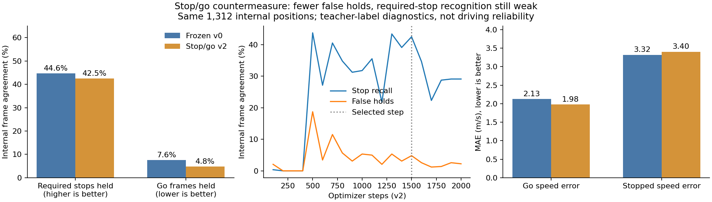
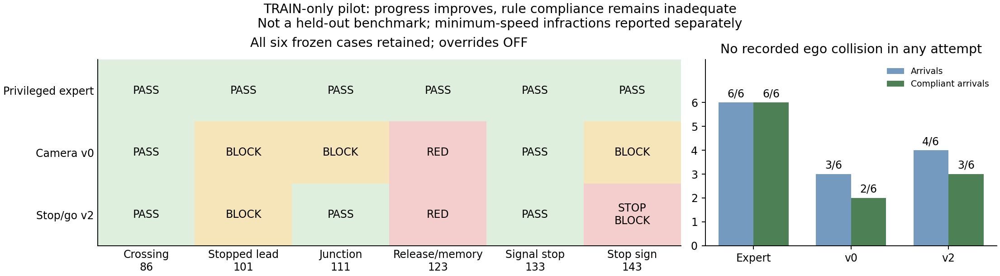

# Stop/go camera countermeasure — 16 October 2026

**M2 remains open; this model is not promoted.** The new policy increases compliant
arrivals from2/6 to3/6 in the fixed TRAIN pilot, but still runs a red light, adds a
stop-sign violation, and becomes blocked twice. The expert completes6/6 compliantly.
Offline required-stop recognition also does not improve. No reliable camera long
drive or learned-rule gate has been established.

The new `camera-stop-go-v2` shares the original scratch CNN and causal GRU. Nine
semantic stop logits cover the immediate decision and the eight future targets.
A predicted stop sets its corresponding target speed to zero; cruising-speed
regression is supervised only on nonzero-speed teacher targets. The original
actuator-brake head becomes a small auxiliary comfort-braking loss. Conventional
control still performs ordinary deceleration, with no forced crawl. Policy
inputs, optional rule layer (OFF), controller, route criteria and rewards are
unchanged. Future profiles remain auxiliary for actuation, as in v0.

Known next-light labels without a valid distance within80m are excluded from the
new light loss. This is a distance mask, **not** an audited visibility or occlusion
label. The reported light accuracy still uses all the same labels for comparison.

The fresh run used the existing audited raw-image cache and identical connected
junction split:50 training and13 internal-validation episodes. It completed2,000
steps in113.81s with batch2,32-frame clips, LR1e-4, AdamW and CUDA BF16. Timing
reuses the cache and is not comparable to v0's cache-building duration. Source
copies/hashes were saved at launch; latest contains full optimizer/RNG/sampler
state. The predeclared internal selection score was
`0.5*(missed-stop fraction + false-hold fraction) + 0.02*go-speed MAE`.
It selected step1,500; step2,000 is not the selected policy.

The comparison below evaluates that checkpoint and the unchanged v0 best300 on
identical32-frame windows, burn-in and1,312 supervised positions. It differs from
v0's earlier16-frame/1,352-position report. The countermeasure changes several
training choices and budget together; this is not a matched-compute or isolated
architecture ablation. No heldout_dev or Town05 sample enters this comparison.

| Matched internal diagnostic | Frozen v0 best300 | Stop/go v2 best1500 |
|---|---:|---:|
| Required-stop frames held | 250/560 (44.64%) | 238/560 (42.50%) |
| Go/nonbraking frames incorrectly held | 44/582 (7.56%) | 28/582 (4.81%) |
| Zero-ego-speed go frames held | 0/13 | 0/13 |
| Speed MAE | 2.621m/s | 2.583m/s |
| Go speed MAE | 2.126m/s | 1.980m/s |
| Stopped speed MAE | 3.320m/s | 3.402m/s |
| Applicable next-light accuracy | 50.38% | 35.21% |
| Applicable red-label recall | 78.54% | 41.57% |
| Lateral-correction MAE | 0.03632m | 0.04014m |
| Positive target-speed/brake co-occurrences | 347/1,312 | 0/1,312 |

Zero contradictions are guaranteed by the output design, not learned-rule
evidence. Both policies miss most required stops in this diagnostic. Neither
should be promoted based on small speed-error changes or lack of movement.
Positive speed plus actuator braking is not inherently wrong:987 training and268
validation teacher timestamps have that combination, all with actual speed above
the teacher target. Thus the347 co-occurrences are not347 proven actuator errors.
The real blocked v0 state is different: zero actual speed, positive requested
speed, and sustained braking. See the run's`teacher_braking_audit.json` and the
journal clarification of earlier broad "conflict" wording.
Detailed measurements, blanked-image diagnostics and matched simple baselines:
[assessment JSON](navigation_m2_stop_go_20261016.json).

Selected checkpoint:
`outputs/navigation_m2_stop_go_20261016/best_policy.pt`.
The original model remains loadable and was checked against its archived source:
identical weights produce bit-for-bit identical outputs and recurrent states.

## Closed-loop diagnostic protocol

Before observing this candidate's driving results, froze the first
geometry-eligible Town03 TRAIN route in each of six families:86 crossing/yield,
101 stopped lead,111 junction,123 release/memory,133 signal stop,143 stop sign.
Seed4242+route id, same routes/checkpoints, no overrides, all failures retained.
See [frozen pilot protocol](navigation_m2_stop_go_pilot_20261016.json).
This tiny TRAIN-location engineering pilot is not the development benchmark or
evidence of unseen-location generalization. Its videos remain diagnostic-only.

The initial pilot was stopped using STOP after a recorder bug was discovered.
The pinned local evaluator appends`.log` to `args.record` and reuses the prefix
for every route. This collided with the pilot console and would retain only the
last native recording per invocation. The stopped attempt, raw scores, videos
and world traces remain at`outputs/navigation_m2_stop_go_pilot_20261016`.
The lifecycle adapter now creates unique`recordings/route_ID_repN.log` files,
refuses overwrite and restores the upstream argument. Scoring and driving are
unchanged. The identical pilot restarts in a fresh retry directory; both raw
attempts must be considered when reporting recorded collisions.

Retry output: `outputs/navigation_m2_stop_go_pilot_retry_20261016`.
All18 scheduled trials finished; all training/simulator services exited.

| Fixed TRAIN pilot | Expert | Frozen v0 | Stop/go v2 |
|---|---:|---:|---:|
| Arrivals | 6/6 | 3/6 | 4/6 |
| Rule-compliant arrivals | 6/6 | 2/6 | 3/6 |
| Strict any-infraction-free arrivals | 3/6 | 1/6 | 2/6 |
| Blocked failures | 0 | 3 | 2 |
| Red-light violations | 0 | 1 | 1 |
| Stop-sign violations | 0 | 0 | 1 |
| Recorded ego collisions | 0 | 0 | 0 |

Rule-compliant arrivals use the existing criterion that reports minimum-speed
infractions separately; no criterion was changed. Every other recorded infraction
still counts. Zero recorded collisions includes the interrupted initial attempt
(24 raw records total). It does not establish safe driving. This small, familiar
geography pilot cannot provide a generalization estimate or justify a new pass bar.

Both camera policies cross the release/memory case before the bound light turns
green: its audit traces contain only Red. Both succeed in the separate signal-stop
case that includes a red-to-green transition. V2 completes junction111, where v0
blocked, but still blocks in stopped-lead101, now at62.46% versus48.75% for v0.
In stop-sign143, v2 records a stop infraction and then blocks at98.11%, about2.76m
from the registered endpoint. That is a failed mission, not a near-enough arrival.
At the two blocked states, its target is zero and stop probabilities are about
0.93 and0.72. Thus consistent outputs alone do not solve inappropriate stopping.

The measurement audit passes independently of the poor model result:18 complete
H.264/yuv420p videos decoded13,317 frames;18 distinct native recordings have valid
headers; console text and archived source hashes verify. All26,623 recorded ego
centres map to approved TRAIN junctions, with zero partition violations. This is
not proof of complete visual/geographic independence. Scenario start and physical
signal identity audits pass, with observed signal-state counts retained.
See [audited pilot JSON](navigation_m2_stop_go_pilot_audited_20261016.json).

The pilot's generic`camera_cnn_gru_map_ego_v1` tag was inherited by both variants;
the actual model was selected by its checkpoint architecture and verified SHA.
After evaluation, future manifests/traces were corrected to carry the validated
checkpoint variant and selected step. This metadata change has no control effect;
old raw records retain their original tag.

## Release coverage and streaming memory

Across all14,745 training positions,308 stationary frames have a go target and
no teacher braking, but only85 occur after the first five seconds of an episode.
There are68 zero-to-go target transitions across50 training episodes. The
validation equivalents are69/30 frames and16 transitions. These are coverage
counts, not independent samples; exact definitions/per-episode counts are saved
under the run's`release_coverage_audit.json`.

An additional paired check carries hidden state across complete internal
validation episodes, burning the first16 frames only once per episode. On the
same2,614 positions, v0/v2 stop recall is500/1,098(45.54%) versus476/1,098(43.35%);
false holds116/1,202(9.65%) versus50/1,202(4.16%). V2 holds2/30 stationary go
positions versus0/30 for v0. This remains teacher-trajectory validation, not
student-state coverage. It does not prove recurrent drift caused the real failures.
The script and corrected results are preserved under the run. An initial extra
diagnostic omitted loading weights; its output/source are explicitly named
`invalid_unloaded_model`, retained and excluded from every result above.

Verification after the final metadata change:237 CPU tests passed,2 skipped;
changed-file lint/format and whitespace checks pass. Original training sources
remain frozen and verified. No reward, benchmark, heldout_dev or Town05 changes.

## Remaining work

Improve rule-critical perception with audited localized/applicable signal labels
and stop-line supervision; the80m mask alone did not establish competent light
reading. Validate full stop-and-release events with streaming memory. Collect
fresh DAgger corrections at blocked, near-goal and stop/release states only on
approved TRAIN geography, recording requested,
expert and executed actions plus privileged interventions/censoring. Do not use
the old long-route diagnostic as imitation data. Retain centreline-only control
as a path baseline and complete time-profile tracking before claiming planning.

The separate heldout_dev suite needs its expert reference before student testing.
Town05 remains unused; freeze its geometry/coverage suite before testing and
disclose that the intended pre-student registration was missed. No long repeat
of this candidate is justified by the internal results alone.
