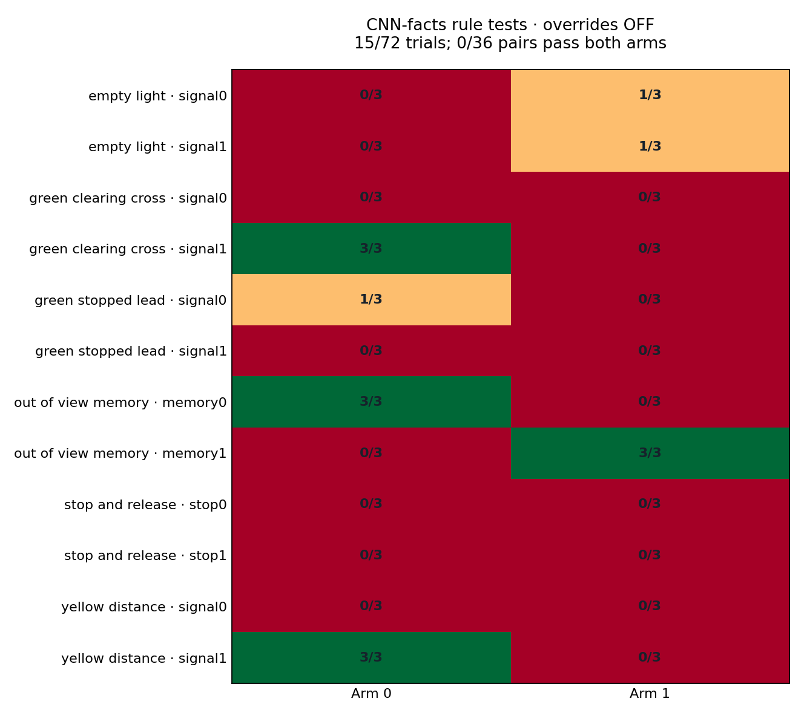

# Frozen camera primary: rule counterfactual results

The original CNN-facts primary passes **15/72** override-disabled component trials. All72 have complete evidence; **22 unfiltered contact starts across9 trials**, 15native red-light violations and5native stop-sign violations are retained. The independent actuation audit verifies72recorders, zero control differences and zero missing acknowledgments. The model fails the M3gate and is not promoted.

| Rule family | Passed / planned |
|---|---:|
| empty_light | 2 / 12 |
| green_clearing_cross | 3 / 12 |
| green_stopped_lead | 1 / 12 |
| out_of_view_memory | 6 / 12 |
| stop_and_release | 0 / 12 |
| yellow_distance | 3 / 12 |

**Both counterfactual arms pass in 0/36 location–seed pairs.** Passing one arm is insufficient to demonstrate that the agent responds correctly to the changed rule or obstruction.

The memory result is location dependent: memory0holds for all3red-history trials but fails all3green departures; memory1fails all3red holds but passes all3green departures. This is consistent with a location-dependent stop/go tendency, not demonstrated use of light history. Stop-and-release scores0/12; failures include both remaining stopped and missing a compliant physical stop. Obstacle-arm contacts account for all22observed contact starts.

These trials use certified scripted setup followed by unchanged camera controls. They do not establish long-route success. There are only two locations per family, with repeated seeds; do not treat72trials as72independent locations. The separately preregistered structured stop correction was frozen before these outcomes and does not train on or reselect from this suite.

## Physical-arm grid

Each cell shows passes over the original3seeds. Arm numbers refer to the immutable certified case definitions.

Source: `outputs/navigation_rule_followthrough_v3_20261020/student/assessment_1792482786065488459/assessment.json` (SHA256 `ddbde9873607b063e84251e3a9d7b40e88f8cae7b4043cc32bbe20c83c6d8477`).
