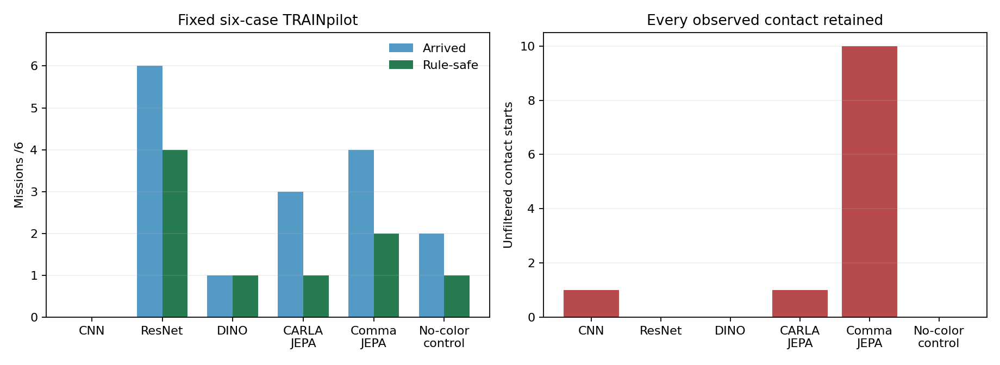

# Corrected encoder study: matched native pilot results

The frozen full-label seed42heads have all completed their original bounded pilots. Keep all30main planned cases:27have native outcomes and3remain unknown failures. The original comma primary is reused, not rerun or reselected. A separate six-case no-color control follows the five-encoder comparison.

| Encoder | Arrived /6 | Rule-safe /6 | Strict /6 | All contacts | Red / stop | Unknown failures |
|---|---:|---:|---:|---:|---:|---:|
| Scratch CNN | 0 | 0 | 0 | 1 | 1 / 0 | 2 |
| ImageNet ResNet18 | 6 | 4 | 3 | 0 | 1 / 1 | 0 |
| DINOv2-S | 1 | 1 | 1 | 0 | 0 / 0 | 1 |
| CARLA JEPA | 3 | 1 | 0 | 1 | 2 / 0 | 0 |
| Comma JEPA (primary) | 4 | 2 | 2 | 10 | 2 / 1 | 0 |
| Comma JEPA, no-color control | 2 | 1 | 0 | 0 | 1 / 0 | 0 |

No model passes all six cases safely. ResNet6/6arrivals/0contacts is useful engineering evidence but still includes one red and one stop-sign violation. The original comma primary completes4/6with10unfilteredcontactstarts,2red/1stop. The no-color control completes2/6with0observedcontacts and1red; it does not establish an improvement over the primary or justify replacing it.

CNNhit the original900s wall cap with4native outcomes and2unexecutedcases; DINOhas5native outcomes and1unexecutedcase. These stay failures in the denominator. Observed zero contacts never certifies an unexecuted case safe. No case retry, replacement or extra wall budget. The earlier cold-start/fact M2variants remain separate experiments and are excluded from this matched table.

The label-efficiency study uses55TRAINepisodes/15712labels, the unchanged13VAL/2822 timestamps and matched downstream update budgets. Comma has the best mean full-label offline score(.3755) but does not yield the best native result. This selection/deployment gap is a result to report, not a license to reselect from evaluation outcomes. Differing external pretraining histories remain disclosed.

All pilots used the original v1policy boundary. The user-approved compact recording/storage activation occurred between the original comma run and remaining heads: final-only recording gates leave these nonfinal videos full, and disk minimum changed25→10GB. Policy/physics/scoring equations remain the same; three archived recording/registration module identities differ. The actuator-v2extension was applied only after the entire matrix finished.

One checkpoint seed and six familiar correlated TRAINcases cannot establish population safety or significant encoder superiority. All full raw attempts, contact recorders, failed videos, source archives and selectors remain retained. The300encounter camera gate, robust rule behavior and M5planner evidence remain open.
