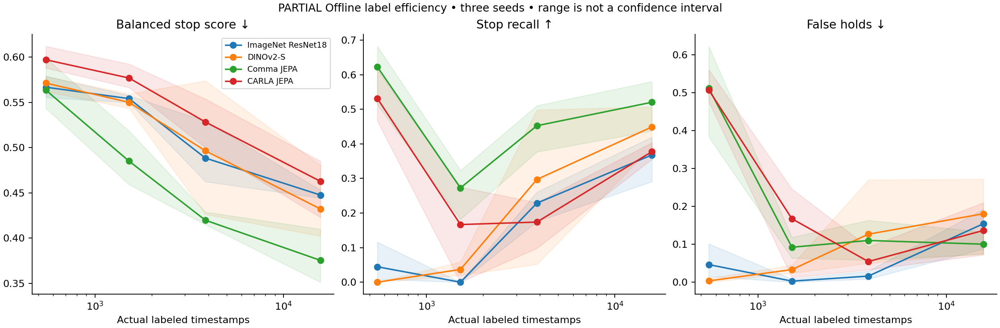

# Partial Corrected encoder study —20 October2026

52/67 registered fits verified. Offline results do not establish safer driving.

| Encoder | Labels | Score | Stop recall | False holds | Go MAE | Fit wall(s),3 seeds |
|---|---:|---:|---:|---:|---:|---:|
| ImageNet ResNet18 | 549 | 0.5668 | 4.5% | 4.6% | 3.295 | 203.8 |
| ImageNet ResNet18 | 1516 | 0.5541 | 0.0% | 0.3% | 2.636 | 166.8 |
| ImageNet ResNet18 | 3857 | 0.4885 | 22.9% | 1.6% | 4.737 | 160.7 |
| ImageNet ResNet18 | 15712 | 0.4477 | 36.8% | 15.4% | 2.728 | 179.0 |
| DINOv2-S | 549 | 0.5713 | 0.0% | 0.3% | 3.478 | 199.4 |
| DINOv2-S | 1516 | 0.5501 | 3.7% | 3.3% | 2.595 | 149.3 |
| DINOv2-S | 3857 | 0.4965 | 29.7% | 12.7% | 4.086 | 154.8 |
| DINOv2-S | 15712 | 0.4323 | 44.9% | 18.0% | 3.327 | 167.5 |
| Comma JEPA | 549 | 0.5636 | 62.3% | 51.1% | 5.957 | 193.0 |
| Comma JEPA | 1516 | 0.4851 | 27.3% | 9.2% | 3.767 | 163.7 |
| Comma JEPA | 3857 | 0.4198 | 45.2% | 11.0% | 4.552 | 128.8 |
| Comma JEPA | 15712 | 0.3755 | 52.0% | 10.0% | 4.277 | 136.6 |
| CARLA JEPA | 549 | 0.5971 | 53.2% | 50.7% | 5.470 | 181.0 |
| CARLA JEPA | 1516 | 0.5769 | 16.7% | 16.7% | 3.831 | 150.0 |
| CARLA JEPA | 3857 | 0.5283 | 17.4% | 5.4% | 4.398 | 121.0 |
| CARLA JEPA | 15712 | 0.4628 | 37.7% | 13.6% | 4.168 | 126.0 |

Three-seed ranges are descriptive, not confidence intervals. Actual label fractions are3.49/9.65/24.55/100%, 549/1516/3857/15712timestamps. Corrected55TRAIN episodes; unchanged13VAL/2822timestamps. Prior contaminated study is preserved separately. ImageNet external labels/DINO data scale and pretraining/latencies are disclosed; downstream updates match, total compute does not. Common photometric fields use no local annotations; no full-label head is inherited. All component controls and the random-ViT diagnostic are in JSON. Native driving qualification remains pending.
