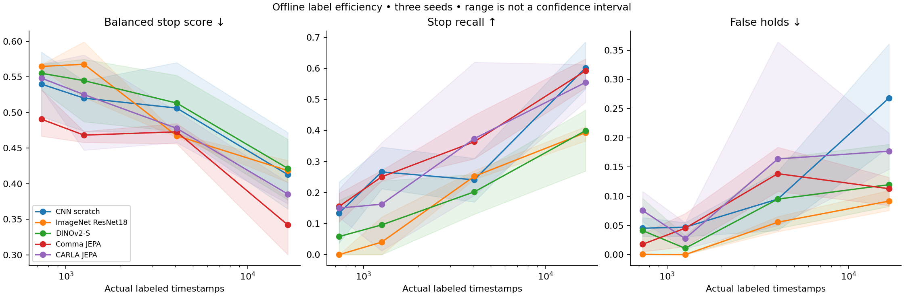

# Matched encoder study —19 October2026

66/66 registered fits verified. Offline results do not establish safer driving.

| Encoder | Labels | Score | Stop recall | False holds | Go MAE | Fit wall(s),3 seeds |
|---|---:|---:|---:|---:|---:|---:|
| CNN scratch | 733 | 0.5398 | 13.4% | 4.5% | 4.207 | 645.7 |
| CNN scratch | 1257 | 0.5202 | 26.7% | 4.7% | 6.501 | 419.9 |
| CNN scratch | 4069 | 0.5062 | 24.1% | 9.5% | 3.958 | 506.2 |
| CNN scratch | 16639 | 0.4126 | 60.2% | 26.8% | 3.976 | 633.7 |
| ImageNet ResNet18 | 733 | 0.5646 | 0.0% | 0.1% | 3.217 | 104.8 |
| ImageNet ResNet18 | 1257 | 0.5677 | 4.0% | 0.0% | 4.396 | 84.2 |
| ImageNet ResNet18 | 4069 | 0.4673 | 25.2% | 5.6% | 3.285 | 78.8 |
| ImageNet ResNet18 | 16639 | 0.4183 | 39.3% | 9.2% | 3.447 | 91.4 |
| DINOv2-S | 733 | 0.5550 | 5.8% | 4.1% | 3.179 | 90.6 |
| DINOv2-S | 1257 | 0.5447 | 9.6% | 1.1% | 4.358 | 60.6 |
| DINOv2-S | 4069 | 0.5132 | 20.2% | 9.5% | 3.343 | 84.8 |
| DINOv2-S | 16639 | 0.4214 | 39.9% | 12.0% | 3.065 | 76.5 |
| Comma JEPA | 733 | 0.4905 | 15.5% | 1.8% | 2.967 | 96.6 |
| Comma JEPA | 1257 | 0.4682 | 25.1% | 4.5% | 3.542 | 69.2 |
| Comma JEPA | 4069 | 0.4728 | 36.4% | 13.9% | 4.269 | 81.2 |
| Comma JEPA | 16639 | 0.3421 | 59.2% | 11.3% | 4.091 | 91.1 |
| CARLA JEPA | 733 | 0.5482 | 15.0% | 7.6% | 4.270 | 96.5 |
| CARLA JEPA | 1257 | 0.5252 | 16.2% | 2.7% | 4.633 | 60.7 |
| CARLA JEPA | 4069 | 0.4778 | 37.4% | 16.4% | 4.138 | 81.8 |
| CARLA JEPA | 16639 | 0.3854 | 55.5% | 17.7% | 3.713 | 91.8 |

Three-seed ranges are descriptive, not confidence intervals. Actual label fractions are4.41/7.55/24.46/100%. ImageNet external labels/DINO data scale and pretraining/latencies are disclosed; downstream updates match, total compute does not. Common photometric fields use no local annotations; no full-label head is inherited. All component controls are in JSON. Same-architecture random-ViT diagnostic and native driving remain pending.
