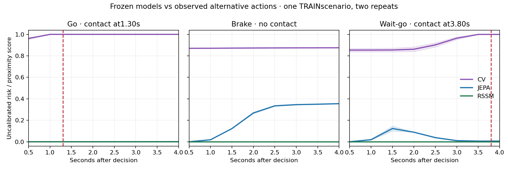

# Frozen-plan collision diagnostic

Both repeats produce the same contact pattern: go hits at1.30s, brake has no contact over4s, and wait-go hits at3.80s. All4unfiltered contact starts are counted. Independent replay/control audits pass.

The original three-member JEPA and RSSM exports both miss all14positive horizons at the fixed.5diagnostic threshold. CVmisses none, but exceeds.5on all34negative horizons. CVproximity and balanced neural sigmoid scores are uncalibrated; neither output supports a safety probability claim.

| Executed option | Observed contact | CV4s score | JEPA4s score | RSSM4s score |
|---|---|---:|---:|---:|
| go | 1.30s | 1.0000 | 0.0015 | 0.0000018 |
| brake | None in4s | 0.8751 | 0.3548 | 0.0000004 |
| wait_go | 3.80s | 0.9995 | 0.0066 | 0.0000003 |

JEPAreverses the observed braking/go risk ordering. The shared frozen-ego collision-only cost selects center-path stop for CVin all6contexts, while both learned models select left-offset/faster. That latter option was not executed, so its actual outcome is unknown; no fabricated full-grid ranking result.

These are post-hoc engineering diagnostics, not final M5qualification: one stationary TRAINlead, three observed options, two correlated repeats, CPUFP32 rather than the original GPUBF16forward, and different CV/learned perception pipelines. Red costs remain unsupported. No update, tuning or promotion.

A subsequent source audit finds157positive training/validation horizons in only 4episodes: two noisy and two expert. Two of3TRAINcollision episodes are rear impacts with near-stationary ego. All144positive horizons with an input before the first event include braking;136also include controls after that event. This supports a distribution/causal-model concern but does not prove the cause of the inverted predictions. Keep rear impacts in every headline count.

Next: collect diverse action-intervention outcomes at strictly separate TRAIN locations and stage20Hzfirst-event prediction. Mask losses after first contact or privileged intervention so reaction controls cannot inform a scored earlier event. Preserve existing models/targets. No new fit until data/splits, matched baselines and calibration protocol are registered.

Raw evidence: `outputs/navigation_fixed_plan_diagnosis_20261020/assessment.json`, `predictions.json`; `outputs/navigation_action_confound_audit_20261020/assessment.json`.
