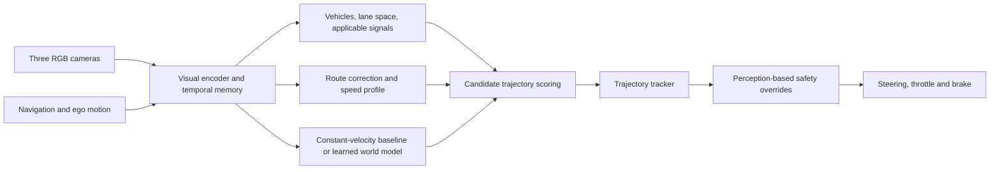

# Camera world-model navigation: full reviewed plan (user-supplied text)

Verbatim plan the user approved on 2026-10-08 after the external review, and
asked to be kept in mind for all navigation work. The condensed working version
is [navigation_plan.md](navigation_plan.md); where they differ in detail, this
file states the intent. Branch: `experiment/camera-world-model-navigation`.

## 1. What changes after this review

**I agree with the review's main recommendations.** The project should establish reliable driving early, then demonstrate whether JEPA and predictive planning improve it. My previous plan delayed the first useful demonstration and gave the world model an insufficient baseline.

Adopt:

- PDM-Lite as the privileged teacher, subject to local validation.
- An existing CARLA evaluation harness.
- Encounter-focused training, with long routes as integration tests.
- Separate path and speed prediction.
- Strong encoder baselines and label-efficiency experiments.
- Constant-velocity forecasting as the baseline for learned predictive planning.
- Off-policy experience and rule counterfactual tests.

Several claims need qualification:

- **Teacher quality matters, but imitation is not mathematically capped at teacher performance.** The practical problems are imperfect demonstrations, distribution shift, and a teacher acting on information unavailable to the student.
- **PDM-Lite's reported 97.02 Driving Score is not 97% success.** The cited table reports **92.27% success**, on a different benchmark. We must measure its performance locally. [Reported results](https://arxiv.org/html/2603.25946v1)
- **The reliability calculation is illustrative.** 0.967¹² ≈ 0.67, but our right-turn trials do not establish independent, equally difficult urban encounters.
- **Compute estimates need profiling.** Three-camera, temporally pooled FP16 features occupy approximately **14.75 GB at 128×128**, or **33.18 GB at 256×144**, per 100,000 timestamps. Videos, checkpoints and additional encoder caches are extra.
- **The existing JEPA predictor needs architectural work.** It averages action embeddings over time and predicts masked parts of a clip. Enabling its action flag does not create a causal future world model. Predictor implementation (`src/jepa/predictor.py:161`).

## 2. Driving architecture and boundaries

The evaluated system uses three RGB cameras, declared navigation waypoints and ego-motion information. Simulator actor states, ground-truth traffic-light states and hazard labels remain restricted to collection, training and scoring.

**First camera student:** one compact CNN backbone, temporal memory, perception heads and imitation heads. Predict a correction to the navigation path separately from an eight-point speed profile over four seconds. Use conventional tracking and explicitly reported rule/safety overrides.

**JEPA stage:** replace the visual backbone with spatial JEPA features and subsequently test its action-conditioned predictor as the world model. Retain a common high-resolution signal-perception component across encoder comparisons; measure how much performance depends on that component.

**Planning comparison:** use the same grid of path and speed candidates, controller, perception and cost definitions for constant-velocity, RSSM and JEPA predictors. Start with three path proposals × five speed profiles. A learned model is promoted only when development results justify replacing the simpler planner.

**Interfaces:** retain `SensorPacket`, training-only `TrainingTargets`, `TrajectoryPlan`, `ControlCommand` and `MissionResult`. Record requested controls, executed controls and intervention reasons separately.

The Leaderboard interface supplies useful sensor validation and frame synchronization, but does not itself prevent Python agents from accessing simulator state. Put camera-policy inference behind a separate process boundary carrying only approved inputs, with import and payload checks. Dense navigation remains explicitly declared; these custom experiments will not be presented as official sensors-track submissions.

## 3. Revised milestones

| Milestone | Deliverable | Completion evidence |
|---|---|---|
| **M0 — Harness and expert** | Pin compatible CARLA Garage/PDM-Lite and Leaderboard/ScenarioRunner revisions; integrate the three-camera rig; validate scoring and repeatability. | Expert long-drive video, measured encounter performance, camera throughput and passing evaluator tests. |
| **M1 — Data engine** | Collect short encounters across Town01–04 and Town10HD, initially 20k timestamps. Use atomic shards and preserve failures. | Audited coverage, valid synchronization, resumable collection and measured storage cost. |
| **M2 — Camera driving** | Train the compact imitation student; add student-state expert corrections. | First camera long-route evaluation and uninterrupted video, alongside encounter results and confidence intervals. |
| **M3 — Rule behavior** | Run paired counterfactual scenarios with engineered rule and emergency overrides disabled. | Pass/fail grid, failure videos and an explicit measurement of dependence on overrides. |
| **M4 — JEPA contribution** | Continue JEPA pretraining on training-town video; run controlled label-efficiency comparisons. | Performance versus labels, downstream compute and latency, including negative results. |
| **M5 — Predictive planning** | Compare constant-velocity, RSSM and causal JEPA prediction; validate rejected actions through resimulation. | Better development safety without reduced completion, plus prediction-calibration results. |
| **M6 — Final evaluation** | Evaluate registered candidates on the frozen Town05 suite. | Complete results, expert-relative comparisons, all collisions and uninterrupted successful/failed runs. |

M0 will reuse the [CARLA Garage `leaderboard_2` integration](https://github.com/autonomousvision/carla_garage/tree/leaderboard_2). Its expert uses modified collection infrastructure, so verify that expert and student evaluations share the same scenario and scoring semantics.

Two upstream behaviors require adaptation: broad force-kill cleanup in the Bench2Drive launcher, and PDM-Lite's removal of actors with invalid bounding boxes. Use the project's controlled lifecycle; any actor-validity exclusions belong in the shared, predeclared scenario setup. [Launcher](https://github.com/Thinklab-SJTU/Bench2Drive/blob/main/leaderboard/leaderboard/leaderboard_evaluator.py), [expert implementation](https://github.com/autonomousvision/carla_garage/blob/leaderboard_2/team_code/autopilot.py)

**Dreamer remains a secondary research arm**, scheduled after the camera baseline works. First complete checkpoint recovery state and investigate the 150k collapse. Then test encounter-based BEV learning with demonstrations and explicit rule rewards under a separately approved contract. Replace the teacher only after measured development improvement. Reward-trained behavior still needs the same counterfactual tests.

## 4. Experiments and tests that make the results credible

**Encounter and route evaluation**

- Train on Town01–04 and Town10HD; reserve Town05 from training, pretraining and model selection.
- Freeze **300 development encounters**, balanced across signal stopping, signal release/memory, stop signs, crossing/yielding, following/stopped vehicles, and route/junction geometry.
- Keep encounters normally 20–40 seconds; include longer waits where signal timing requires them. Do not truncate legitimate waiting into automatic failure.
- Generate twelve Town05 routes of 1–3 km, each with three traffic seeds. Require coverage across all five mapped stop-sign locations and at least 30 stop-sign and 30 red-light opportunities across the suite. Verify actual runtime signs and applicable lanes.
- Hash routes, scenario settings and analysis rules before student results. Expert failure does not justify removing a scenario.
- Report safe completion, collision counts/types, infractions per kilometre, rule violations per opportunity, blocked time, interventions, comfort and latency. Driving Score is supplementary.

The previous **33/36 completion with zero collisions/rule violations** remains a stretch target, not a statistical safety guarantee. Zero failures in 36 independent missions still permits an approximately 8% failure probability at the one-sided 95% bound. Even zero in 300 encounters only brings that bound to approximately 1%, before accounting for clustering.

Use paired scenario comparisons, exact McNemar tests where appropriate, and confidence intervals clustered by scenario/location. Report expert-relative gaps without using fault attribution to remove collisions.

**Rule counterfactuals**

Test all six proposed families: empty red versus green; green with a stopped lead vehicle; a red light leaving the camera view; yellow at different stopping distances; stop-and-release at an empty stop junction; and green while cross traffic clears. Compare the complete system with the learned policy operating without engineered rule enforcement or emergency overrides.

**JEPA label efficiency**

Compare:

1. JEPA continued on CARLA video.
2. Existing comma2k19 JEPA.
3. DINOv2-S.
4. ImageNet-pretrained ResNet-18.
5. A CNN trained from scratch.

Use nested **5%, 10%, 25% and 100%** labeled episode subsets, identical navigation inputs, shared downstream heads and three training seeds. Count auxiliary perception labels within the label budget too. Split by episode/location before forming overlapping clips.

Equalize downstream training and tuning budgets; report actual inference cost and differing pretraining histories. Cache frozen encoders only. A trainable CNN must continue seeing images. Keep a same-architecture random-ViT control as an additional diagnostic.

**World-model evidence**

- Collect bounded action perturbations, student rollouts and recoveries. Record privileged safety interventions as censored outcomes, not evidence that the original action was safe.
- Collect separate controlled simulator branches where alternative actions can reach their actual outcomes.
- Implement ordered action tokens, past-only context, future targets and explicit temporal/spatial positions. Test action-order sensitivity and absence of future leakage.
- Use three independently initialized, episode-bootstrapped small dynamics models for uncertainty.
- Resimulate the identical prefix, measure state agreement, then branch actions with live reactive traffic. Recorder playback is for visualization; it imposes recorded actor motion and is not an interactive counterfactual. [CARLA recorder documentation](https://carla.readthedocs.io/en/0.9.15/adv_recorder/)
- Report hazard calibration, missed hazards and candidate-ranking accuracy against observed outcomes. Retain constant-velocity planning if learned prediction provides no benefit.

## 5. Laptop execution and immediate next step

- Create `experiment/camera-world-model-navigation` when implementation begins; preserve historical contracts, checkpoints and existing uncommitted work.
- Start with **one CARLA server**. Defer parallel servers until measurements demonstrate a worthwhile throughput gain within memory limits.
- Use three 512×288 cameras at yaw 0°/±60°. Initially retain the harness's synchronized 20 Hz sensor/control cycle, consume video history at 10 Hz and plan at 5 Hz. Measure total throughput and p95 planning latency.
- Profile 256×144 JEPA inputs before selecting training batches or estimating hours. Rectangular inputs require proper spatial positional-embedding support.
- Grow collection from 20k toward 100k timestamps only within measured capacity. Keep one regenerable encoder cache at a time and at least 25 GB disk headroom.
- Save optimizer, scaler when applicable, RNG, sampler and dataset/replay provenance. Use bounded stages, complete checkpoints, regression checks and visible progress.
- Defer learned creeping, HD-map light crops, real-video transfer demonstrations and large-model expansion until the core comparisons work.

**The first implementation stage is M0: a validated expert long drive, trustworthy scoring, and a measured three-camera compute budget.** That gives useful evidence before another training night.
