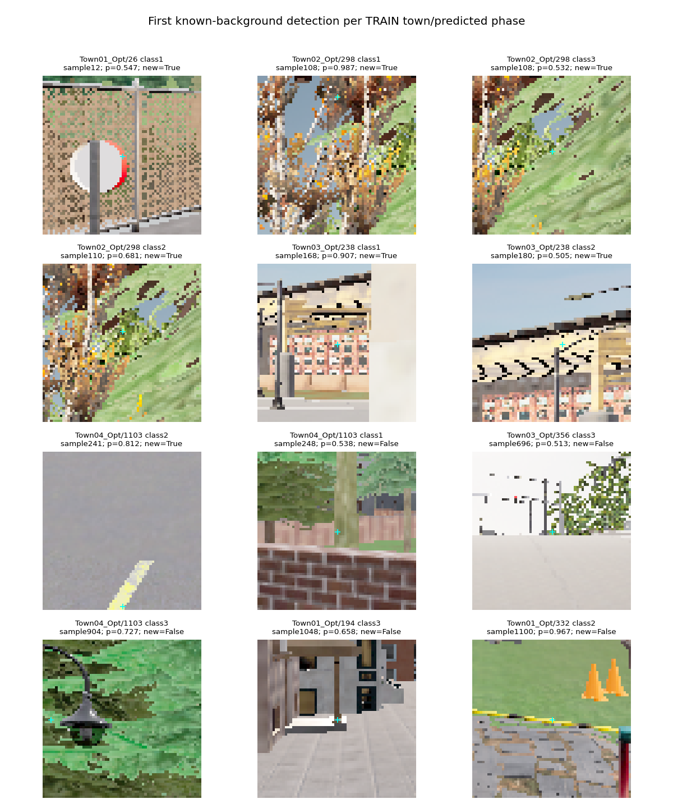

# Expanded negative coverage helps, but the candidate fails

The full TRAIN audit completed in 56.47 minutes and remains rejected. Every
12,362,313 frozen candidate coordinate was classified across 2,844 images, using
three heads that each excluded the image's whole junction during fitting.

| Measurement | Previous head | Expanded-background head | Required |
|---|---:|---:|---:|
| Correct location and phase | 1,234 / 1,248 | 1,232 / 1,248 | ≥1,234 |
| Known-background detections | 8,197 | 4,848 | ≤3,075.8 |
| Red lights correct | 618 / 626 | 616 / 626 | ≥618 |
| Green lights correct | 311 / 313 | 311 / 313 | ≥311 |
| Yellow lights correct | 305 / 309 | 305 / 309 | ≥305 |
| Unknown-region detections | 7,480 | 7,497 | Retained, not relabeled |

The two lost red lights are in Town03 (279→277). The remaining town totals are
unchanged. False detections decreased 40.86%, but that does not satisfy the
declared background limit or recall protection. No component validation,
all-TRAIN final fit, deployment or final Town05 driving follows this candidate.

An independent recount reproduces all aggregate/town/phase results. The full audit
also reproduces 48,865 original sampled feature/prediction rows and 182,016 newly
sampled background feature rows exactly. The sampled diagnostic had unchanged
1,144 correct detections and 201 background detections; it understated the full
proposal-distribution problem.

The gallery selects the first background detection per TRAIN town/predicted phase,
without score-based selection. Visible errors include sign edges, foliage,+building textures and road markings. Of 4,848 false detections, 2,911 occur outside
the older local-refinement proposals and only 201 coincide with the old sampled
background rows. Predicted phases are 3,676 red, 1,022 yellow and 150 green; median
foreground confidence is 0.874. This motivates spatial-context investigation,
not a post-hoc confidence threshold or a causal claim about every error.

All model fits, failed criteria, source archives, probabilities and original
coordinates remain retained. These correlated TRAIN component results do not
prove unseen driving reliability. M2/M3/M5 remain unqualified; M6 has not run.

Evidence: `outputs/navigation_signal_background_full_20261022/assessment.json`,
independent `navigation_signal_background_full_20261022.json`, and
`navigation_signal_background_full_protocol_20261022.md`.
