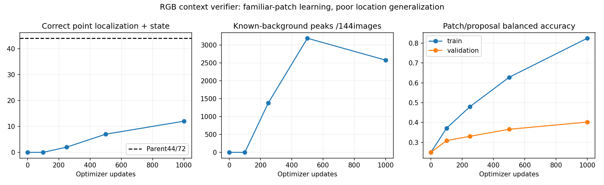

# RGB context verifier rejected: no protected checkpoint

All1000updates finished in30.13seconds including25.59seconds of cache preparation.
None preserves the original44/72jointlight detections or town/state coverage.
Select no verifier. The latest1000has14localized/12joint and2575backgroundpeaks;
the original proposer remains56localized/44joint/37241backgroundpeaks, unqualified.

| Updates | Localized | Joint | Backgroundpeaks | TRAINbalancedacc | VALbalancedacc |
|---|---:|---:|---:|---:|---:|
| 0 | 0/72 | 0/72 | 0 | 0.250 | 0.250 |
| 100 | 0/72 | 0/72 | 0 | 0.372 | 0.309 |
| 250 | 4/72 | 2/72 | 1,381 | 0.480 | 0.331 |
| 500 | 13/72 | 7/72 | 3,186 | 0.628 | 0.366 |
| 1000 | 14/72 | 12/72 | 2,575 | 0.825 | 0.402 |

The verifier has126,804parameters and sees only32pixel native plus96pixel context
from the sameRGBimage. It scores all38,543frozen validation proposals. TRAINmining
used202,518proposals:909known-positive,192,283known-background,9,326unknown;
16negatives/image and audited bulb anchors yield15,678cachedpatches
(14,016background/831red/412yellow/419green). Same876TRAIN/144VALimages,72known
validation housings. All seven TRAINlocations are outside current reservations.

Frozen diagnosis shows TRAINbalancedaccuracy82.47% versusVAL40.25%; the TRAIN
sample includes extra known-bulb anchors. A separate predicted-point-only check
gives75.35%TRAINbalancedaccuracy, still aboveVAL. Original-statebinaryrejection
is posthocdiagnostic only: latestkeeps28/72jointwith4135backgroundpeaks, also
losing parentcoverage. No threshold retuning, reselection or fit extension.

Whole-housing proposal state labels can include a dark/inactive pixel rather than
the active bulb; the failed context classifier cannot be taken as proof that
largerRGBcontext is intrinsically useless. Coverage/label diversity and local
phase information remain possible causes. Do not automatically train longer.

Geography audit finds21eligible signaljunctions acrossTown01–04but only7currently
represented in these staticTRAINpairs. AllTown10HDsignaljunctions are reserved
by existing roles; the remaining allowed134/664/841/895arestop/unsignalized.
Retain those reservations and disclose this coverage gap. Next freeze additional
eligible TRAINapproaches/illumination, independently audit captures and avoid
changing the original144validationimages/72labels orTown05finalsuite.

Thirteenfocused crop/unknown/boundary tests pass; all scheduled checkpoint/RNG/
optimizer and probability files retained. No driving or rule-understanding claim.
Protocol: [RGBcontext](navigation_signal_context_protocol_20261021.md).
Evidence: outputs/navigation_signal_context_20261021 and
outputs/navigation_signal_context_diagnosis_20261021. M2/M3/M5unqualified;M6notrun.
