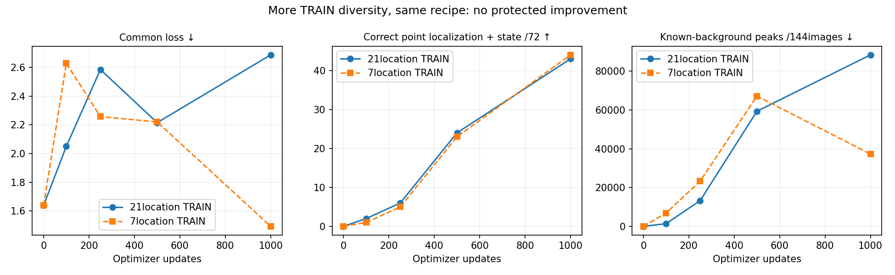

# More signal data audited; the unchanged training recipe still fails

The new164verified phase cases broaden TRAINcoverage from7to21signaljunctions.
The fixed1000update model does not pass: common loss selects initialization0.
Latest1000localizes61/72known lights,43withcorrectstate, but produces88,379
known-background peaks. Originalselectedbulb1000was56/44/37,241. Keep both failed
studies; no trained-model promotion, extension or driving rollout.

| Updates | Common loss ↓ | Localized | Joint state | Backgroundpeaks | Active background |
|---|---:|---:|---:|---:|---:|
| 0 | 1.6382 | 0/72 | 0/72 | 0 | 0.000% |
| 100 | 2.0501 | 4/72 | 2/72 | 1,381 | 7.565% |
| 250 | 2.5859 | 10/72 | 6/72 | 13,272 | 67.586% |
| 500 | 2.2156 | 34/72 | 24/72 | 59,322 | 18.224% |
| 1000 | 2.6886 | 61/72 | 43/72 | 88,379 | 4.078% |

## Native collection and independent audit

Frozen100poses/21junctions/36approaches inTown01–04, twoilluminationconditions,
200plannedcases/2400images. Eightisolatednativeworkers settled in319.84seconds.
FirstTown01clear-noon fails immediate nativeweather-statecheck beforeimages;
36cases remain UNKNOWN, no retry or replacement. Exact mismatched weather values
were not saved; cause is open. Other seven children exit0, each engineexit143;
first engine exits−11. The original owner's abnormal-exit counter8 is preserved
but is not eightSIGSEGVs or a proof of stable shutdown. Collection remainsFAILED.

After exactownerexit, separate7.08secondaudit verifies164cases/1968images:
originalsource/plan/RGBhashes, physicalsignal identity, independent camera-box
reprojection, phase/backgroundlamp states, orderedframes, actualstaticpose/rig
tolerances and≥1mreserved-geographyclearance. No additionalquarantine;36unknown.
All21locations represented;100overcast/64clear cases. Supported active-pixel
targets221red/green and219yellow, allnonempty. Empty/unsupported housings stay
unknown. Acceptedmanifest SHA:
f400408ae0ce7f53bbf16326592742b4df0ccdc4e79c3f16cc864cb3a7a8bdac.

Town10HD has no eligible TRAINsignaljunction under currentreservations. No
borrowing reservedlocations. The two lighting distributions are imbalanced by
the failed36cases. Staticphysics-offpairs omit originaltraffic and prove no
driving behavior or applicability. Originalfailure/source/nativeartifacts retained.

## Matched recipe and selection

2844TRAINimages versus prior876; same144VALimages/72labels/ignoreregions
byte-identical. Samefreshseed42/native21pixelRF37772parameterCNN/AdamW.001/
1000updates/class-balancedcrops/foregroundCE+.2meanbackgroundCE. Noarchitecture,
loss, threshold, encoder or state-feedback change. Newdatasetphasecopies:
626red/309yellow/313green, including repeatedred as originallydefined.
Execution22.49seconds, fitting/evaluation6.38seconds. Everycheckpoint/RNG/
optimizer/prediction retained. Initialmodeltensors andvalidationpredictions exactly
match priorseed42initialization; independentclosed-predictionrecount reproduces
allfivecheckpoints'localized/joint/background/town/statecounts.

Latest foreground loss2.661 versus old1.478 and backgroundCE.1391versus.07156.
Thus newdata alone does not resolve labelconfidence/backgroundconfusion under
thisbudget. Morelocalizedpoints are not a safety improvement. Town10joint9versus
old10; all other townjointcounts7/15/12unchanged. Original commonloss selection
is respected; no posthoclatest promotion. Componentvalidation was alreadyinspected,
not an untouchedtest. Pointmetric isNOTbounding-boxAP.

Next inspect the missedstates/falsealarmrepresentation and use a separately
registered semantic foreground verifier or architecture change. Existing pretrained
RGBbackbones may offer a different prior from the failedscratchcontextCNN; this
is a hypothesis, not a result. Keepallpreviousfailures and baselinebudgets explicit.
M2/M3/M5unqualified;M6notrun. No benchmark/reward/allowedinput/M4primary change.

Protocols: [capture](navigation_signal_diversity_protocol_20261021.md),
[fit](navigation_signal_diverse_fit_protocol_20261021.md). Evidence roots:
outputs/navigation_signal_diversity_20261021,
outputs/navigation_signal_diversity_audit_20261021,
outputs/navigation_signal_diverse_fit_20261021.
