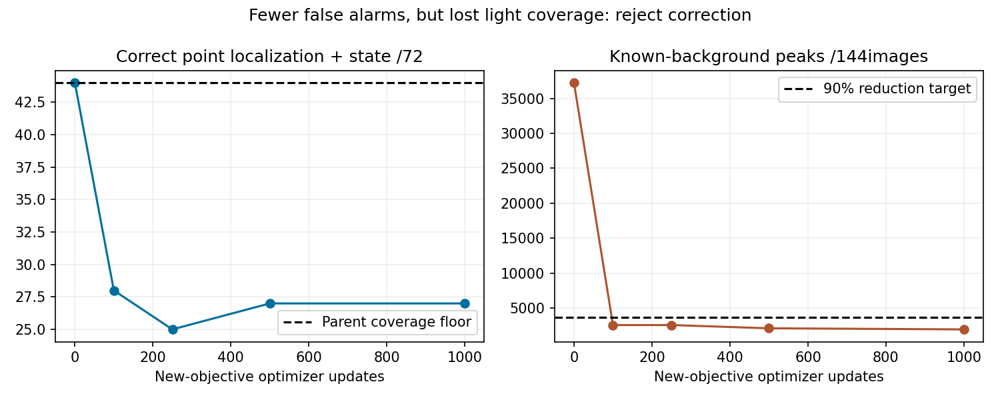

# Hard-background correction rejected: coverage regresses

The registered1000update fit completed24.01seconds. Every trained checkpoint
fails parent light-coverage protection. Select initialization0; all parent model
tensors and frozen predictions independently match exactly. The parent itself
remains unqualified. No component or driving promotion, no native rollout.

| Updates | Localized | Joint state | Background peaks | Active background | Protected |
|---|---:|---:|---:|---:|---|
| 0 | 56/72 | 44/72 | 37,241 | 1.6541% | yes |
| 100 | 31/72 | 28/72 | 2,572 | 0.0728% | no |
| 250 | 28/72 | 25/72 | 2,578 | 0.1011% | no |
| 500 | 30/72 | 27/72 | 2,112 | 0.0836% | no |
| 1000 | 32/72 | 27/72 | 1,957 | 0.0849% | no |

Latest1000reduces backgroundpeaks37,241→1,957(94.7%) and activefraction
1.6541%→0.0849%(94.9%). But correct lights fall44→27. Bytown joint counts
Town01 7→5,Town03 15→8,Town04 12→12,Town10HD10→2. Red22→14,yellow15→6,
green7→7. Never trade these losses for a misleading cleaner-looking demo.

Only the TRAINloss changed: original foreground+.2meanbackgroundCE plus
the mean hardest1%backgroundCE per image. The model remains a single-view
RGB37,772parameter/21pixel-receptive-fieldCNN; same876TRAIN/144VAL and72known
housings, source/split/thresholds unchanged. All checkpoints, optimizer/RNG and
predictions retained. The old paired experiment remains failed as originally
recorded. Seventeen focused signal/research-boundary tests pass; no full-suite
claim. Protocol [hard background](navigation_signal_hard_pixels_protocol_20261021.md).

Next: test wider RGB housing context or a separately learned candidate verifier
using TRAIN-only mined background patches. Current evidence shows a precision/
coverage trade-off; it does not prove context is the cause. Freeze the new method
and budget before fitting, preserve the same validation denominator and all
past failures, and do not tune the finalTown05suite. Signal applicability and
stop/release memory still require separate camera-driving evidence.

M2/M3/M5 remain unqualified; M6has not run. Approved actuatorfeedbackv2 and
original storagebaseline remain active. No reward, benchmark, M4primary or
allowed-input changes. Evidence: outputs/navigation_signal_hard_pixels_20261021.
