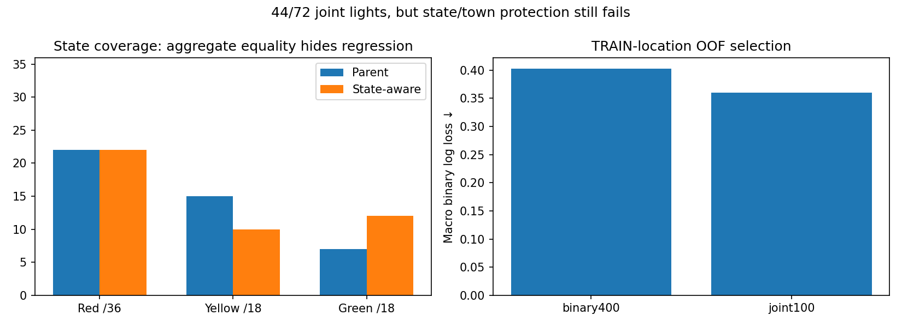

# State-aware supervision matches the total, but loses yellow coverage

The seven-fit study completes in48.71seconds. TRAIN-location folds select joint100
(macro binary OOF logloss0.360094) over binary400(0.402281). The selected head
localizes45/72lights and correctly classifies44, with1,171background detections
(96.86%below parent37,241). Aggregate44matches the parent, but the component gate
FAILS: yellow15→10 and Town10HD10→9. No deployment, threshold change or promotion.

| State | Parent joint | State-aware joint | Labels |
|---|---:|---:|---:|
| Red |22|22|36|
| Yellow |15|10|18|
| Green |7|12|18|

Town joint counts: Town01 7/8, Town03 16/20, Town04 12/12, Town10HD 9/32.
No state or town can compensate for another in the unchanged protection gate.
The result improves green classification, but does not solve yellow observability.

Same original51,094TRAINpoints/87RGBfeatures plus the exact two gamma variants,
153,282rows in each final fit; no data copies, new native collection or VAL transforms.
State labels are derived only from existing TRAIN phase supervision. Foreground
and background each receive half the training weight; each state receives one sixth.
Runtime model inputs remain RGB-derived features, without phase/teacher/world metadata.

Both arms use400trees:400binary iterations versus100four-class iterations, with
the same leaf limits and settings. This matches tree count, not exact CPU work or
parameter count; all actual fit times are retained in the JSON audit. Original
binary100/gamma and all prior failed models remain unchanged. Six internal folds
predict original TRAIN points; only the TRAIN-selected final head reaches the
144image/72housing component evaluation. Foreground gate stays0.5; joint state
is argmax of predicted foreground-state probabilities. All38,543proposals scored.

Independent audit reproduces all six OOF vectors, whole-location separation,
sample counts, macro loss, selection before final fitting, four-class probability
normalization/marginalization, all seven400tree receipts, and every final metric.
Serialized predictions exactly reproduce the fitted model. Ten focused
phase-label/weight/inference/augmentation/group/research-boundary tests passed.

Next test an explicit RGB opponent-color representation with TRAIN-only selection
before another component comparison. Bright yellow differs from gray/white by
channel relationships; raw-channel tree splits may represent those inefficiently.
This is a hypothesis, not an explanation established by these outcomes. Preserve
the five yellow regressions, original denominators and all protected locations.

No native planner or M6 driving. M2/M3/M5 remain unqualified. Original storage
baseline14GBnet/10GBminimum stays active. Component VAL has been inspected repeatedly;
this remains engineering evidence, not a final-test claim or M4 primary reselection.
[Protocol](navigation_signal_phase_boost_protocol_20261021.md).
Evidence: outputs/navigation_signal_phase_boost_20261021.
