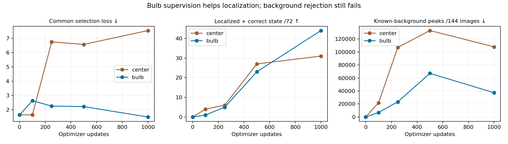
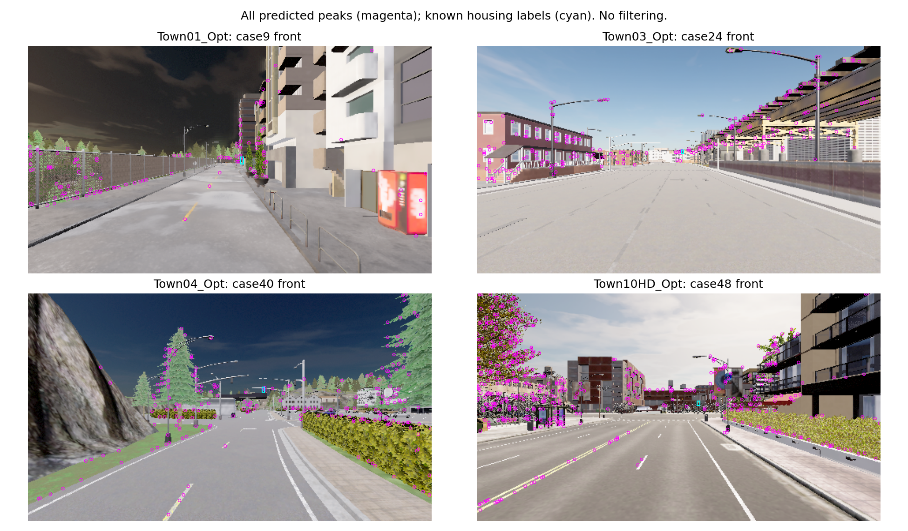

# Native bulb labels: better localization, rejected background behavior

The bulb-supervised model localizes56/72known lights and correctly classifies44,
but generates37,241known-background peaks across144images (258.6/image).
It fails both registered background-protection checks; no driving deployment.
The center control selects its untrained step0 by the frozen common loss.
Do not change that selection after seeing the point-localization result.

| Arm | Updates | Common loss ↓ | Localized | Localized + state | Background peaks ↓ |
|---|---:|---:|---:|---:|---:|
| center | 0 | 1.6382 | 0/72 | 0/72 | 0 |
| center | 100 | 1.6433 | 12/72 | 4/72 | 21,839 |
| center | 250 | 6.7519 | 21/72 | 6/72 | 106,930 |
| center | 500 | 6.5769 | 50/72 | 27/72 | 132,924 |
| center | 1000 | 7.5507 | 55/72 | 31/72 | 107,857 |
| bulb | 0 | 1.6382 | 0/72 | 0/72 | 0 |
| bulb | 100 | 2.6297 | 3/72 | 1/72 | 6,877 |
| bulb | 250 | 2.2580 | 12/72 | 5/72 | 23,329 |
| bulb | 500 | 2.2205 | 35/72 | 23/72 | 67,117 |
| bulb | 1000 | 1.4919 | 56/72 | 44/72 | 37,241 |

Fresh37,772parameter native-stride1 CNNs,1000updates each, same876TRAINimages
from73poses/sevenlocations. Original144VALimages/72known housings unchanged.
The paired-label audit checked1800original images and excluded65oldTRAINposes:
63at newly reserved locations, two actual poses inside reservedTown02junctions
242/132 despite nominal298labels. All92red/green and90yelloweligible housings
have stable phase-response targets. No validation pixel labels were constructed.

Both arms use single-view RGB only, no coordinates/map/phase-pair input at
inference. The audit's paired phases/geometry are offline label construction.
Center and bulb arms use the same architecture/optimizer/updates and sampling
distribution; positive crop positions differ with the supervision. Original
four validation junctions were inspected previously, so this is development.

Bulb selected1000: town joint countsTown01 7/8,Town03 15/20,Town04 12/12,
Town10HD10/32; red22/36,yellow15/18,green7/18. Background-active fraction1.654%.
Original housing-center accuracy22/72is not the bulb task. This point-in-box
metric is NOTbounding-boxIoU/AP and cannot be compared directly to old44/72
box detections. Background labels outside projected light regions are approximate.
All predictions in other ignored light regions remain unknown, not false positives.

Execution28.53s including preparation; center15.28s/bulb5.37s with cold-start
overhead differences. Three-viewGPUforward p95center3.00ms/bulb3.17ms,
20timed calls after5warmups; excludesCPUpeak extraction/simulator/IPC.
Every scheduled checkpoint includes optimizer/RNG and explicitBF16(no scaler).
Independent closed-prediction recount reproduces selected localized/joint/background
counts. Fivefocused tests and dataset preflight passed, not a full-suite claim.

Next investigate TRAIN-only hard background pixels with the fixed bulb labels.
The mean background loss can hide rare confident peaks among mostly easy pixels;
this is a testable loss-weighting hypothesis, not a proven cause. A separately
registered countermeasure must protect light coverage and measure background
rejection. No automatic extension, threshold retuning, native pilot or M6run.
The old M4primary, M3rule failures and all scientific gates remain unchanged.

Evidence: outputs/navigation_signal_pixel_audit_20261021 and
outputs/navigation_signal_pixel_study_20261021. Protocols:
[label audit](navigation_signal_pixel_audit_protocol_20261021.md),
[paired study](navigation_signal_pixel_study_protocol_20261021.md).
