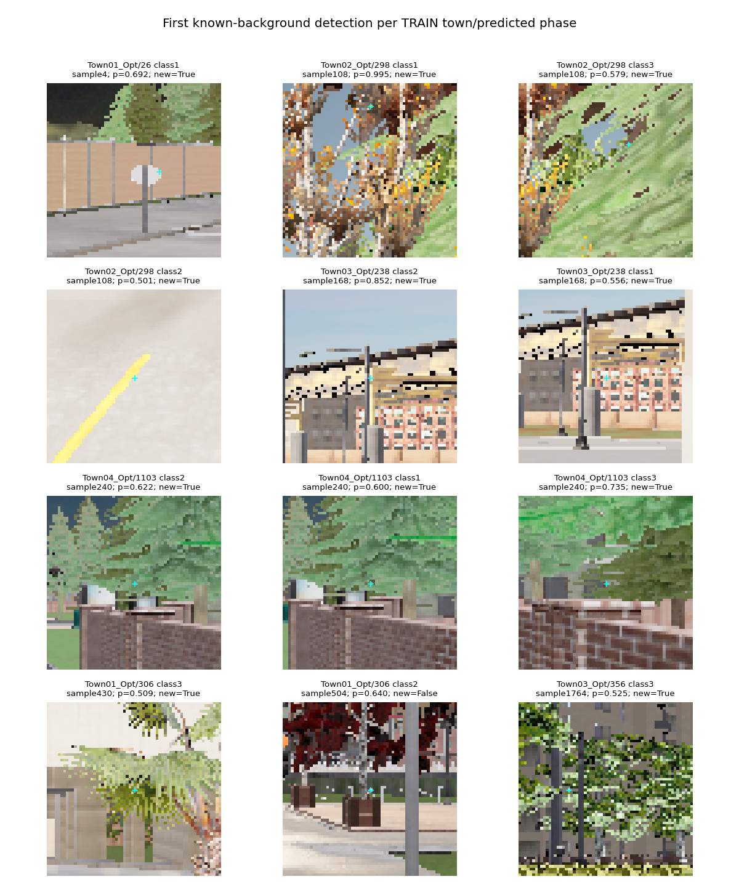

# Independent RGB plateau proposals: high TRAIN recall, failed background gate

The full TRAIN audit finished in **48.68 minutes**. It improves correct housing-and-phase
detections from **1,189 to 1,234 out of 1,248**, but raises known-background detections
from **2,668 to 8,197**. The fixed limit was **3,075.8**, so the candidate is rejected.
No component-validation predictions or native driving followed this result.

| TRAIN metric | Local refinement | Independent plateau union |
|---|---:|---:|
| Correct housing + phase /1,248 | 1,189 | 1,234 |
| Known-background detections | 2,668 | 8,197 |
| Unmatched unknown detections | 4,233 | 7,480 |
| Red /626 | 597 | 618 |
| Green /313 | 305 | 311 |
| Yellow /309 | 287 | 305 |
| Town01 /296 | 272 | 288 |
| Town02 /128 | 124 | 126 |
| Town03 /556 | 534 | 554 |
| Town04 /268 | 259 | 266 |

All 12,362,313 registered coordinates were scored across 2,844 TRAIN images using
whole-junction excluded heads. All earlier 1,770,643 points remain; 10,591,670 were
added. Every original 48,865 sampled feature and probability row reproduced exactly.
A separate score-order matcher independently recounts all housing, background,
unknown, town and phase totals from the retained arrays. Source hashes and arrays
remain intact; the earlier dense proposal cap failure is also retained.

**Negative-example coverage.** Of 8,197 background detections, 5,529 occur at newly
added coordinates. Only 201 coincide with original sampled background training
coordinates; these counts are a coverage diagnostic, not a proof of causality.
Predicted false-positive phases: 5,111 red, 370 green, 2,716 yellow. Median foreground
confidence is 0.850; 90th percentile 0.994. Raising a threshold blindly is not a
supported fix and would change the declared acceptance rule.

The gallery selects the first original sample/coordinate per TRAIN town and
predicted phase, independently of confidence. It includes sign edges, foliage,
road markings and building edges. Known background excludes projected lamp ignore
regions; unknown detections are not relabeled background. A 5×5 RGB appearance can
resemble an active lamp away from the housing context. Training the existing head
mostly on the previous CNN proposal distribution leaves the broader RGB candidate
distribution insufficiently represented.

**Next registered question.** Test additional background examples sampled directly
from the new TRAIN proposal distribution. Select them using TRAIN background masks
and a fixed seed, independent of classifier outputs, and exclude each complete
held-out junction from that fold's fit. This avoids selecting negatives using a
head trained on the held-out fold. Preserve supported positive labels, class-prior
weights, original evaluation labels and thresholds. A separate prospective protocol
must precede cache generation and fitting.

**Runtime limitation.** Incremental classification and RGB features took 2,833.10 s;
median 0.957 s per image, p95 1.474 s. This excludes earlier proposal generation and
old-point scoring, so it is not a complete three-camera profile. The separate staged
GPU tree export is faster only for the measured tree kernel; it has not changed this
scientific audit or any deployed policy. Further feature-extraction optimization
still requires numerical verification.

The latest component result remains 55/72 and fails yellow protection. These TRAIN
points and phase repeats are correlated; upstream proposer TRAIN exposure remains.
No independent driving success claim follows from high TRAIN component recall.
M2/M3/M5 remain unqualified; M6 is not run. The full project goal remains active.
