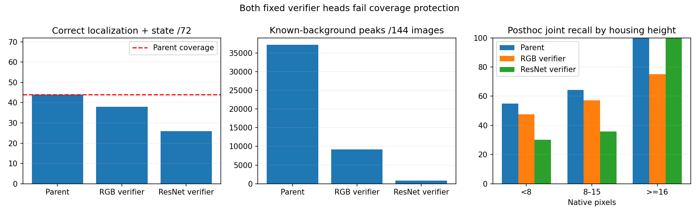

# Frozen visual verifiers reduce false alarms but lose lights

Both predeclared heads finish in an 87.22-second study and fail coverage protection.
No model is promoted or deployed. ResNet removes 97.9% of background peaks but
loses 18 of the parent's 44 correctly localized and classified lights.

| Model | Localized | Correct localization + state | Background peaks |
|---|---:|---:|---:|
| Parent | 56/72 | 44/72 | 37,241 |
| RGB verifier | 46/72 | 38/72 | 9,176 |
| ResNet verifier | 29/72 | 26/72 | 789 |

Same original 38,543 proposals, 144 validation images and 72 housing labels.
All proposals are scored, without a top-K cap. The binary gate is fixed at 0.5;
original proposal states are retained. A point inside a housing is the localization
metric; these are not bounding-box AP or driving results. Every town and state
must retain parent coverage as well as reducing background peaks by 90%.

TRAIN uses 2,844 images at 21 eligible locations: 51,094 patches, including 5,600
foreground and 45,494 background. Ambiguous projected lights are ignored. The
87-feature RGB head and 1,024-feature frozen ImageNet ResNet18 head each use
TRAIN-only standardization and balanced L2 logistic regression (C=1). They converge
in 133 and 81 iterations, without warnings. Exported probabilities reproduce the
fitted model within 1e-12. Frozen encoder parameters and batch-normalization buffers
are independently unchanged. All source, data, feature and head hashes are retained.

This changes representation, task and data relative to the older scratch context
study, so it does not isolate a causal pretraining benefit. ImageNet supervision
is declared. Inputs remain current RGB crops only, without map, phase-pair, teacher,
absolute-coordinate or metadata inputs. No reserved Town10HD signal location is used.

## Frozen size diagnosis (posthoc; no selection change)

Full metric recount exactly reproduces the stored assessment. Housing-height bins
below describe the same closed predictions; no threshold or model is reselected.

| Housing height (pixels) | Labels | Parent joint | RGB joint | ResNet joint |
|---|---:|---:|---:|---:|
| <8 | 40 | 22 | 19 | 12 |
| 8–15 | 28 | 18 | 16 | 10 |
| >=16 | 4 | 4 | 3 | 4 |

Size is correlated with location, distance and appearance in this small component
set; these counts cannot establish that crop scale causes the losses. Validation
has been inspected repeatedly and is development evidence, not an untouched test.
The frozen proposer also misses 16 housings before any verifier is applied.

Next: use these size counts to decide whether a prospective tighter-scale feature
study is warranted. Keep TRAIN mining, validation, fixed gates and all failed runs.
M2/M3/M5 remain unqualified; no M6 driving or final Town05 tuning has occurred.

[Protocol](navigation_signal_pretrained_verifier_protocol_20261021.md).
Evidence: outputs/navigation_signal_pretrained_20261021. Neither isolated crop
throughput nor this offline fit establishes full runtime latency or reliability.
