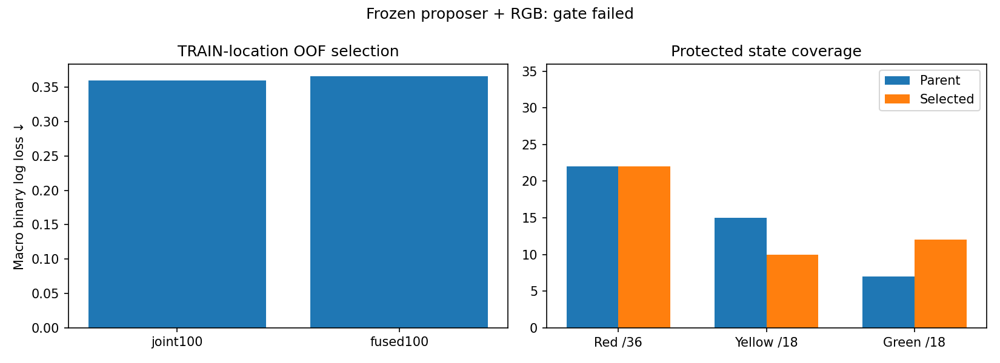

# Frozen-proposer representation fused with RGB

The seven-fit comparison completes in55.32seconds and selects
joint100 using whole-TRAIN-junction OOF loss. The selected model produces
45/72localized lights, 44joint correct states and
1,171known-background peaks. It FAILS the component gate.
No native driver deployment or M6 evaluation follows automatically.

| Arm | Macro TRAIN-location OOF logloss ↓ |
|---|---:|
| joint100 | 0.360094 |
| fused100 | 0.365732 |

| State | Parent joint | Selected joint | Labels |
|---|---:|---:|---:|
| Red | 22 | 22 | 36 |
| Yellow | 15 | 10 | 18 |
| Green | 7 | 12 | 18 |

Same51,094TRAINpoints×3original/gamma versions, original38,543VALproposals,
144VALimages/72housings and all town/state/background protections. Raw87RGB
features versus123features including32frozenCNNchannels and4probabilities.
Classifier recipe,400trees, labels, sample weights, RNG, internal folds and selector
are matched. Only selected final head reaches component VAL. Every model and
prediction is retained; no threshold search or unselected-arm VAL evaluation.

Independent recount reproduces all six OOF vectors, group/class loss, selection
before final fitting, all final component metrics and exact raw-control folds.
All predictions use summed foreground probability>=.5 and RGB-predicted state.
Feature augmentation rows stay aligned within their original TRAIN location.
Actual fit times are in the JSON audit; equal trees do not mean equal CPU work.

## Cache provenance and limits

Original cache attempt failed at zero features because tuple-valued points were
compared directly with JSON arrays. All2988sample records and both index lists
were semantically identical. Corrected full-JSON identity preserves every field
and order; a regression test rejects point/order/split changes. Failed attempt
retained; v2 kept the original absolute1800second deadline. No scientific fit was
repeated and no source image, label, proposal or benchmark changed.

v2extracts in107.03s. Every8676same-batch extractor/originalforward comparison is
exact; model weights frozen; original/augmentedRGBfeatures exactly reproduced.
Newbatch1BF16+FP16cached probabilities differ from older proposal scores by up to
.013758, with zero point-class disagreements. Original proposal identities/scores
are preserved. This is disclosed numerical variation, not old-batch parity.

Separate14.20saudit verifies all hashes/shapes/ranges and67fixedfull-image original
model-hook forwards:21TRAINlocations×3versions plus4VALtowns, all exact. It is
sampled independent recomputation, not recomputation of every point. Fitting
requires matching complete cache/audit receipts. Ninefocusedextractor/audit/fusion/
research-boundary tests pass; source bytes were pinned through each active stage.

The proposer was trained on some of these TRAIN locations and selected on this
component validation before this study. Internal folds test the NEW downstream
head, not unseen end-to-end feature learning. Component validation has been
repeatedly inspected. No final driving/generalization or M4primary claim follows.
Original storage guardian baseline14GBnet/10GBminimum and all failed artifacts
remain. M2/M3/M5 driving gates remain unqualified; M6 has not run.

[Protocol](navigation_signal_proposer_fusion_protocol_20261021.md).
Evidence roots: outputs/navigation_signal_proposer_features_v2_20261021,
outputs/navigation_signal_proposer_audit_20261021,
outputs/navigation_signal_proposer_fusion_20261021.
