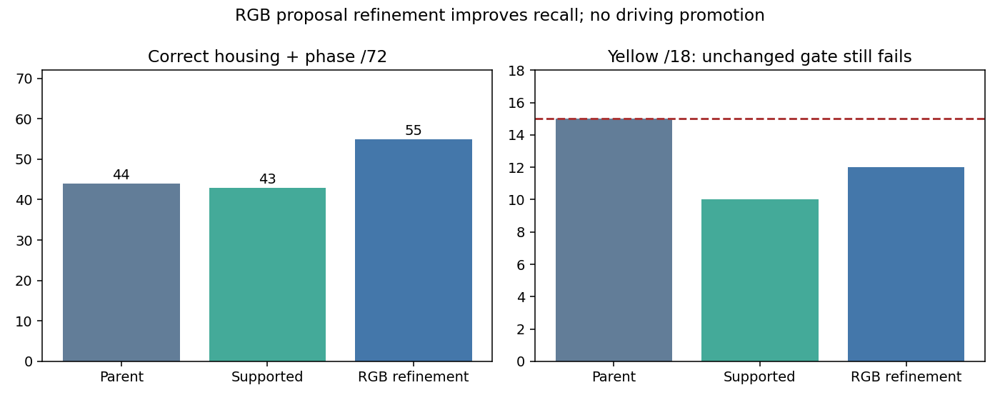

# RGB-only proposal refinement

**Component gate still fails on yellow signals.** Overall correct detections improve
from43to55/72 versus the supported head, and44to55versus the original bulb parent.
No model was retrained; the improvement comes from candidate coordinates computed
from RGB alone. The candidate remains experimental and is not deployed.

| Component metric | Original bulb parent | Supported head | RGB refinement |
|---|---:|---:|---:|
| Correct housing + phase /72 | 44 | 43 | 55 |
| Known-background detections | 37,241 | 40 | 127 |
| Unmatched unknown detections | 1,246 | 98 | 193 |
| Red /36 | 22 | 22 | 30 |
| Green /18 | 7 | 11 | 13 |
| Yellow /18 | 15 | 10 | 12 |
| Town01 /8 | 7 | 7 | 7 |
| Town03 /20 | 15 | 16 | 17 |
| Town04 /12 | 12 | 12 | 12 |
| Town10HD /32 | 10 | 8 | 19 |

Every38,543original proposal remains. Add54,099deduplicated RGB channel maxima
within its5×5neighborhood, for92,642points. Keep the same supported classifier,
threshold.5and score-ordered matching. Recompute all38,543original feature/probability
rows exactly. A separate original scorer independently recounts all72labels,
background/unknown detections, towns and phases from the retained arrays.
The99.66%background reduction versus parent does not offset yellow15→12.

**Prospective TRAIN gate.** All2,844TRAINimages, same three whole-junction excluded
heads: joint1,144→1,189/1,248; red578→597,green300→305,yellow266→287. Everytown
improves or ties. Background724→2,668, still91.33%below the rawRGBcontrol30,758,
passing the predeclared tradeoff. Unknown2,391→4,233. All715,825original coordinates
remain;1,054,818added. Exact48,865sampled feature/probability checks and independent
original-control recount pass. Only after that gate was the component check run.

**Remaining TRAIN misses.** A posthoc TRAIN-only audit finds59missed housings:
39withno refined candidate,20with all candidates filtered. Existing OOF active-pixel
queries can recognize49of59at coordinates absent from the candidate set. These
oracle coordinates are privileged diagnostics only; they cannot be runtime inputs.
Misses include29red/repeated-red,8green,22yellow. This evidence supports testing a
proposal generator independent of the frozen CNN seeds, rather than another blind
phase-classifier fit. No additional component error mining or threshold change.

**Cost and limitations.** TRAIN audit317.25s; component check31.57s. Incremental
RGB refinement plus new-point classification has median0.091s/TRAINimage and0.097s/
componentimage, excluding original CNN and old-point scoring. This is not a full
three-camera runtime profile. CPU latency and point-to-policy integration remain
open. The existing policy expects boxes; do not invent box size from a bulb point.
Repeatedly inspected component VAL is development evidence, not untouched test
performance. Only verifier folds are junction-held-out; proposer TRAIN exposure
remains. Correlated phases/points are not independent driving trials.

Eight focused refinement/supervision/boundary tests pass. Source hashes, point/
probability arrays, offsets, failed prior models and all scores are retained.
M2/M3/M5 remain unqualified, M6 not run; original M4 primary unchanged.

Protocols: [TRAIN](navigation_signal_refinement_protocol_20261022.md),
[component](navigation_signal_refinement_component_protocol_20261022.md).
All results and the remaining59TRAIN cases are in the accompanying JSON.
