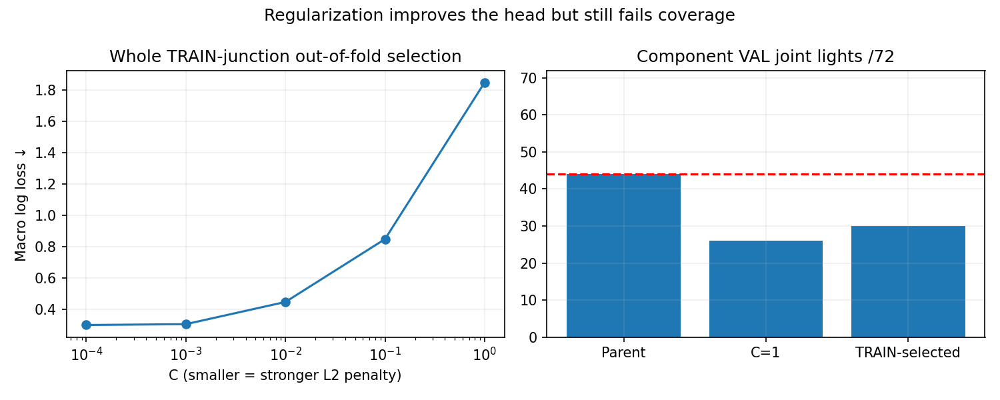

# TRAIN-selected regularization remains unqualified

All 16 CPU fits converge in a 42.49-second study. Whole-junction internal folds
select C=0.0001 before the final fit or component-validation assessment. The final
head localizes 33/72 lights, classifies 30 correctly and leaves 1,919 background
peaks. That improves the previous ResNet head's 26 joint lights but still loses
14 of the parent's 44. The 94.85% background reduction does not compensate for
lost coverage: FAIL, no deployment or driving promotion.

| Fixed C | Mean TRAIN-location OOF balanced log loss ↓ |
|---|---:|
| 0.0001 | 0.299255 |
| 0.001 | 0.304612 |
| 0.01 | 0.446382 |
| 0.1 | 0.847789 |
| 1 | 1.847459 |

## Selection and independent checks

Same larger-crop frozen ResNet features and original 51,094 TRAIN points. Three
folds keep all frames/views/phases of each of 21 TRAIN junctions together. Each
fold fits its own scaler on that fold's training portion only. Selection scores
48,865 predicted TRAIN points, excluding GT-only extra anchors; each location
and each class receive equal weight. All original rows remain available for fit.
Original component VAL is not used to select C. Penalty values, tie rule and
fitting recipe were registered before execution; threshold stays at 0.5.

The selected penalty is at the tested boundary. This does not establish the best
possible penalty, and no posthoc range extension is included in this result.
The component set has been inspected repeatedly; this remains development
evidence, not an untouched test. Internal-fold scores also share the predeclared
proposer and are not claims about entirely unseen end-to-end systems.

Independent recount verifies all 15 out-of-fold arrays against their head
predictions, whole-location separation, class/location aggregation, selector,
all 16 convergence receipts, and selection timestamp before final fitting.
The single saved component prediction vector reproduces all reported metrics.
Final town joint counts: Town01 7/8, Town03 8/20, Town04 12/12, Town10HD 3/32.
Final state joint counts: red 16/36, green 6/18, yellow 8/18.

No new recordings or feature cache copies. Original storage guardian baseline,
14 GB net cap and 10 GB minimum remain. All source hashes and failed candidates
are retained. M2/M3/M5 remain unqualified; M6 has not run.

Next: assess TRAIN-only appearance augmentation and feature adaptation using the
same whole-location internal folds before another component comparison. The
strong TRAIN fit and remaining location gap do not justify a longer unchanged
fit. Reserved signal locations, original M4 primary and final Town05 remain fixed.

[Protocol](navigation_signal_regularization_protocol_20261021.md),
[preceding scale diagnosis](navigation_signal_tight_20261021.md).
Evidence: outputs/navigation_signal_regularized_20261021.
