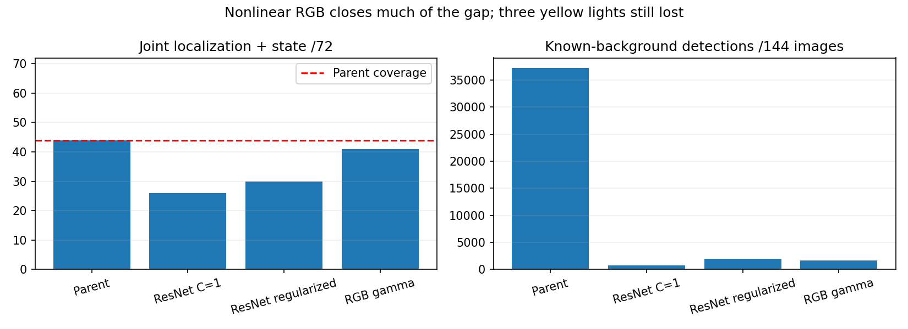

# Nonlinear RGB improves coverage, but misses the gate by three lights

Seven fixed-budget CPU fits complete in 79.65 seconds including feature extraction.
Whole TRAIN-junction folds select gamma augmentation: macro binary logloss
0.360422 versus plain 0.390922. The selected final head gives 47/72 localized lights,
41 with correct state, and 1,696 known-background peaks. Parent: 56/44/37,241.
Background peaks fall 95.45%, but three parent-correct yellow lights are lost.
The unchanged coverage gate FAILS; no deployment or driving promotion.

Town joint counts: Town01 7/8, Town03 15/20, Town04 12/12 and Town10HD 7/32.
The first three equal the parent; Town10HD loses three. State joint counts:
red22/36 and green7/18 equal parent; yellow12/18 versus parent15/18.

## What changed and what was checked

Same 51,094 TRAIN points, 21 locations, 87 native-RGB features, frozen proposer,
144 VAL images /72 housings and all38,543proposals. A nonlinear histogram-boosted
classifier replaces the linear head. Paired plain/gamma arms share one fixed
100-iteration recipe. Gamma .7/1.4 transforms full TRAIN images before context
averaging; final fit uses153,282original/augmented points. Channel order and pixel
geometry are preserved; this is approximate photometric variation, not new native
weather. Original untransformed features reproduce the existing FP16 cache exactly.

Three internal folds keep entire TRAIN junctions together. Augmented views follow
their source fold. The selector scores original predicted points only, excluding
GT-only anchors, and uses no original component VAL. Only the chosen gamma arm
is fitted on all TRAIN data and evaluated on component VAL. No threshold search,
plain-arm component assessment, or reselection. Every model, OOF vector and source
hash is retained. Serialized predictions match exactly. An independent recount
reproduces all six OOF vectors, group/class aggregation, selection before final fit,
and all final metrics. Fixed iterations are not a convergence claim.

## Remaining failure diagnosis

The three lost yellow housings are samples362/374/382, all Town10HD. Each has
one original proposal inside it, with foreground probability0.300916/0.108676/
0.137065, below the fixed0.5gate. All are filtered out; changing proposal ranking
to original parent order gives identical counts. This posthoc diagnostic rules
out ranking as the explanation here; it does not change selection or thresholds.

TRAIN OOF positive recall also remains incomplete. Plain/gamma recall respectively:
red51.97%/58.16% (1697points), green49.29%/55.18% (850), yellow47.82%/54.00% (824).
These are correlated proposal points, not independent encounter success rates.
The previous ResNet regularization selector had lower internal binary logloss
(.299255) but only30joint VAL lights; a lower average loss does not guarantee
every state's coverage. No primary research model is reselected on these results.

Next: inspect phase-aware foreground supervision and the remaining appearance gap
using TRAIN-only folds, with a prospectively registered objective/architecture.
Keep the three errors in the validation denominator; do not lower the gate to
pass them. Native pixel inspection confirmed genuine single-pixel emissive
responses, not loader corruption or justification for relabeling.

## Execution and limits

Original output navigation_signal_rgb_boost_20261021 retains a failed empty
preflight after the storage guardian disappeared during an execution gap. It read
no data and performed no fit. Host liveness was checked, the same immutable
guardian baseline resumed, and v2 retained the original1800second deadline.
No scientific trial was repeated, no allowance reset and no artifact deleted.
The100MBstage cap / original14GBnet cap /10GBminimum remain. Seven focused
augmentation/fold/research-boundary tests passed. No native data were collected.

Component validation has been repeatedly inspected; this is engineering evidence,
not a held-out driving result. Point-in-housing metrics are not bounding-box AP.
No reserved TRAIN location was borrowed, no phase/teacher/world metadata enters
inference, and no final Town05 trial has run. M2/M3/M5 remain unqualified.

[Protocol](navigation_signal_rgb_boost_protocol_20261021.md).
Evidence: outputs/navigation_signal_rgb_boost_v2_20261021.
