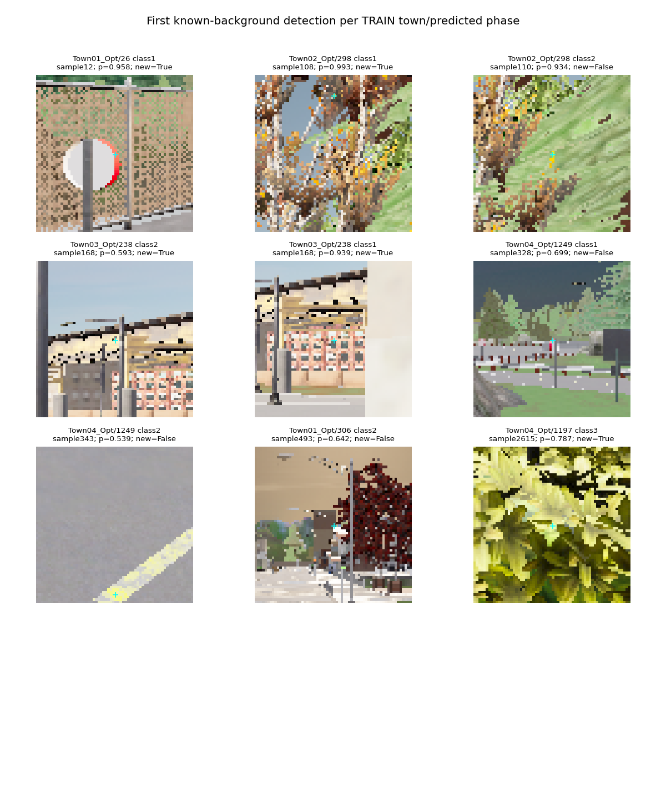

# Spatial RGB context reduces false detections but fails the recall gate

The full TRAIN audit completed in 657.41 seconds and is rejected. All 12,362,313
frozen coordinates across 2,844 TRAIN images were scored using whole-junction
excluded models. No component validation or driving evaluation follows.

| Measurement | Original plateau head | Expanded backgrounds | Spatial context |
|---|---:|---:|---:|
| Correct location + phase / 1,248 | 1,234 | 1,232 | 1,228 |
| Known-background detections | 8,197 | 4,848 | 3,221 |
| Red correct / 626 | 618 | 616 | 614 |
| Green correct / 313 | 311 | 311 | 309 |
| Yellow correct / 309 | 305 | 305 | 305 |
| Unknown-region detections | 7,480 | 7,497 | 6,898 |

The original acceptance bar remains at least 1,234 correct, every town and phase
protected, and at most 3,075.8 background detections. Spatial context misses all
four criteria: Town01 joint 288→286 and Town03 554→550; Town02/04 remain 126/266.
Background is down 60.71% from the original plateau head, but still exceeds the
fixed limit. Lower false detections do not excuse lost lights.

All 48,865 original sampled raw/spatial features and probabilities match their
caches exactly; all 182,016 added background raw/spatial features and probabilities
also match. Original CPU preprocessing independently reproduces the sampled raw
features despite using the faster compiled path in full inference. An independent
recount reproduces every aggregate/town/phase result. The newer feature/head path
took median 160 ms/image here; this includes 375 features and a different head,
and is not the earlier 87-feature GPU profile or full driving latency.

The three fixed fits took 508.46 seconds total, versus 77.45 seconds for the
87-feature expanded-background study. Equal tree count did not mean equal CPU cost.
Sampled joint recall fell 1,144→1,138 while sampled background fell 201→163; those
diagnostics did not qualify the model. All original failed models remain retained.

A separate no-inference TRAIN coverage check found 1,596 frozen candidate points
that are independently audited active bulb pixels but absent from the old sampled
supervision. They remain diagnostic until a separately registered, independently
verified training release. This is a concrete next data comparison, not evidence
that the next model will pass. No confidence threshold search, component-label
mining or original M4 primary change. M2/M3/M5 remain unqualified; M6 has not run.

Evidence: `outputs/navigation_signal_spatial_fit_20261022`,
`outputs/navigation_signal_spatial_full_20261022`, independent recount
`navigation_signal_spatial_full_20261022.json`, and the registered spatial protocols.
