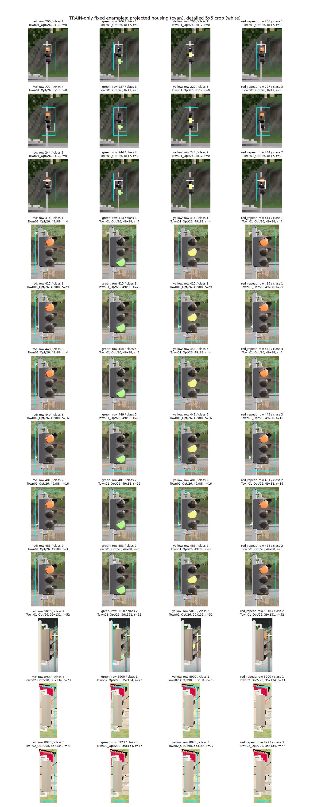

# TRAIN signal supervision and visible context

The audit supports a mismatch between housing-wide positive labels and the small
RGB crop used to predict phase. It does not establish corrupt source annotations.
All 3,371 original predicted-positive TRAIN points were inspected; no component
validation row, label, prediction, threshold or result was changed.

| Quantity | Active pixel within 5×5 | Active pixel outside 5×5 |
|---|---:|---:|
| Points | 1,365 | 2,006 |
| Median housing width × height | 4 × 8 px | 32 × 68 px |
| Median / maximum nearest active-pixel distance | 0 / 2 px | 13 / 77 px |
| All alternate-phase local differences ≤ red-repeat variation | 5 | 1,351 |

Distance is Chebyshev distance in the native image, restricted to the matching
housing. No point has multiple matching housing boxes, so overlapping boxes or
first-match ordering do not explain the finding. Boxes reach 50 px width and
134 px height. A radius-47 context includes active pixels for 3,345/3,371 points,
but the existing wide crop is averaged down and its RGB features retain only
channel means and standard deviations. This is not evidence that expanding the
window alone will improve driving.

The fixed gallery selects the first original row for each phase and radius bin
(0–2, 3–15, 16–47, 48+), independently of model errors. It shows real large signal
housings, including grazing views; some positive proposals fall on their edges,
visors or mounting structures far from the active lamp. No near-plane box explosion
or overlapping-box explanation appeared in these selected examples. This visual
inspection does not exhaustively validate every projected box.

Every local alternate-phase patch differs by at least one pixel value; there are
zero exactly identical patches. The red-repeat comparison is a noise diagnostic,
not a proof of no phase information. Points and phase images are correlated and
mask support is conservative. The complete 87-feature vector also includes context
statistics, so local evidence cannot establish full-vector indistinguishability.

Next experiment: exclude unsupported positive TRAIN points from the fitting loss,
keep them in original scoring, and compare original and supported supervision on
whole-junction TRAIN folds. Background and active-bulb anchors stay unchanged.
See [prospective protocol](navigation_signal_supported_protocol_20261022.md).
No component-validation or driving promotion in this stage.

Evidence: `navigation_signal_support_geometry_20261022.json` retains every point,
all paired differences, box sizes, selection and input hashes. The exact executed
source is archived as `navigation_signal_support_geometry_20261022_source.py`;
subsequent runner edits were formatting only. Three line-length lint findings were
corrected after retaining the executed source; formatted runner passes lint.
