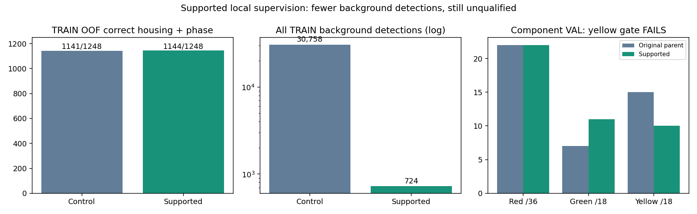

# Supported local signal supervision

The change substantially reduces background detections, but **fails the unchanged
component gate**. It is retained as an experiment and is not deployed.

| Evidence | Control | Supported supervision |
|---|---:|---:|
| Sampled TRAIN correct housing + phase /1,248 | 1,141 | 1,144 |
| Sampled TRAIN accepted background proposals | 1,990 | 201 |
| All TRAIN correct housing + phase /1,248 | 1,141 | 1,144 |
| All TRAIN background detections | 30,758 | 724 |
| All TRAIN unmatched unknown detections | 4,524 | 2,391 |
| TRAIN macro point logloss (lower is better) | 0.360094 | 1.264219 |
| Component correct housing + phase /72 | 44 | 43 |
| Component background detections | 37,241 | 40 |
| Component unmatched unknown detections | 1,246 | 98 |

TRAIN control is the previous RGB joint100 head, evaluated out of fold. Component
control is the original native bulb proposer used by the immutable protection gate.
They are different controls. Relative to the previous RGB joint100 component result
(44joint/1,171background), the new model has43joint/40background.

The full TRAIN audit includes all715,825original proposals across2,844images; it is
not the sampled-background result. Every48,865original sampled row reproduces its
RGB features and both OOF probability vectors exactly. Independent sampled metric
recounts also match. All original TRAIN housing labels and excluded positives remain
in scoring. GT-only anchors never contribute detections.

| Component subgroup | Original correct | Supported correct | Labels |
|---|---:|---:|---:|
| Red | 22 | 22 | 36 |
| Green | 7 | 11 | 18 |
| Yellow | 15 | 10 | 18 |
| Town01 | 7 | 7 | 8 |
| Town03 | 15 | 16 | 20 |
| Town04 | 12 | 12 | 12 |
| Town10HD | 10 | 8 | 32 |

**Method.** The paired-phase TRAIN audit showed that housing membership frequently
assigned phase to points whose detailed5×5crop contained no audited active bulb.
Exclude2,006suchpositivepoints from the fitting loss (unknown, never background),
keep45,494backgroundrows and2,229verifiedGT-onlyanchors. Fit49,088retainedrows and
two originalgamma variants:147,264examples. Same87RGBfeatures, joint100classifier,
400trees,seed42,weights and hyperparameters. Three whole-junction fold fits select
continuation by a predeclared housing-level TRAIN criterion; full-proposal audit
confirms it. One final fit then assesses original144componentimages/72labels once.
Point logloss worsens because excluded local labels remain in scoring; it is not
hidden or redefined after results.

**Timing.** Three-fold stage30.75s; all-proposal audit
220.22s; final fit/evaluation13.08s.
Final classifier fit7.05s. Ten focused tests pass; serialized model predictions are
exact. A separate score-order matcher independently reproduces all component counts,
towns, phases and gate failures from retained probabilities, without refitting.
Final model SHA256: `ed533241a872943c928d725ac06399c7bc2c78ce73e1f05cd4d359929e583191`.

**Limits and next action.** These are correlated component images and points, not
driving success rates. The upstream proposer has TRAIN exposure, while only the
new verifier is cross-validated by location. The component set has been repeatedly
inspected and is development evidence. The99.89%background reduction does not offset
missing yellow lights or qualify safety. No threshold relaxation, benchmark edits,
runtime integration, native driving, or M6 evaluation occurred.

Next investigate TRAIN-supported bulb appearance/phase generalization and the
remaining signal-recall limitation before a prospectively registered correction.
Preserve Town10HD reserved locations and the original yellow/town protection gates;
do not mine them as training data or relax thresholds to rescue this result.
Original M4 primary remains unchanged. M2/M3/M5 remain unqualified; M6 not run.

Protocols: [fold comparison](navigation_signal_supported_protocol_20261022.md),
[full TRAIN audit](navigation_signal_supported_full_protocol_20261022.md),
[conditional component evaluation](navigation_signal_supported_final_protocol_20261022.md).
Evidence and hashes are retained in the accompanying JSON and all three output roots.
