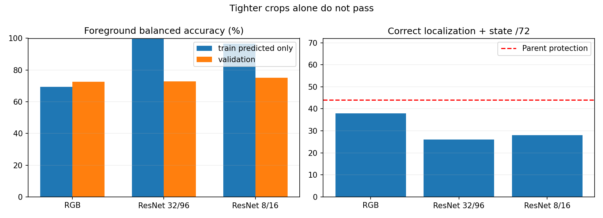

# Tighter frozen-feature crops are insufficient

The paired crop-scale study completes in 89.46 seconds. ResNet 8/16-pixel crops
give 33/72 localized lights, 28 with correct state, and 2,250 background peaks.
The 32/96-pixel version gave 29/26/789. Both fail the unchanged parent coverage
requirement of 44 joint lights plus every town and state. No promotion or deployment.

| Head | Joint | Background | TRAIN balanced acc.* | VAL balanced acc. | VAL recall |
|---|---:|---:|---:|---:|---:|
| RGB | 38/72 | 9,176 | 69.4% | 72.6% | 69.9% |
| ResNet 32/96 | 26/72 | 789 | 99.7% | 72.9% | 47.9% |
| ResNet 8/16 | 28/72 | 2,250 | 96.6% | 75.1% | 56.2% |

*TRAIN diagnostic excludes GT-only bulb anchors; the fitted head used the same
51,094 examples as registered. TRAIN backgrounds were sampled, whereas all VAL
proposals were retained. Balanced accuracy adjusts the positive/background class
frequency but does not eliminate differences within those classes. This is a
posthoc diagnosis, not a threshold search or new selection rule. VAL has 73 known
positive proposals, not 73 independent lights; duplicates and shared static cases
make image-level counts correlated. There are 72 labeled housings.

Paired TRAIN points/labels, RGB arrays and VAL offsets match exactly. The repeated
RGB probabilities and entire head archive match bit-for-bit. The same frozen
ResNet18 weights, 1,024 features, pooling, balanced linear head, C=1 and threshold
0.5 are retained; only the two crop sizes change. ResNet converges in 92 iterations,
with no warnings; all parameters/buffers stay frozen. Saved linear probabilities
match the fitted head within 1e-12. Independent closed-prediction recount matches
every reported metric. All registered source hashes are unchanged during the run.

The result does not support a crop-only fix. A large TRAIN-to-VAL gap points toward
representation/generalization limits; high TRAIN accuracy alone cannot justify a
longer fit. Before further training, inspect the errors and augmentation coverage
on TRAIN-only location folds. Keep this component VAL set for declared development
comparison and leave held-out development routes / final Town05 untouched.

No new native data or driving results. Eleven focused tests passed, including
crop alignment/boundary padding, frozen encoder behavior and research boundaries.
The original 14 GB net storage cap / 10 GB minimum and baseline remain unchanged.
M2/M3/M5 are unqualified; M6 has not run. Full runtime cost remains unmeasured.

[Protocol](navigation_signal_tight_verifier_protocol_20261021.md),
[prior study](navigation_signal_pretrained_20261021.md).
Evidence: outputs/navigation_signal_tight_20261021.
