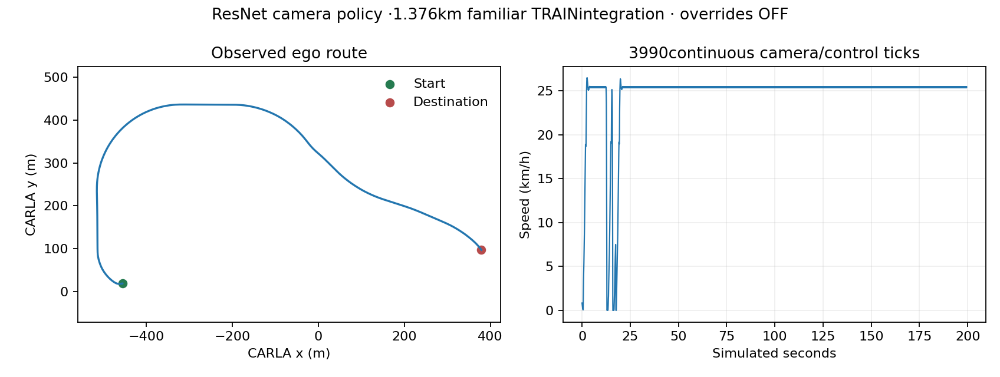

# Camera long-drive integration:1.376km completed

The frozen ImageNet-ResNet18 camera policy completes the predetermined1375.64m Town04TRAINroute with **0unfilteredcontactstarts,0red/stop violations and0interventionticks**. It uses the originalv1three-RGB/navigation/ego inputs, overridesOFF. All3990observed poses remain within allowed TRAINjunctions.

- Simulated time199.5s; native route wall255.125s; end-to-end15.57physicsfps.
- Camera-policy IPCp9525.10ms, excluding simulator/video/audit work.
- Five minimum-speed infractions remain counted: rule-safe arrival, not strict success.
- Onejunction only. Familiar TRAIN/posthoc engineering parent, not untouched urban-rule evidence.

The original expert attempt segfaulted in CARLAbefore its first trace row; its empty/truncated evidence remains an infrastructure failure. Only the genuinely unstarted camera arm continued, with the same source/seed62071/checkpoint/900scap. There is no valid expert-relative comparison and no expert retry.

[Full uninterrupted three-camera video](..//home/deepakbalaji/Project/Auto_Thinker_Engine/outputs/navigation_train_integration_continuation_20261020/student/episodes/route_route0_10_20_14_45_55/three_cameras.mp4)

The old unsafe Town03drive and its13contacts/2red/1stop remain preserved. Different route geometry cannot support a before/after gain claim. The new route is strictly TRAINonly, selected by seeded map geometry and43.29mclearance from reserved junction geometry before driving. No benchmark route replacement, M4primary reselection, M3pass or M5/M6qualification follows from this one successful integration.

Rule-coverage audit: the native opportunity meter records **zero red-light or stop-sign opportunities** on this route (`rule_opportunities/0.json`, empty events/no errors). Therefore zero rule violations here provide no rule-handling evidence. The meaningful result is sustained camera navigation without observed contacts on this familiar route; the separate rule counterfactual failures remain unchanged.
