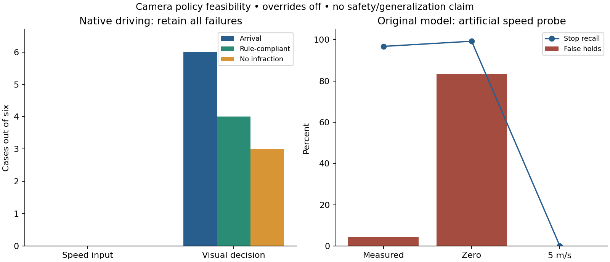

# Camera speed-input ablation —19 October2026

The visual-decision model reaches all six pilot destinations, but still runs one
red and one stop sign. It is not promoted. The speed-conditioned model reached
none; its excellent offline stopping score hid a stationary closed-loop failure.

| Same six-case pilot | Speed input | Visual decision |
|---|---:|---:|
| Arrivals | 0/6 | 6/6 |
| Rule-compliant arrivals | 0/6 | 4/6 |
| Any-infraction-free arrivals | 0/6 | 3/6 |
| Unfiltered recorder contact starts | 0 | 0 |
| Red / stop violations | 0 / 0 | 1 / 1 |

Exactly2000 identical labeled-episode draws, fresh identical initial weights,
same labels/loss/validation/controller and native scenario seeds. Only the neural
ego-speed coordinate is omitted in the ablation; the physical controller always
uses actual measured speed. The common selector chooses updates
500 and2000, respectively.
Offline stop recall96.79% versus
40.00%; false holds
4.47% versus
7.56%. Lower teacher-forced
error did not imply better autonomous behavior.

The artificial input probe is not a physical counterfactual or a driving score.
TRAIN contains392 stationary-go labels versus8910 stationary-stop;
273/392 launch labels are omitted by burn-in8. This remains a disclosed data/loss
limitation, not silently repaired in one encoder arm.

Both native pilot audits verify all declared setups, bound physical lights,
camera/trace alignment, source archives, distinct CARLA recorders and full H.264
video decoding. Six familiar TRAIN-location cases cannot establish generalization;
the historical stop/go model achieved3/6 rule-compliant, expert6/6. No heldout_dev
or Town05 result is consumed here. Every failed case remains in its denominator.

Original1233m integration route status: **evaluation_complete**.
Ordered completion100%; 13 unfiltered contact starts (5 native collision events), 2 red violations and1 stop violations. This is a failed safety result. The uninterrupted video fully decodes.
Detailed outcomes and audit evidence: [reproduced JSON](navigation_visual_decision_20261019.json).
The pinned native criterion filters near-stationary collisions; preserved recorder
queries supply contact counts independently. All313 complete recordings match
official queries. See [collision correction](navigation_collision_correction_20261019.md).

The old integration route traversed two now-reserved heldout_dev locations,
Town03 junctions1135/103 (142/105 recorded junction ticks). This engineering
exposure must be disclosed; the17-location development geography is no longer
wholly unseen. Keep all300 frozen cases and full denominators, avoid tuning on
those sites and never remove them after seeing this result. The common encoder
architecture/protocol was fixed before the long-route outcomes. TRAIN arrays
exclude both sites; Town05 student outcomes remain unused.

The first broad encoder matrix never started. The corrected common architecture
is frozen in navigation_m4_visual_protocol_20261019.md before other encoder fits;
the ResNet feasibility history is disclosed. M2 encounter/reliable-driving,
M3 physical rule tests, full M4 study, M5 planning and M6 final driving remain open.

Reproduce: `.venv/bin/python scripts/summarize_navigation_visual_decision.py`.
